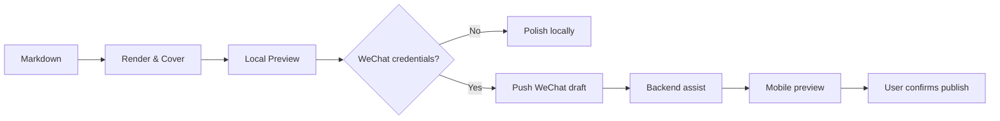
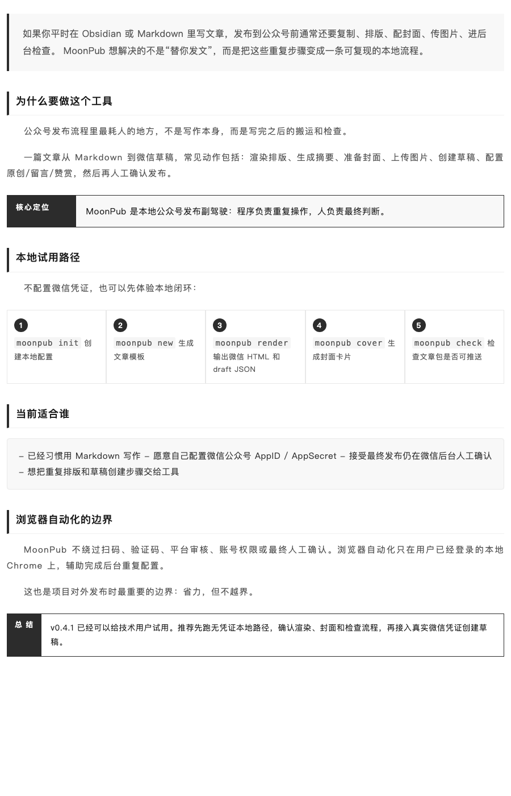
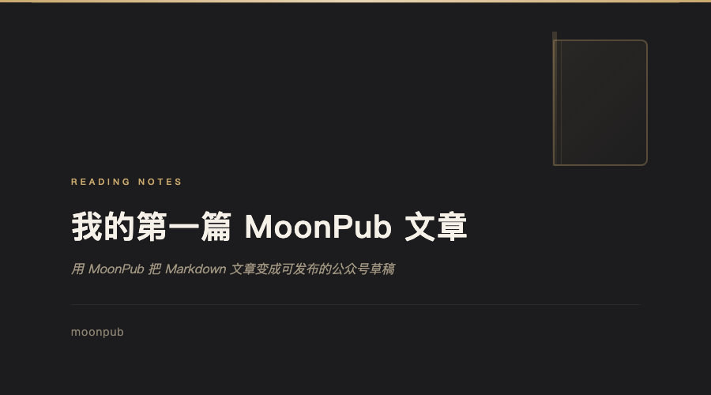
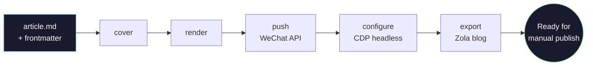
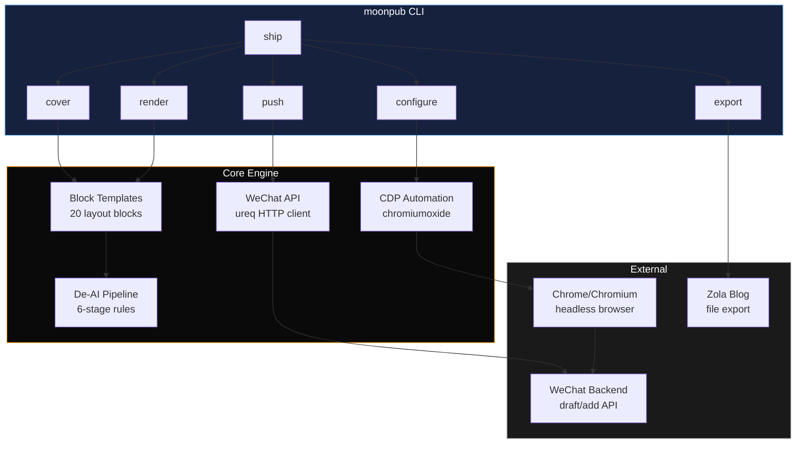

# MoonPub


Pure Rust CLI and local publishing copilot for WeChat Official Accounts: Markdown → rendered article → WeChat draft → assisted backend configuration → blog export.

## How It Works



## Install

**Pre-built binary (recommended, no Rust):** download the latest
`moonpub-<platform>` archive from the
[Releases](https://github.com/qiaopengjun5162/moonpub/releases) page (macOS Apple
Silicon / x86_64, Linux x86_64 / ARM64, Windows x86_64; each archive ships a
`.sha256` checksum), unpack, and drop the binary on your `PATH`:

```bash
# example: macOS Apple Silicon
curl -L https://github.com/qiaopengjun5162/moonpub/releases/latest/download/moonpub-macos-arm64.tar.gz | tar xz
sudo mv moonpub /usr/local/bin/
```

Windows: download `moonpub-windows-amd64.zip`, unpack `moonpub.exe`, add it to
PATH (extra manual checks: [docs/WINDOWS_SMOKE_CHECKLIST_ZH.md](docs/WINDOWS_SMOKE_CHECKLIST_ZH.md)).

**From source (requires Rust):**

```bash
cargo install --git https://github.com/qiaopengjun5162/moonpub
```

**Docker (no Rust, includes Chromium):**

```bash
docker build -t moonpub https://github.com/qiaopengjun5162/moonpub.git
docker run -v ~/.config/moonpub:/root/.config/moonpub -v $(pwd):/articles moonpub status

# Convenience alias
alias moonpub='docker run -v ~/.config/moonpub:/root/.config/moonpub -v $(pwd):/articles moonpub'
```

Homebrew support is planned, but no public tap is available yet. For the longer-term plugin, multi-platform, app, and commercialization direction, see [ROADMAP.md](ROADMAP.md).

## 30-Second Local Preview (No WeChat Credentials)

```bash
moonpub init --yes
moonpub new "Why I started reading every day"
moonpub render Articles/drafts/Why-I-started-reading-every-day.md
moonpub preview Articles/drafts/Why-I-started-reading-every-day.md
moonpub cover Articles/drafts/Why-I-started-reading-every-day.md --style literary
```

These commands only read and write local files. They do not call the WeChat API or publish anything.

## Then Publish (Optional)

Configure WeChat credentials and push to the WeChat drafts box:

```bash
export WECHAT_APPID=wx***
export WECHAT_SECRET=your_secret
moonpub ship Articles/drafts/Why-I-started-reading-every-day.md --style literary
```

`ship` covers: cover → render → push to WeChat draft → assisted backend settings → mobile preview send. Final publishing still requires you to click confirm in the WeChat backend.

## Project Status

MoonPub is currently **Beta / early adopter ready**.

It is ready for technical users who can configure WeChat Official Account credentials and are comfortable checking generated drafts before publishing. The local Markdown → HTML preview path works without any WeChat credentials, so you can try the renderer first. Real `push` / `ship` commands call the WeChat API and may open or control Chrome for backend draft configuration.

MoonPub is **not** positioned as an unattended publishing bot. The stable core is API-first draft creation and local rendering; browser automation is an assisted mode that reduces repeated clicks in the WeChat backend while keeping final publishing under user control.

## Pick Your Entry Path

If you do not want to read the full command surface first, choose the path that matches how you work:

### 1. You already have a Markdown article

Use:

- `existing Markdown article -> local preview -> WeChat draft`

This is the best fit if your article is already written in Obsidian or Markdown and you mainly need rendering plus publishing.

### 2. You only have Feishu Minutes or raw transcript material

Use:

- `Feishu Minutes transcript -> editable draft -> preview -> WeChat draft`

This is the best fit if your content starts as raw spoken notes and should become a draft before publishing.

### 3. You mainly work inside Obsidian and want less terminal usage

Use:

- `Obsidian plugin homepage -> context-aware entry -> preview / assisted publish`

This is the best fit if you want to start from the MoonPub homepage inside Obsidian, see workspace-level guidance first, and then continue into the right workflow for the current article, Feishu material, or photos.

### 4. You mainly want to turn a batch of photos into a draft

Use:

- `photos -> editable draft -> preview -> WeChat draft`

This is the best fit if your content starts as a small set of real-life photos that you want to preserve as a factual note before deciding whether to publish.

See:

- [docs/USER_ONBOARDING.md](docs/USER_ONBOARDING.md) for the English 10-minute onboarding guide
- [docs/USER_ONBOARDING_ZH.md](docs/USER_ONBOARDING_ZH.md) for the Chinese version
- [docs/RECOMMENDED_WORKFLOWS.md](docs/RECOMMENDED_WORKFLOWS.md) (English) / [docs/RECOMMENDED_WORKFLOWS_ZH.md](docs/RECOMMENDED_WORKFLOWS_ZH.md) (Chinese)
- [docs/FIRST_RUN_WALKTHROUGH.md](docs/FIRST_RUN_WALKTHROUGH.md) (English) / [docs/FIRST_RUN_WALKTHROUGH_ZH.md](docs/FIRST_RUN_WALKTHROUGH_ZH.md) (Chinese)
- [docs/FIRST_RUN_AUDIT_ZH.md](docs/FIRST_RUN_AUDIT_ZH.md)
- [docs/PRODUCT_WRAP.md](docs/PRODUCT_WRAP.md) (English) / [docs/PRODUCT_WRAP_ZH.md](docs/PRODUCT_WRAP_ZH.md) (Chinese)
- [docs/EXECUTION_PLAN.md](docs/EXECUTION_PLAN.md) (English) / [docs/EXECUTION_PLAN_ZH.md](docs/EXECUTION_PLAN_ZH.md) (Chinese)
- [docs/KNOWN_LIMITS.md](docs/KNOWN_LIMITS.md) (English) / [docs/KNOWN_LIMITS_ZH.md](docs/KNOWN_LIMITS_ZH.md) (Chinese)
- [docs/AGENT_PROTOCOL.md](docs/AGENT_PROTOCOL.md) (English) / [docs/AGENT_PROTOCOL_ZH.md](docs/AGENT_PROTOCOL_ZH.md) (Chinese)
- [obsidian-plugin/README.md](obsidian-plugin/README.md)

Current limits:

- Browser automation depends on the live WeChat backend UI and may soft-fail when WeChat changes DOM or wording.
- Browser automation does not bypass QR login, captcha, platform review, or final human confirmation.
- Homebrew support is planned, but no public tap is available yet.
- `write` / `expand` / `polish` / `ship --ai` are optional AI-powered commands (configurable provider: DeepSeek, OpenAI); the core render/push pipeline does not call AI APIs.

## What It Does

Write an article in Markdown, render it locally, push it to WeChat drafts, then let MoonPub assist with repetitive backend settings:

```bash
moonpub render article.md
moonpub preview article.md
moonpub ship article.md --style literary
moonpub cards article.md          # split into Xiaohongshu-style vertical cards + publish-copy
```

### v0.4.1 Demo Output

The screenshots below were generated from the v0.4.1 release binary without WeChat credentials.





### Pipeline Flowchart



### Architecture



Core rendering is local and deterministic. Optional AI commands call an AI provider only when you explicitly use them.

## Try Locally First

Start with the smallest guide that matches what you need:

- First-run walkthrough: [docs/FIRST_RUN_WALKTHROUGH.md](docs/FIRST_RUN_WALKTHROUGH.md) (English) / [docs/FIRST_RUN_WALKTHROUGH_ZH.md](docs/FIRST_RUN_WALKTHROUGH_ZH.md) (Chinese)
- Three workflow paths: [docs/RECOMMENDED_WORKFLOWS.md](docs/RECOMMENDED_WORKFLOWS.md) (English) / [docs/RECOMMENDED_WORKFLOWS_ZH.md](docs/RECOMMENDED_WORKFLOWS_ZH.md) (Chinese)
- Product framing: [docs/PRODUCT_WRAP.md](docs/PRODUCT_WRAP.md) (English) / [docs/PRODUCT_WRAP_ZH.md](docs/PRODUCT_WRAP_ZH.md) (Chinese)
- Agent / app integration protocol: [docs/AGENT_PROTOCOL.md](docs/AGENT_PROTOCOL.md) (English) / [docs/AGENT_PROTOCOL_ZH.md](docs/AGENT_PROTOCOL_ZH.md) (Chinese)
- Full command reference: [docs/COMMANDS.md](docs/COMMANDS.md) (English) / [docs/COMMANDS_ZH.md](docs/COMMANDS_ZH.md) (Chinese)
- Release evidence and proof gaps: [docs/FIRST_RUN_AUDIT_ZH.md](docs/FIRST_RUN_AUDIT_ZH.md), [docs/FIRST_RUN_EVIDENCE_CHECKLIST_ZH.md](docs/FIRST_RUN_EVIDENCE_CHECKLIST_ZH.md), [docs/first-run-evidence/README.md](docs/first-run-evidence/README.md), [docs/RELEASE_GATE_v0.4.2_ZH.md](docs/RELEASE_GATE_v0.4.2_ZH.md)

The main entry paths:

- existing Markdown article -> local preview -> WeChat draft
- Feishu Minutes transcript -> editable draft -> preview -> WeChat draft
- photos -> editable draft -> preview -> WeChat draft

If you mainly work inside Obsidian, the plugin homepage (left Ribbon MoonPub icon) runs the same discovery commands — `doctor`, `workflow-registry`, `layout-recipes`, `evidence-status`, `release-check`, `workspace` — and maps safe-start contracts to buttons. It requires a CLI that supports `moonpub --json doctor` (v0.4.2+). See [obsidian-plugin/README.md](obsidian-plugin/README.md) for the workbench tour.

Agents, plugins, and app shells can call `moonpub workflow-registry --json` to discover the built-in workflow contracts for current articles, Feishu Minutes, photo memories, WeChat content review, and WeChat draft handoff without scraping README text.

The 30-second path above needs no WeChat credentials; use the path printed by `moonpub new` if your title contains spaces.

## Real Publish Workflow

### 1. Write

Markdown file with YAML frontmatter:

```markdown
---
title: Why I Left Everything to Paint
digest: He was 40, had a wife, kids, a good job. Then he walked away.
author: Your Name
cover: https://example.com/my-cover.png
---

:::intro
A 1-3 sentence hook to grab the reader.
:::

Your article content here...

:::summary
Closing thoughts.
:::
```

### 2. Preview

```bash
moonpub render article.md    # Generate HTML
moonpub preview article.md   # Open in browser to check
moonpub preflight article.md # Local read-only quality gate before WeChat
```

### 3. Configure WeChat Credentials

```bash
export WECHAT_APPID=wx***
export WECHAT_SECRET=your_secret
moonpub login
```

`moonpub login` opens Chrome once for WeChat backend login and stores the browser session for later CDP automation.

If you want an isolated one-off browser environment instead of MoonPub's default persistent profile, add `--temporary-profile`. This uses a temporary Chrome profile, does not read or write the saved session, and usually requires scanning the QR code again. `push` / `publish --target wechat-draft` also accept this flag; in that case the WeChat API draft upload stays the same, while the post-push backend automation uses the isolated profile.

### 4. Push Or Assisted Ship

```bash
moonpub ship article.md --style literary
```

The article is pushed to WeChat drafts, then MoonPub automatically runs `configure` through Chrome automation, which includes sending a WeChat backend phone preview.

Check the draft in WeChat and publish manually when everything looks right.

The first time `ship` / `configure` sends a backend preview, it needs a recipient WeChat id. Provide it once via:

- `moonpub ship article.md --to <your-wechat-id>`
- `moonpub configure --to <your-wechat-id>`
- `WECHAT_PREVIEW_TO=<your-wechat-id>` environment variable
- or run `moonpub test-yulan --to <your-wechat-id>` once

After a successful preview-send, MoonPub saves the recipient to `.moonpub/preview_to`, so later `ship` / `configure` / `test-yulan` runs need no arguments. If no recipient is configured, the preview-send step prints a one-time setup hint and is skipped; the rest of the flow still completes.

When `[wechat].auth_method = "cookie"` is set (or `WECHAT_AUTH_METHOD=cookie`), `ship` bypasses the WeChat IP whitelist entirely by reusing the browser session saved by `moonpub login`. In cookie mode `ship` does not need `WECHAT_APPID` / `WECHAT_SECRET`; cover and body images are uploaded through the cookie-authenticated backend.

When `push` creates a new WeChat draft for an article bundle that already has a local `.media_id`, MoonPub updates the `.media_id` file and then tries to delete the previous WeChat draft. Cleanup is best-effort and keyed by the recorded `media_id`, not by title, so same-title drafts are not removed accidentally.

### 5. Or Step by Step

Each step runs independently:

```bash
moonpub cover article.md --style gradient --screenshot   # Just cover image
moonpub render article.md                                 # Just HTML render
moonpub push article.md                                   # Upload draft, then move bundle to ready/
moonpub preflight article.md                              # Local read-only quality gate
moonpub configure                                         # Just draft config + preview-send
moonpub export article.md --target zola                   # Blog export
```

Discovery commands (`doctor`, `workspace`, `workflow-registry`, `capabilities`, `layout-recipes`, `layout-audit`, `evidence-status`, `release-check`, `wechat-checklist`) all support `--json` for plugins and agents. Full list: [docs/COMMANDS.md](docs/COMMANDS.md).

### Feishu Publishing Flow

For Feishu content that already enters the draft-generation path, there are two recommended follow-up modes:

- Default conservative path: `moonpub intake feishu ... --draft --preview`
- Explicit fast-forward path: `moonpub intake feishu ... --draft --push`

The recommended default is to stop at an editable draft plus local HTML review first. Only add `--push` when you intentionally want to continue into WeChat draft creation right away.

There are also two different preview stages:

- Local preview: `moonpub preview <article.md>` or `intake feishu ... --draft --preview`. This is purely local and needs no WeChat credentials.
- WeChat backend preview-send: part of `moonpub configure` after the article is already in WeChat drafts (or `moonpub test-yulan` in isolation). It needs a one-time recipient (`--to <wxid>`, `WECHAT_PREVIEW_TO`, or a saved `.moonpub/preview_to`); after the first successful send, later runs are automatic.

```bash
moonpub test-yulan --to <your-wechat-id>          # send preview for the most recent draft
moonpub test-yulan --title "Draft Title" --to <your-wechat-id>
```

Once a Feishu-derived article reaches WeChat drafts, the rest of the flow is the same as any other article: `configure` / `ship` -> WeChat backend preview-send -> manual publish.

For agent or app integration, the workflow/discovery commands return command-specific JSON objects with `--json` instead of the legacy `{"output":"..."}` wrapper (recommended form: `moonpub --json <command>`). Field-by-field contracts for every structured command live in [docs/COMMANDS.md](docs/COMMANDS.md) (English) / [docs/COMMANDS_ZH.md](docs/COMMANDS_ZH.md) (Chinese); `capabilities --json` ships `schema_version` / `moonpub_version` plus per-target risk metadata, prerequisites and argv-style `command` templates — replace the `"{article}"` placeholder and pass the array to the process runner instead of building a shell string.

## Cover Image

MoonPub handles covers in three ways, in priority order:

### 1. Frontmatter `cover` field (easiest)

Put a local image path in your article's frontmatter:

```markdown
---
title: Why I Left Everything to Paint
digest: He was 40. He walked away.
cover: ./assets/my-cover.png     # relative to article, or absolute path
---
```

During `push` or `ship`, the image is **automatically uploaded** to WeChat permanent material and set as the draft cover. URLs (`http://...`) are downloaded first, then uploaded to WeChat.

### 2. Built-in cover generator (default)

If no `cover` field is set, MoonPub generates a cover card from frontmatter fields — title, digest, and author are typeset into a styled HTML card:

```bash
moonpub cover article.md --style editorial|swiss|swiss-dark|aurora|riso|noir|bauhaus|dark|geek-black|blueprint|ai-lab|clean|minimal|warm|serif|gradient|literary|ink|sunset|forest|workflow|ai-art --screenshot
```

Cover title fallback is shared by `cover` and `ship`: frontmatter `title` → first `#` heading → first meaningful body line → normalized file name. When title is still empty, the digest is promoted to the primary title line instead of rendering a placeholder like `无标题`.

Default style is **literary** — a dark, book-review aesthetic with gold accents. Use `geek-black` for terminal-like AI / Rust / Web3 covers, `blueprint` for architecture reviews, or `ai-lab` for experiment notes. Export to PNG with `--screenshot` (requires Chrome).
Use `ai-art` for unique anime-futuristic covers generated per-article via OpenAI image API (dall-e-3). Requires `[ai] provider = "openai"` and `OPENAI_API_KEY`. The cover contains only the article title, rendered as a stylish text overlay over a custom illustration.

### 3. Config `thumb_media_id`

Pre-upload an image to WeChat material library manually, put the resulting `media_id` in `moonpub.toml`:

```toml
[wechat]
thumb_media_id = "EmukC2rjB9X3nj6feGSEr..."     # from WeChat material library
```

**Priority:** frontmatter `cover` > config `thumb_media_id` > auto-generated cover. Once `cover` is set on an article, `ship` keeps using that image and does not replace it with a newly generated cover.

## Configuration

MoonPub reads credentials and settings from three sources, in priority order:
**environment variables > .env file > moonpub.toml**

### .env (recommended for API keys)

```env
WECHAT_APPID=wx***
WECHAT_SECRET=your_secret
MOONPUB_VAULT=/path/to/your/articles
```

Docker:

```bash
docker run --env-file .env -v ~/.config/moonpub:/root/.config/moonpub -v $(pwd):/articles moonpub ship article.md
```

### moonpub.toml

```bash
moonpub init
```

```toml
[articles]
root = "/path/to/your/articles"

[wechat]
appid = "wx..."
author = "Your Name"
theme = "geek"                 # default | warm | dark | geek | geek-black | blueprint | ai-lab | paper | magazine | notebook | classic | forest | sunset | ocean | mono | editorial | zen | newsletter | academic | cyber | letter | mist | gallery | moonlit | porcelain | fieldnote | monokai | dracula | nord | one-dark | gruvbox
account_type = "personal"     # personal | verified | service | wecom
auto_publish = false           # keep false for assisted/manual publish workflow
thumb_media_id = ""            # pre-uploaded cover image media_id (optional)

[footer]
enabled = true
variant = "community"          # community | minimal
title = "Join My Community"
description = "Welcome to all friends passionate about tech and curiosity."
rules = "· Introduce yourself with your real identity\n· Focus on tech, speak with substance\n· Respect every member, agree to disagree\n· No ads, keep it clean"
qrcode = "Context/assets/qrcode.png"
qrcode_note = "Follow my WeChat Official Account first, then scan the QR code to join.\nIf expired, reply \"join\" to get the latest."
follow_image = ""
follow_text = "Tap 👍 if you like this, tap 👆 to share with more readers."
divider = "— · —"

# `Context/assets/qrcode.png` is a non-scannable placeholder in this repo.
# Keep real QR images outside Git, point this value to a local untracked file,
# or leave `qrcode` empty to hide only the QR image.
# `variant = "minimal"` keeps only `follow_image` and `follow_text`.
# Empty `qrcode` only skips the QR image; community title/description/rules/QR note can still render.
#
# You can override the footer per article in frontmatter:
#   footer_variant: community
#   footer_qrcode: Context/assets/qrcode-group.png
#   footer_qrcode_note: "Follow my WeChat Official Account first, then scan the QR code to join.\nIf expired, reply \"join\" to get the latest."
# `footer_qrcode` is resolved relative to the articles root. Only point to a
# real local QR image outside this repo; the placeholder must not be used for
# an actual community ending.
# `footer_qrcode_note` can override the copy above the QR image per article;
# `\n` in a double-quoted value renders as a line break.

[blog]
kind = "zola"
root = "/path/to/blog"

[template]
name = "Xunyue Pavilion Ending"  # optional; used by configure moban / ship

[ai]
provider = "deepseek"      # deepseek | openai
model = "deepseek-chat"    # optional, defaults per provider
# api_key = "sk-..."       # optional; prefer DEEPSEEK_API_KEY / OPENAI_API_KEY
```

### Article Typography Themes

`moonpub render` and `moonpub ship` use `[wechat].theme`, or per-article frontmatter `theme`, to style the rendered body. Current article themes:

| Theme | Best for |
|-------|----------|
| `default` | Clean general-purpose articles |
| `warm` | Essays and softer reading |
| `dark` | Short dark-accent pieces |
| `geek` | Technical posts and code |
| `geek-black` | Terminal-like dark technical posts and AI engineering notes |
| `blueprint` | Architecture reviews, system design, and protocol explainers |
| `ai-lab` | AI experiments, agent workflows, and product engineering notes |
| `paper` | Book notes and long-form reading |
| `magazine` | Opinion columns with stronger hierarchy |
| `notebook` | Notes, tutorials, and learning logs |
| `classic` | Serif book reviews and classic essays |
| `forest` | Calm long-form essays |
| `sunset` | Warm opinion pieces |
| `ocean` | Clear tutorials and explainers |
| `mono` | Focused black-and-white posts |
| `editorial` | Serif editorial essays with stronger openings |
| `zen` | Quiet reflective essays and slow reading |
| `newsletter` | Digest-style updates and weekly notes |
| `academic` | Research notes and structured arguments |
| `cyber` | High-contrast tech essays and launch posts |
| `letter` | Personal letters, opening notes, reflective prose |
| `mist` | Quiet life notes and subtle long-form reflections |
| `gallery` | Photo essays, life records, and visual posts |
| `moonlit` | Low-saturation moonlit openings and private collections |
| `porcelain` | Clean blue-gray long-form reading |
| `fieldnote` | Field notes, photo memories, walks, and factual life fragments |
| `monokai` | Monokai code palette for technical and geek-flavored posts |
| `dracula` | Dracula night palette for dark technical long-form |
| `nord` | Nord cool palette for restrained engineering notes |
| `one-dark` | One Dark editor feel for code-heavy articles |
| `gruvbox` | Gruvbox retro warm palette with terminal nostalgia |

Standard Markdown headings, lead paragraphs, paragraphs, inline highlight / strikethrough, blockquotes, dividers, figures with captions, tables, unordered / ordered / task lists, and triple-backtick code blocks are rendered with WeChat-compatible inline CSS.

## Browser Automation (CDP)

After `push`, WeChat drafts need manual settings: originality, tips, comments, source, preview. MoonPub assists with these repetitive steps via Chrome DevTools Protocol.

This is an assisted local workflow, not a bypass:

- You scan QR login yourself; MoonPub reuses your local browser session.
- MoonPub does not bypass captcha, review, permissions, or account restrictions.
- Final publishing remains a human decision in the WeChat backend.
- If WeChat changes the editor UI, automation steps are expected to soft-fail instead of blocking API draft creation.

First time — scan QR code once (opens browser):

```bash
moonpub login
```

Thereafter, when the saved session is still reusable, daily backend configuration runs headless. If the session is no longer reusable, headless commands fail fast with a recovery hint instead of waiting for an invisible QR code:

```bash
moonpub configure                    # All steps
moonpub configure zanshang chuangzuo # Specific steps
moonpub configure moban --headed     # Debug template insertion only
moonpub configure --headed           # Debug: visible browser + screenshots
moonpub configure --temporary-profile --headed  # Debug with an isolated one-off profile
moonpub step-test --temporary-profile --headed  # Full interactive test with an isolated profile
moonpub test-zanshang --headed       # Debug single step
```

If `[template].name` is configured in `moonpub.toml`, `configure` / `ship` will also try to insert that saved WeChat backend template before preview. If it is missing, the step is soft-skipped.

Docker: login on host, configure in container.

```bash
moonpub login   # On host
docker run --env-file .env -v ~/.config/moonpub:/root/.config/moonpub -v $(pwd):/articles moonpub configure
```

## Block Templates

Use `:::blockname` in Markdown for WeChat-optimized layout:

```markdown
:::book-info
title: Book Title
author: Author
cover: https://...
publisher: Publisher
rating: 8.1
:::

:::callout
label: Key Idea
The one thing you want readers to take away.
:::

:::steps
1. Step one description
2. Step two description
3. Step three description
:::

:::key-points
- Lead with the conclusion
- Support it with evidence
:::

:::pull-quote
source: Author or book

A sentence worth slowing down for.
:::

:::scene-card
label: On the Road
place: Under the trees
One honest moment from the day, before the longer reflection begins.
:::

:::meta-strip
date: 2026-07-03
place: Riverside trail
weather: Evening breeze
mood: Quiet
One factual note before the photos and reflection.
:::

:::photo-grid
- /photos/run-1.jpg | Trees after the rain
- /photos/run-2.jpg | The road back home
:::

:::closing-card
label: Until Next Time
Let the article land softly instead of ending abruptly.
:::

:::compact-links
- 01 | Short source title | Source｜short note | https://example.com/source
:::
```

20 blocks: `book-info` / `intro` / `callout` / `steps` / `summary` / `figure` / `checklist` / `key-points` / `pull-quote` / `cover` / `letter-card` / `scene-card` / `closing-card` / `compact-links` / `photo-grid` / `meta-strip` / `quote-card` / `divider` / `concept-card` / `emotion-card`

## De-AI (humanize)

Strips common AI writing patterns from your article:

```bash
moonpub humanize article.md
moonpub render --humanize article.md   # Combined
```

6-stage rule pipeline: filler phrases → AI vocabulary → parallelism breaking → modifier simplification → generic conclusions → em-dash cleanup

## All Commands

One line per command. Run `moonpub help <command>` for flags,
`moonpub help errors` for the full `error/v1` code list, or see
[docs/COMMANDS.md](docs/COMMANDS.md) (English) / [docs/COMMANDS_ZH.md](docs/COMMANDS_ZH.md)
for the full reference, behavior notes and `--json` output contracts.

### Getting started

| Command | What it does |
| --- | --- |
| `moonpub init` | Create a sample moonpub.toml |
| `moonpub doctor` | Check local readiness for first use |
| `moonpub workspace` | Summarize the workspace and suggest the next command |
| `moonpub status` | List articles in drafts, ready and published |
| `moonpub help` | Show the command list, one command's usage, or the error codes |
| `moonpub version` | Print the moonpub version |

### Writing

| Command | What it does |
| --- | --- |
| `moonpub new` | Scaffold an article with frontmatter and body template |
| `moonpub write` | Generate an article from an idea |
| `moonpub expand` | Expand reading notes into a full article |
| `moonpub polish` | AI polish and de-AI-ify an existing article |
| `moonpub humanize` | Strip AI writing patterns offline |
| `moonpub draft-from-inbox` | Turn Inbox source material into an editable draft |

### Render & review

| Command | What it does |
| --- | --- |
| `moonpub render` | Generate HTML and draft.json from Markdown |
| `moonpub check` | Check that an article bundle has md / html / draft.json |
| `moonpub preflight` | Read-only publish gate; `--strict` makes a failed check exit non-zero |
| `moonpub layout-audit` | Flag WeChat editor compatibility risks in rendered HTML |
| `moonpub layout-recipes` | List layout recipes and recommended themes |
| `moonpub preview` | Open the rendered HTML in your browser |
| `moonpub cover` | Generate a cover from article frontmatter |
| `moonpub cards` | Split an article into Xiaohongshu-style vertical cards |

### Publish & WeChat backend

| Command | What it does |
| --- | --- |
| `moonpub login` | One-time WeChat backend login by QR scan |
| `moonpub wechat-health` | Check whether the saved browser session is reusable |
| `moonpub push` | Push a draft, write .media_id, move the bundle to ready/ |
| `moonpub publish` | Generic publish entrypoint |
| `moonpub update-draft` | Re-push updated HTML to an existing WeChat draft |
| `moonpub ship` | Cover + render + push + configure + export in one go |
| `moonpub configure` | Configure 原创 / 赞赏 / 留言 / 创作来源 and preview-send |
| `moonpub step-test` | Interactive browser automation test |
| `moonpub test-zanshang` | Test the 赞赏 (reward) step only |
| `moonpub test-chuangzuo` | Test the 创作来源 (creation source) step only |
| `moonpub test-yulan` | Test the backend preview-send step only |
| `moonpub list-drafts` | List all drafts with media_id and title |
| `moonpub delete-draft` | Delete a draft by media_id |
| `moonpub mark-ready` | Move a bundle to Articles/ready |
| `moonpub mark-published` | Move a bundle to Articles/published |
| `moonpub export` | Generic export entrypoint |

### Import & research

| Command | What it does |
| --- | --- |
| `moonpub fetch` | Fetch a WeChat article and extract title + body |
| `moonpub intake` | Import Feishu minutes or photos into the Obsidian Inbox |
| `moonpub radar` | Store and analyze platform trend samples |

### Integration & release

| Command | What it does |
| --- | --- |
| `moonpub capabilities` | List built-in targets with risk and capability metadata |
| `moonpub workflow-registry` | List workflow contracts for plugins, apps and agents |
| `moonpub wechat-checklist` | Read-only checklist for positioning, title and read-through |
| `moonpub evidence-status` | Check required release evidence files |
| `moonpub release-check` | Aggregate release gate status from docs and evidence |

Global flags (before the command): `--articles <path>` / `--config <moonpub.toml>` / `--json`.

## Development

```bash
cargo fmt
cargo clippy --all-targets --all-features --tests --benches -- -D warnings
cargo nextest run
```

Use `cargo nextest`, not `cargo test`.

## Architecture

- Zero AI dependencies — all transformations are deterministic
- CLI parsing: `src/cli.rs`
- Configuration: `src/config.rs`
- Article / frontmatter helpers: `src/article.rs`
- WeChat API client: `src/wechat.rs` (ureq, no SDK)
- Markdown → HTML: `src/markdown.rs`
- Block templates: `src/illustrate.rs`
- CDP automation primitives: `src/cdp.rs`
- Editor automation steps: `src/publish_steps.rs`
- Browser automation orchestration: `src/publish.rs`
- De-AI pipeline: `src/humanize.rs`
- Cover generation: `src/cover.rs`
- All styles inline CSS, WeChat-compatible

## Contributing

PR-first workflow. Branch from `main`, keep changes focused, run `cargo clippy && cargo nextest run`, push and open a PR. See [CONTRIBUTING.md](CONTRIBUTING.md).

## License

MIT

## References

- Launch narrative and progress: [docs/LAUNCH_READY_ZH.md](docs/LAUNCH_READY_ZH.md), [docs/LAUNCH_PLAN_ZH.md](docs/LAUNCH_PLAN_ZH.md), [docs/LAUNCH_ARTICLE_ZH.md](docs/LAUNCH_ARTICLE_ZH.md)
- Command-level behavior, JSON contracts and not-yet-command ideas: [docs/COMMANDS.md](docs/COMMANDS.md) / [docs/COMMANDS_ZH.md](docs/COMMANDS_ZH.md)
- External projects MoonPub draws principles from (Khoj, Identity Skill, hand-drawn PPT, AstrBot, Horizon, and more): see the "Documented ideas" section of [docs/COMMANDS.md](docs/COMMANDS.md)

## Contributors

<!-- ALL-CONTRIBUTORS-LIST:START - Do not remove or modify this section -->
<!-- prettier-ignore-start -->
<!-- markdownlint-disable -->
<table>
  <tbody>
    <tr>
      <td align="center" valign="top" width="14.28%"><a href="https://github.com/qiaopengjun5162"><br /><sub><b>Paxon Qiao</b></sub></a><br /><a href="https://github.com/qiaopengjun5162/moonpub/commits?author=qiaopengjun5162" title="Code">💻</a> <a href="#doc-qiaopengjun5162" title="Documentation">📖</a> <a href="#ideas-qiaopengjun5162" title="Ideas">🤔</a> <a href="#projectManagement-qiaopengjun5162" title="Project Management">📆</a></td>
    </tr>
  </tbody>
</table>
<!-- markdownlint-restore -->
<!-- prettier-ignore-end -->
<!-- ALL-CONTRIBUTORS-LIST:END -->
