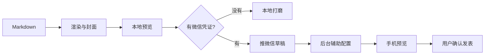
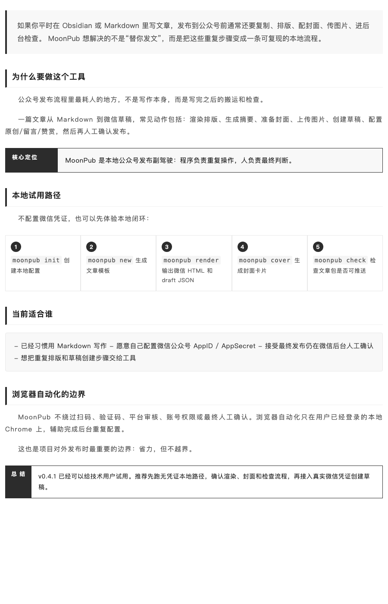
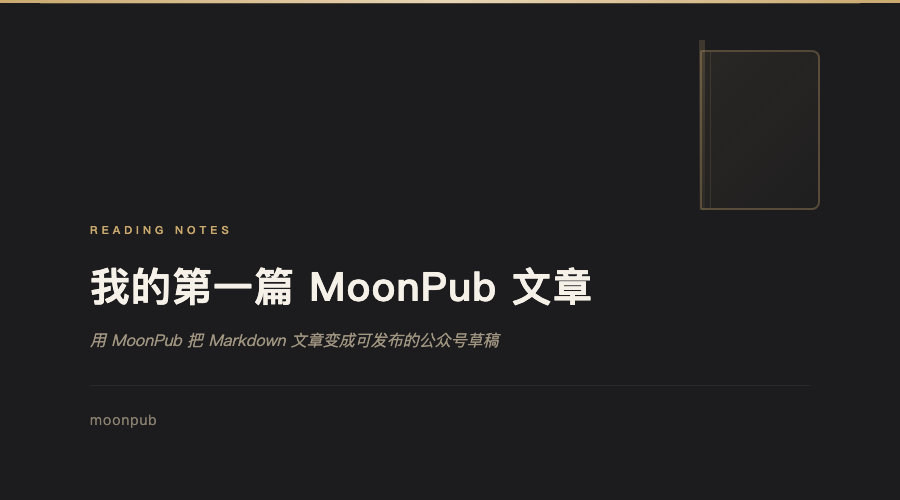

# MoonPub


纯 Rust CLI，本地公众号发布副驾驶：Markdown → 渲染文章 → 微信草稿 → 辅助配置后台 → 同步导出博客。

## 工作流程



## 安装

**从源码安装（始终可用，无需单独下载）：**

```bash
cargo install --git https://github.com/qiaopengjun5162/moonpub
```

**预编译二进制：** 从 [Releases](https://github.com/qiaopengjun5162/moonpub/releases) 页面下载最新的 `moonpub-<平台>` 压缩包（macOS / Linux / Windows），解压后把 `moonpub` 放到 `PATH` 里：

```bash
# 例：macOS Apple Silicon
curl -L https://github.com/qiaopengjun5162/moonpub/releases/latest/download/moonpub-macos-arm64.tar.gz | tar xz
sudo mv moonpub /usr/local/bin/
```

macOS Intel 换 `moonpub-macos-amd64.tar.gz`；Linux 换 `moonpub-linux-*.tar.gz`；Windows 从 [Releases](https://github.com/qiaopengjun5162/moonpub/releases) 下载 zip 并把 `moonpub.exe` 加进 PATH。

## 30 秒本地体验（不需要微信凭证）

```bash
moonpub init --yes
moonpub new "我为什么开始每天读书"
moonpub render Articles/drafts/我为什么开始每天读书.md
moonpub preview Articles/drafts/我为什么开始每天读书.md
moonpub cover Articles/drafts/我为什么开始每天读书.md --style literary
```

这一步只读写本地文件，不调用微信 API，也不发布任何内容。

## 然后发布（可选）

配置微信凭证并推送到公众号草稿：

```bash
export WECHAT_APPID=wx***
export WECHAT_SECRET=你的secret
moonpub ship Articles/drafts/我为什么开始每天读书.md --style literary
```

`ship` 会完成：封面 → 渲染 → 推微信草稿 → 后台辅助配置 → 发送手机预览。最终发表仍需你在微信后台点确认。

## 项目状态

MoonPub 当前处于 **Beta / 技术用户可试用** 阶段。

如果你能配置微信公众号 AppID / AppSecret，并愿意在发布前检查草稿，它已经可以用于真实工作流。没有微信凭证时，也可以先跑本地渲染和预览路径，确认排版、Block 模板和封面效果。

最新的公开 release 见 [Releases](https://github.com/qiaopengjun5162/moonpub/releases) 页面：GitHub 已完成五个平台打包和归档 smoke，本机也已从 Releases 下载 macOS ARM64 资产、校验 SHA-256 并跑通无凭证 smoke。

Windows 用户现在也可以先试用：PR CI 已验证源码构建的 Windows 二进制可跑通无凭证路径，release workflow 也会在发布前自动验证打包后的 zip；如果你想在自己的 Windows 机器上额外复核，再按 [docs/WINDOWS_SMOKE_CHECKLIST_ZH.md](docs/WINDOWS_SMOKE_CHECKLIST_ZH.md) 跑一次本地 smoke。

MoonPub 不是无人值守发布机器人，也不是群控工具。稳定核心是本地渲染和微信官方 API 草稿推送；浏览器自动化是辅助驾驶，用来减少微信后台里的重复点击，最终发布仍由用户自己确认。

## 你是哪类用户

如果你现在还没耐心先看完整 README，可以先按自己属于哪一类用户来选路径：

### 1. 你已经有 Markdown 文章

走这条：

- `已有 Markdown 文章 → 本地预览 → 微信草稿`

适合你，如果你已经在 Obsidian / Markdown 里写好了文章，只是想把它排版后推进到公众号草稿。

### 2. 你现在只有飞书秒记 / 语音转写素材

走这条：

- `飞书秒记 → 草稿 → 预览 → 微信草稿`

适合你，如果你现在拿到的还不是文章，而是一段原始素材，想先整理成草稿，再决定是否继续发布。

### 3. 你主要在 Obsidian 里操作，不想先打开终端

走这条：

- `Obsidian 插件入口 → 预览文章 / 发布副驾驶`

适合你，如果你想直接在 Obsidian 里调用本地 `moonpub`，少切一次终端。

### 4. 你现在主要想整理一组生活照片

走这条：

- `照片素材 → 草稿 → 预览 → 微信草稿`

适合你，如果你想先把一组照片沉淀成草稿，而不是继续散落在相册里。

这四类路径的正式说明分别在：

- [docs/USER_ONBOARDING_ZH.md](docs/USER_ONBOARDING_ZH.md) 中文 / [docs/USER_ONBOARDING.md](docs/USER_ONBOARDING.md) English
- [docs/RECOMMENDED_WORKFLOWS_ZH.md](docs/RECOMMENDED_WORKFLOWS_ZH.md) 中文 / [docs/RECOMMENDED_WORKFLOWS.md](docs/RECOMMENDED_WORKFLOWS.md) English
- [docs/FIRST_RUN_WALKTHROUGH_ZH.md](docs/FIRST_RUN_WALKTHROUGH_ZH.md) 中文 / [docs/FIRST_RUN_WALKTHROUGH.md](docs/FIRST_RUN_WALKTHROUGH.md) English
- [docs/PRODUCT_WRAP_ZH.md](docs/PRODUCT_WRAP_ZH.md) 中文 / [docs/PRODUCT_WRAP.md](docs/PRODUCT_WRAP.md) English
- [docs/EXECUTION_PLAN_ZH.md](docs/EXECUTION_PLAN_ZH.md) 中文 / [docs/EXECUTION_PLAN.md](docs/EXECUTION_PLAN.md) English
- [docs/KNOWN_LIMITS_ZH.md](docs/KNOWN_LIMITS_ZH.md) 中文 / [docs/KNOWN_LIMITS.md](docs/KNOWN_LIMITS.md) English
- [docs/AGENT_PROTOCOL_ZH.md](docs/AGENT_PROTOCOL_ZH.md) 中文 / [docs/AGENT_PROTOCOL.md](docs/AGENT_PROTOCOL.md) English
- [obsidian-plugin/README.md](obsidian-plugin/README.md)

当前限制：

- `push` / `ship` 会触达微信 API，`login` / `configure` 会打开或控制 Chrome。
- 浏览器自动化依赖微信后台实时页面，微信改 DOM 或文案时，部分配置步骤可能软失败。
- 浏览器自动化不绕过扫码、验证码、平台审核、账号权限或最终人工确认。
- Homebrew tap 尚未发布，当前推荐使用 release 二进制或 Cargo 安装。
- `write` / `expand` / `polish` / `ship --ai` 是可选 AI 功能（支持配置 DeepSeek、OpenAI 等 provider）；核心渲染和推送流程不依赖 AI。

```bash
moonpub render article.md
moonpub preview article.md
moonpub ship article.md --style literary
```

## v0.4.1 演示效果

下面两张图来自 v0.4.1 release 二进制生成的本地演示素材，没有读取或触达真实微信凭证。





## 快速开始

上手指南按需取用：

- 10 分钟上手（安装、初始化、三条路径、插件、命令速查）：[docs/USER_ONBOARDING_ZH.md](docs/USER_ONBOARDING_ZH.md)
- 最短首次体验路径（插件首页 → 飞书 / 照片 / 当前文章）：[docs/FIRST_RUN_WALKTHROUGH_ZH.md](docs/FIRST_RUN_WALKTHROUGH_ZH.md) 中文 / [docs/FIRST_RUN_WALKTHROUGH.md](docs/FIRST_RUN_WALKTHROUGH.md) English
- 命令详细说明：[docs/USER_GUIDE.md](docs/USER_GUIDE.md)；三条工作流：[docs/RECOMMENDED_WORKFLOWS_ZH.md](docs/RECOMMENDED_WORKFLOWS_ZH.md)
- 全部命令参考（含 JSON 契约与排障）：[docs/COMMANDS_ZH.md](docs/COMMANDS_ZH.md)
- 路径验证程度与证据：[docs/FIRST_RUN_AUDIT_ZH.md](docs/FIRST_RUN_AUDIT_ZH.md)、[docs/FIRST_RUN_EVIDENCE_CHECKLIST_ZH.md](docs/FIRST_RUN_EVIDENCE_CHECKLIST_ZH.md)，或跑 `moonpub evidence-status`
- 发布验证记录：[docs/RELEASE_GATE_v0.4.2_ZH.md](docs/RELEASE_GATE_v0.4.2_ZH.md)，或跑 `moonpub release-check`
- Obsidian 插件首页与工作台：[obsidian-plugin/README.md](obsidian-plugin/README.md)（需要支持 `moonpub --json doctor` 的 v0.4.2+ CLI）
- 项目介绍稿与选题：[docs/MOONPUB_INTRO_ARTICLE_ZH.md](docs/MOONPUB_INTRO_ARTICLE_ZH.md)、[docs/CONTENT_SERIES_ZH.md](docs/CONTENT_SERIES_ZH.md)；排障经验：[docs/ENGINEERING_LESSONS_ZH.md](docs/ENGINEERING_LESSONS_ZH.md)

`moonpub wechat-checklist` 是本地只读的公众号内容复盘清单（定位、选题、标题、完读、红线），不触发微信 API、不打开 Chrome、不调用 AI。

如果你不确定本地环境是否已经能开始，先跑：

```bash
moonpub doctor
moonpub --json doctor
```

`doctor` 只做本地可用性诊断，不触达微信 API，也不会打开 Chrome。

### 不需要微信凭证：先本地体验

```bash
moonpub init                         # 创建 moonpub.toml
moonpub new "我的第一篇文章"          # 创建文章（带 frontmatter 模板）
moonpub render Articles/drafts/我的第一篇文章.md
moonpub preview Articles/drafts/我的第一篇文章.md
moonpub cover Articles/drafts/我的第一篇文章.md --style literary
```

如果全局 `[footer]` 默认是极简结尾，但某一篇项目介绍、活动或社群文章需要完整社群结尾，可以在该文章 frontmatter 显式覆盖：

```yaml
footer_variant: community
footer_qrcode: Context/assets/qrcode-group.png
footer_qrcode_note: "请先关注我的微信公众号，再长按下方二维码入群。\n若二维码过期，请在公众号后台回复 加群 获取最新二维码。"
```

`footer_qrcode` 按 Articles 根目录解析。只引用本地真实二维码，仓库占位图不能用于真实社群结尾；`footer_qrcode_note` 可单篇覆盖二维码上方说明文字，双引号里的 `\n` 会渲染成换行。未声明覆盖的文章继续使用全局 footer 配置。

如果标题里有空格，文件名会把空格转成 `-`；后续命令以 `moonpub new` 打印出的路径为准。

### 需要微信凭证：推送到草稿

```bash
export WECHAT_APPID=wx***
export WECHAT_SECRET=your_secret
moonpub login
moonpub push Articles/drafts/我的第一篇文章.md --render
```

或者一键发布：

```bash
moonpub ship Articles/drafts/我的第一篇文章.md --style literary
```

### 绕开 IP 白名单：cookie 会话模式

默认 `push` 用 `WECHAT_SECRET` 换 `access_token`，而微信要求调用 IP 在公众号后台的
**IP 白名单**里（否则报 `40164 invalid ip ... not in whitelist`）。如果你的出口 IP
经常变化、或你就是不想碰白名单，可以改用 **cookie 会话模式**：

```toml
[wechat]
auth_method = "cookie"   # appsecret（默认，需配 IP 白名单）| cookie（浏览器会话，绕开白名单）
```

原理：复用 `moonpub login` 保存的浏览器会话（`~/.config/moonpub/session.json`），
从登录后的后台 URL 取出网页 `token`，再用这套 cookie 调 `mp.weixin.qq.com` 的草稿接口——
**完全不走 `api.weixin.qq.com`，因此不查 IP 白名单**，在任何网络下都能推。

使用前先确保登录态有效：

```bash
moonpub login          # 扫码一次，保存会话
moonpub push Articles/ready/我的文章.md --render
```

> ⚠️ cookie 会话会过期（通常几天到几周）。一旦推送报
> `WeChat cookie session not ready ... 请先 moonpub login 重新扫码`，重新 `moonpub login` 即可。
> cookie 模式下 `push` 不再需要 `WECHAT_SECRET`。

## 配置

```bash
moonpub init    # 创建默认 moonpub.toml
```

```toml
[articles]
root = "/path/to/ObsidianMain"

[wechat]
appid = "wx..."
author = "寻月隐君"
theme = "geek"                 # default | warm | dark | geek | geek-black | blueprint | ai-lab | paper | magazine | notebook | classic | forest | sunset | ocean | mono | editorial | zen | newsletter | academic | cyber | letter | mist | gallery | moonlit | porcelain | fieldnote | monokai | dracula | nord | one-dark | gruvbox
account_type = "personal"      # personal | verified | service | wecom
auto_publish = false            # 推荐保持 false，最终发布由人工确认
thumb_media_id = ""             # 默认封面图 media_id（ship 会自动上传刷新）
qrcode = "Context/assets/qrcode.png"
# 仓库里的 Context/assets/qrcode.png 是不可扫码占位图。
# 真实二维码请放在本地未跟踪路径后再配置，或把 qrcode 留空隐藏社群二维码区。

[footer]
enabled = true
variant = "community" # community | minimal
title = "加入「我的社群」"
description = "欢迎每一位对技术保持热爱与好奇心的朋友。"
rules = "· 亮出身份，以诚会友\n· 专注技术，言之有物\n· 君子之交，和而不同\n· 广告勿扰，保持纯粹"
qrcode = "Context/assets/qrcode.png"
qrcode_note = "请先关注我的微信公众号，再长按下方二维码入群。\n若二维码过期，请在公众号后台回复 加群 获取最新二维码。"
follow_image = ""
follow_text = "点个「赞」让我知道你喜欢，点个「推荐」让更多人看到。"
divider = "— · —"

# variant = "minimal" 时只保留 follow_image / follow_text。
# qrcode 留空时只跳过二维码图片；社群标题、介绍、规则和入群提示仍可显示。

[blog]
kind = "zola"
root = "/path/to/blog"

[template]
name = "寻月阁标准结尾" # 可选；供 moonpub configure moban / ship 自动插入

[ai]
provider = "deepseek"      # deepseek | openai
model = "deepseek-chat"    # 可选，默认按 provider 推荐模型
# api_key = "sk-..."       # 可选；更推荐用 DEEPSEEK_API_KEY / OPENAI_API_KEY
```

**优先级:** 环境变量 > .env 文件 > moonpub.toml

## 一键发布副驾驶 (ship)

`ship` 命令把文章推进到“微信后台可人工确认发布”的状态：

```bash
moonpub ship article.md --style literary
```

流程：封面截图 → 渲染 HTML → API 推送草稿 → 浏览器自动化配置 → 发送手机预览 → 导出博客 → 人工检查并发布

`ship` 现在会自动调用 `configure`，完成原创声明、赞赏、留言、创作来源、模板插入等后台配置，并默认发送手机预览。你跑一个命令，文章就到了手机上。

```bash
moonpub configure                    # 配置后台设置，并默认发送手机预览
moonpub configure yulan             # 同上（显式指定 preview 步骤）
moonpub test-yulan --to <你的微信号> # 单独发送后台预览
```

第一次让 `configure` 发送手机预览时，需要告诉 MoonPub 发给谁（`--to <你的微信号>`、`WECHAT_PREVIEW_TO` 环境变量，或之前保存的 `.moonpub/preview_to`）。成功一次后自动记住，以后 `configure` / `test-yulan` 不再需要输入。如果没有配置接收人，预览发送步骤会提示一次并跳过，configure 的其它步骤仍继续完成。

支持 22 种封面 style，完整清单和适用场景跑 `moonpub layout-recipes` 或 `moonpub help cover`。其中 `editorial` / `swiss` / `swiss-dark` / `aurora` / `riso` / `noir` / `bauhaus` 是**内容驱动、少文字**的封面（分类小标 + 大标题 + 小作者，配色构图由标题和摘要确定性推导，同一篇永远同一张）；`ai-art` 走 OpenAI 图片生成，需要 `[ai] provider = "openai"` 和 `OPENAI_API_KEY`；其余为固定版式风格。

首版验收清单见 [docs/RELEASE_CHECKLIST.md](docs/RELEASE_CHECKLIST.md)；产品定位见 [docs/PRODUCT_WRAP_ZH.md](docs/PRODUCT_WRAP_ZH.md)；长期路线见 [ROADMAP.md](ROADMAP.md)。更多文档入口集中在文末「参考资料」。

## 浏览器自动化 (CDP)

API 推送后，MoonPub 通过 Chrome DevTools Protocol 辅助完成微信草稿的重复配置：原创声明、赞赏、留言、创作来源、可选的模板插入，并默认发送手机预览。第一次发送手机预览时需要提供接收微信号，之后自动记住；未配置接收人时预览步骤会提示一次并跳过，其它配置步骤仍继续完成。

这是本地辅助驾驶，不是绕过平台：

- 用户自己扫码登录，MoonPub 只复用本地浏览器会话。
- 不绕过验证码、审核、权限限制或账号风控。
- 最终发布仍由用户在微信后台人工确认。
- 微信后台页面变化时，自动化步骤应软失败，不能影响 API 草稿推送主流程。

首次需扫码登录一次（打开浏览器）：

```bash
moonpub login
```

发文前可以先做一次浏览器自动化体检，不发草稿、不改后台设置，只确认当前持久登录态能不能继续复用：

```bash
moonpub wechat-health
moonpub --json wechat-health
moonpub wechat-health --headed
moonpub configure --headed --evidence-dir docs/first-run-evidence/wechat
```

如果输出 `status: ready`，说明可以继续走 `configure` / 微信后台预览发送；如果输出 `status: needs_login`，先跑 `moonpub login` 重新扫码一次。日常流程不需要每次都跑 `login`，只有微信登录态过期、换机器、清理 profile 或账号风控导致 session 失效时才需要重新扫码。

如果要为 v0.4.2 release gate 留存真实微信后台截图，可以显式运行：

```bash
moonpub configure --headed --evidence-dir docs/first-run-evidence/wechat
```

它会保存 `wechat-draft-created.png`、`configure-headed.png` 和 `preview-sent.png`。这些文件提交前必须人工检查并脱敏；`evidence-status` 只检查文件是否存在，不判断图片是否安全。

如果提示 `persistent Chrome profile is already in use`，说明 MoonPub 的独立 Chrome profile 已经被另一个自动化浏览器窗口占用。先关闭现有 MoonPub 自动化 Chrome 窗口再重试；如果只是临时验证，也可以加 `--temporary-profile` 走一次性隔离环境。

如果你不想复用 MoonPub 默认保存的浏览器登录态，而是想用一次性的隔离环境，可以显式加上 `--temporary-profile`。该模式会使用临时 Chrome profile，不读写持久 session，通常需要重新扫码。`push` / `publish --target wechat-draft` 也支持这个参数；这时微信 API 推草稿本身不变，只有推送成功后的公众号后台自动化改用隔离 profile。

有可复用 session 后，日常后台配置默认静默 headless；如果 session 不可复用，headless 命令会直接提示你先刷新登录态，不会在看不见二维码的后台窗口里等待扫码：

```bash
moonpub configure                    # 全部步骤
moonpub configure zanshang chuangzuo # 指定步骤
moonpub configure moban --headed     # 单独调试模板插入
moonpub configure --headed           # 调试：可见浏览器 + 截图
moonpub configure --headed --evidence-dir docs/first-run-evidence/wechat # 保存 release 证据截图
moonpub configure --temporary-profile --headed # 使用一次性隔离 profile 调试
moonpub step-test --temporary-profile --headed # 用隔离 profile 跑完整交互测试
moonpub test-yulan --to <你的微信号> # 单独调试微信后台预览发送
moonpub test-yulan --title "草稿标题" --to <你的微信号>
```

如果你在 `moonpub.toml` 中配置了 `[template].name`，`configure` / `ship` 会在预览前自动尝试插入对应微信后台模板；未配置时该步骤会软跳过。

当前自动化状态：

| 步骤 | 状态 |
|------|------|
| 原创声明 | ✅ |
| 赞赏 | ✅ |
| 留言 | ✅ |
| 创作来源 | ✅ |
| 预览 | ✅ |
| 合集 | ⏸ 已禁用 |

## Block 模板系统

在 Markdown 中使用 `:::blockname` 语法：

```markdown
:::book-info
title: 书名
author: 作者
cover: https://...
publisher: 出版社
rating: 8.1
:::

:::intro
1-3 句话导语，迅速抓住读者
:::

:::callout
label: 核心结论
这里写你最想让读者带走的一句话
:::

:::steps
1. 第一步说明
2. 第二步说明
3. 第三步说明
:::

:::summary
结尾总结
:::

:::key-points
- 先给结论
- 再补证据
:::

:::pull-quote
source: 作者或书名

值得被放大的金句。
:::

:::scene-card
label: 路上
place: 月下林边

这里写一段当天真实发生的小场景，适合放在照片或生活记录前面。
:::

:::meta-strip
date: 2026-07-03
place: 河边小路
weather: 晚风
mood: 安静

这里放一条实事求是的当日备注。
:::

:::photo-grid
- /photos/run-1.jpg | 雨后的树影
- /photos/run-2.jpg | 回家的路
:::

:::closing-card
label: 慢慢来

给文章一个温柔收束，不要突然结束。
:::

:::compact-links
- 01 | 短标题 | 来源｜短说明 | https://example.com/source
:::
```

支持的 20 种 Block：`book-info` / `intro` / `callout` / `steps` / `summary` / `figure` / `checklist` / `key-points` / `pull-quote` / `cover` / `letter-card` / `scene-card` / `closing-card` / `compact-links` / `photo-grid` / `meta-strip` / `quote-card` / `divider` / `concept-card` / `emotion-card`

## 正文排版主题

`moonpub render` / `moonpub ship` 会按 `[wechat].theme` 或文章 frontmatter `theme` 渲染正文。当前有 31 套正文主题：

| 主题 | 适合场景 |
|------|----------|
| `default` | 通用白底简洁 |
| `warm` | 暖色阅读、随笔 |
| `dark` | 深色强调、短文 |
| `geek` | 技术文章、代码块 |
| `geek-black` | 极客黑、终端感、AI / Rust / Web3 工程文章 |
| `blueprint` | 系统设计、架构复盘、协议说明 |
| `ai-lab` | AI 实验、Agent 工作流、产品工程笔记 |
| `paper` | 读书笔记、长文 |
| `magazine` | 观点专栏、杂志感 |
| `notebook` | 笔记整理、教程 |
| `classic` | 经典衬线、书评 |
| `forest` | 安静长文、生活思考 |
| `sunset` | 暖色观点、个人表达 |
| `ocean` | 清爽教程、知识解释 |
| `mono` | 黑白专注、短文快读 |
| `editorial` | 编辑部风格、开篇更有仪式感 |
| `zen` | 安静克制、慢读随笔 |
| `newsletter` | 周报、信息流、合集更新 |
| `academic` | 研究笔记、结构化论证 |
| `cyber` | 高对比技术文章、发布稿 |
| `letter` | 信笺随笔、开篇短笺、私人表达 |
| `mist` | 安静生活记录、细腻长文、慢读随笔 |
| `gallery` | 图文展陈、照片记录、生活合集 |
| `moonlit` | 月下隐林、克制私密、合集开篇 |
| `porcelain` | 瓷白留白、蓝灰长文、清爽慢读 |
| `fieldnote` | 生活手记、照片留档、散步随记 |
| `monokai` | Monokai 代码配色、技术随笔、极客表达 |
| `dracula` | Dracula 夜色、暗色系技术长文 |
| `nord` | Nord 冷调、克制的工程笔记 |
| `one-dark` | One Dark 编辑器感、代码密集型文章 |
| `gruvbox` | Gruvbox 复古暖调、终端怀旧风 |

如果你不想从 31 套主题和 20 种 Block 里慢慢试，可以直接看 [微信文章排版配方](docs/LAYOUT_RECIPES_ZH.md)，里面按生活随笔、静谧开篇、口述随记、合集开篇、记忆留档、照片记录、日更贴图、读书笔记、技术文章、AI 工程笔记、系统设计复盘、日报周报和透明信源简报给了可复制结构。

也可以直接在命令行查看主题分组、重点主题和配方索引：

```bash
moonpub layout-recipes
moonpub --json layout-recipes
```

排版后如果想先做一轮公众号兼容性检查，可以跑：

```bash
moonpub layout-audit article.html
moonpub --json layout-audit article.html
```

普通 Markdown 的标题、首段导语、段落、行内高亮 / 删除线、引用、分割线、带 caption 的图片、表格、无序 / 有序 / 任务列表和三反引号代码块都会渲染成微信兼容的 inline CSS 排版。

## 去 AI 味

```bash
moonpub humanize article.md              # 单独处理
moonpub render --humanize article.md     # render 时一并处理
```

6 阶段规则处理：填充短语 → AI 词汇替换 → 排比打破 → 修饰简化 → 通用结论 → 破折号清理

## 封面生成

```bash
moonpub cover article.md                      # 默认 editorial 风格（内容驱动、少文字）
moonpub cover article.md --style swiss        # 瑞士网格：大留白 + 超大粗体标题
moonpub cover article.md --style swiss-dark   # 同一套网格的深色版：近黑底 + 薄荷强调
moonpub cover article.md --style aurora       # 极光渐变：深夜底 + 柔和光晕
moonpub cover article.md --style riso         # 丝网印刷：纸底双色套印 + 噪点
moonpub cover article.md --style noir         # 黑白电影：条纹光 + 胶片齿孔
moonpub cover article.md --style bauhaus      # 包豪斯几何：原色圆 / 方 / 三角
moonpub cover article.md --style dark         # 固定版式：深色风格
moonpub cover article.md --screenshot         # 同时生成 PNG
```

风格总共 22 个，完整清单在 `moonpub layout-recipes`（文本与 `--json` 的 `cover_styles` 都有）。写错名字不会静默换模板：`moonpub cover` 会打印 `⚠ 未知封面风格 <name>`，`moonpub preflight` 会直接判 fail。

封面相关的 frontmatter 字段：

```yaml
cover_title: 第一个提交 4967 行       # 封面主标题，留短；缺省回落到 title
cover_subtitle: 四个多月后只剩 131 行  # 封面副标题；缺省回落到 digest
cover_style: swiss                   # 封面风格，独立于正文 theme
cover: ./my-cover.jpg                 # 直接指定封面图，设置后 ship 不再生成
```

`cover` 和 `ship` 共用同一条解析链：标题 `cover_title` → `title` → 正文第一个 `#` 标题 → 第一行有效正文 → 文件名；风格 `--style` → `cover_style` → `theme` → `editorial`。两条命令对同一篇文章出同一张封面。即使标题最终为空，也会把摘要提到主标题位置，不再渲染 `无标题` 这种占位字样。

## 飞书发布流程

对于已经进入“生成草稿”这条链路的飞书内容，推荐固定区分成两种后续模式：

- 默认保守模式：`moonpub intake feishu ... --draft --preview`
- 显式快速模式：`moonpub intake feishu ... --draft --push`

飞书秒记生成草稿时，会优先按 `spoken-note` 口述随记排版来组织内容：`theme: letter`，并尽量使用 `intro`、`letter-card`、`summary`、`closing-card`。这样跑步、散步、随口记录不会一上来被写成过度包装的长文。

默认推荐先停在“可编辑草稿 + 本地预览”，确认内容、语气、配图都没问题后，再继续推进。只有你明确想直接推进到微信草稿时，才加 `--push`。

2026-07-01 的最新真实验证结果：

- `moonpub --articles "<Obsidian 路径>" --json intake feishu --latest --draft --preview --no-open` 已成功跑通到 `Inbox/Feishu`、`Articles/drafts` 和本地 HTML 预览输出。
- `moonpub --articles "<Obsidian 路径>" --json intake feishu --latest --draft --push` 已成功跑通到微信草稿创建、自动配置原创/赞赏/留言/创作来源，并完成微信公众号后台“预览发送到手机”。

注意两个实际使用细节：

- 当前项目入口参数是 `--articles <path>`，不是 `--vault`
- 插件和脚本推荐使用全局前置 `--json`，例如 `moonpub --json workspace`；结构化工作流 / 发现命令也兼容后置 `--json`，例如 `moonpub workspace --json`

这里有两个“预览”阶段，不是一回事：

- 本地预览：`moonpub preview <article.md>` 或 `intake feishu ... --draft --preview`
- 微信公众号后台预览：文章已经进入微信草稿后，在 `configure` / `ship` 里执行的“预览发送到手机”

飞书内容一旦进入微信草稿，后半段就和其它文章完全一致：`configure` / `ship` -> 微信公众号后台预览 -> 人工发布。

## 全部命令

一行一命令。单命令用法跑 `moonpub help <command>`；完整参考（行为说明、JSON 输出契约、排障）见 [docs/COMMANDS_ZH.md](docs/COMMANDS_ZH.md)。

### 快速上手

| 命令 | 作用 |
| --- | --- |
| `moonpub init` | 创建示例 moonpub.toml |
| `moonpub doctor` | 检查首次使用前的本地环境 |
| `moonpub workspace` | 概览工作区并推荐下一步命令 |
| `moonpub status` | 列出 drafts / ready / published 中的文章 |
| `moonpub help` | 看命令列表或单命令用法 |
| `moonpub version` | 显示版本号 |

### 写作

| 命令 | 作用 |
| --- | --- |
| `moonpub new` | 创建带 frontmatter 模板的新文章 |
| `moonpub write` | 从想法生成文章（AI） |
| `moonpub expand` | 读书笔记展开成完整文章（AI） |
| `moonpub polish` | AI 润色 + 去 AI 味 |
| `moonpub humanize` | 离线去除 AI 写作痕迹 |
| `moonpub draft-from-inbox` | 从 Inbox 素材生成可编辑草稿 |

### 渲染与审阅

| 命令 | 作用 |
| --- | --- |
| `moonpub render` | 生成 HTML 和 draft.json |
| `moonpub check` | 检查文章包 md / html / draft.json 三件套 |
| `moonpub preflight` | 发布前本地只读质量门 |
| `moonpub layout-audit` | 检查微信 HTML 编辑器兼容风险 |
| `moonpub layout-recipes` | 列出排版配方和推荐主题 |
| `moonpub preview` | 浏览器打开本地 HTML 预览 |
| `moonpub cover` | 从 frontmatter 生成封面 |
| `moonpub cards` | 拆成小红书式竖版卡片 |

### 发布与微信后台

| 命令 | 作用 |
| --- | --- |
| `moonpub login` | 一次性扫码登录微信后台 |
| `moonpub wechat-health` | 检查浏览器会话是否可复用 |
| `moonpub push` | 推送草稿并移动到 ready/ |
| `moonpub publish` | 通用发布入口 |
| `moonpub update-draft` | 更新已有微信草稿 |
| `moonpub ship` | 封面 + 渲染 + 推送 + 配置 + 导出 |
| `moonpub configure` | 自动配置后台设置并预览发送 |
| `moonpub step-test` | 交互式浏览器自动化测试 |
| `moonpub test-zanshang` | 只测试赞赏步骤 |
| `moonpub test-chuangzuo` | 只测试创作来源步骤 |
| `moonpub test-yulan` | 只测试后台预览发送步骤 |
| `moonpub list-drafts` | 列出所有微信草稿 |
| `moonpub delete-draft` | 按 media_id 删除草稿 |
| `moonpub mark-ready` | 移动文章包到 Articles/ready |
| `moonpub mark-published` | 移动文章包到 Articles/published |
| `moonpub export` | 通用导出入口 |

### 导入与研究

| 命令 | 作用 |
| --- | --- |
| `moonpub fetch` | 抓取微信文章标题 + 正文 |
| `moonpub intake` | 导入飞书秒记 / 妙记或照片到 Inbox |
| `moonpub radar` | 存储并分析平台热点样本 |

### 集成与发布门禁

| 命令 | 作用 |
| --- | --- |
| `moonpub capabilities` | 列出内置 target 能力和风险元数据 |
| `moonpub workflow-registry` | 列出插件 / App / Agent 工作流契约 |
| `moonpub wechat-checklist` | 本地只读公众号内容复盘清单 |
| `moonpub evidence-status` | 检查 release 证据文件是否齐全 |
| `moonpub release-check` | 汇总 release gate 状态 |

全局 flag（放在命令前面）：`--articles <path>` / `--config <moonpub.toml>` / `--json`。

## 开发

```bash
cargo fmt
cargo clippy --all-targets --all-features --tests --benches -- -D warnings
cargo nextest run
```

使用 `cargo nextest`，不是 `cargo test`。

## 架构

- Zero AI dependencies — 所有转换完全离线、确定性的
- CLI 解析: `src/cli.rs`
- 配置: `src/config.rs`
- 文章 / frontmatter 工具: `src/article.rs`
- WeChat API 客户端: `src/wechat.rs` (ureq, 零 SDK)
- Markdown → HTML: `src/markdown.rs`
- Block 模板: `src/illustrate.rs`
- CDP 自动化原语: `src/cdp.rs`
- 编辑器自动化步骤: `src/publish_steps.rs`
- 浏览器自动化编排: `src/publish.rs`
- 去 AI 味: `src/humanize.rs`
- 封面生成: `src/cover.rs`
- 所有样式 inline CSS，微信兼容

## 贡献

使用 PR-first 工作流。创建 `codex/<short-topic>` 分支，保持改动聚焦，运行 `cargo clippy` 和 `cargo nextest`，推送分支，向 `main` 发起 PR。详见 [CONTRIBUTING.md](CONTRIBUTING.md)。

## 参考资料

- [docs/REFERENCES.md](docs/REFERENCES.md) — 30+ 参考项目文档
- [docs/BROWSER_AUTOMATION.md](docs/BROWSER_AUTOMATION.md) — 浏览器自动化参考
- [docs/KHOJ_REFERENCE_ZH.md](docs/KHOJ_REFERENCE_ZH.md) — Khoj 本地知识助手参考边界
- [docs/IDENTITY_SKILL_REFERENCE_ZH.md](docs/IDENTITY_SKILL_REFERENCE_ZH.md) — Identity Skill 参考图驱动视觉流程边界
- [docs/IAN_HANDDRAWN_PPT_REFERENCE_ZH.md](docs/IAN_HANDDRAWN_PPT_REFERENCE_ZH.md) — Ian Handdrawn PPT 中文手绘解释图参考边界
- [docs/ASTRBOT_README_REFERENCE_ZH.md](docs/ASTRBOT_README_REFERENCE_ZH.md) — AstrBot README 产品上手表达参考边界
- [docs/HORIZON_REFERENCE_ZH.md](docs/HORIZON_REFERENCE_ZH.md) — Horizon 雷达和自动化日报参考边界

## License

MIT

## 贡献者

<!-- ALL-CONTRIBUTORS-LIST:START - Do not remove or modify this section -->
<!-- prettier-ignore-start -->
<!-- markdownlint-disable -->
<table>
  <tbody>
    <tr>
      <td align="center" valign="top" width="14.28%"><a href="https://github.com/qiaopengjun5162"><br /><sub><b>Paxon Qiao 乔鹏军</b></sub></a><br /><a href="https://github.com/qiaopengjun5162/moonpub/commits?author=qiaopengjun5162" title="Code">💻</a> <a href="#doc-qiaopengjun5162" title="Documentation">📖</a> <a href="#ideas-qiaopengjun5162" title="Ideas">🤔</a> <a href="#projectManagement-qiaopengjun5162" title="Project Management">📆</a></td>
    </tr>
  </tbody>
</table>
<!-- markdownlint-restore -->
<!-- prettier-ignore-end -->
<!-- ALL-CONTRIBUTORS-LIST:END -->
这个工作台现在也开始更像插件首页：首页、当前文章工作台、飞书/照片结果工作台、发布前检查和排版审计工作台已经统一为卡片化布局（`moonpub-card` + `moonpub-action-row`），视觉上更一致。你可以直接从左侧 MoonPub 图标或 `打开 MoonPub 首页` 进去，它会先读取 `doctor --json` 展示 CLI、Articles 根目录和本地配置状态，再继续点“检查当前文章”“预览当前文章”“导入最近飞书妙记”“导入当前图片目录”，而不需要先回命令面板重新找入口。
如果你主要在 Obsidian 里写作，也可以看 [obsidian-plugin/README.md](obsidian-plugin/README.md)。插件文件随 Release 发布为 `moonpub-obsidian-plugin-vX.Y.Z.zip`（含 `main.js`、`manifest.json`、`styles.css`），可以通过 BRAT 安装或手动复制到 `.obsidian/plugins/moonpub/`。当前插件虽然仍处于实验性阶段，但它现在已经不只是“第三个入口”，而是开始提供一个真正的首页式入口：你可以先点击左侧 MoonPub 图标打开 `MoonPub 首页工作台`，再从里面继续进入当前文章、飞书或照片这些上下文路径；命令面板里的 `打开 MoonPub 首页` 仍然保留为备选入口。插件需要能支持 `moonpub --json doctor` 的 CLI，如果 PATH 里优先命中旧版 `moonpub`，请在插件设置里填写 v0.4.2+ 二进制路径。
