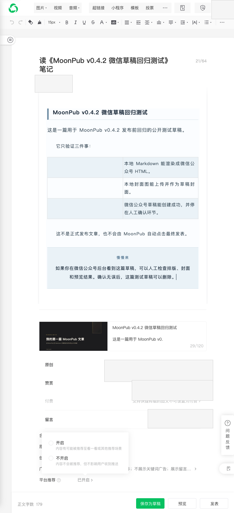

> **项目**：MoonPub —— 用 Rust 写的公众号发布副驾驶
> **仓库**：github.com/qiaopengjun5162/moonpub
> **本篇**：第 2 篇 · 三个半小时、七次换栈，和那个换库永远修不好的 bug

## 前言

上一篇讲到，MoonPub 的第一个提交用一个晚上塞了 4967 行，把「Markdown 变成微信草稿」这条链路跑通了。但草稿只是半成品——原创声明、赞赏、创作来源、留言、合集，这十几项设置**没有任何 API**，只能在微信后台的网页上点。

这一篇讲第二天晚上发生的事：我用三个半小时、49 次提交、七次切换技术栈，去点几个开关，全部失败。真正的根因在**第二天**才被找到，而且只用一行提交信息就写完了。

读完你能拿走一件事：**当一个症状在三个不同的库里都出现，问题大概率不在库，在你和它之间那层协议。** 那三个半小时里我一直在换锤子，而墙不是钉子。

## 背景

时间：2026 年 6 月 11 日，项目第二天。

前一天晚上（06-10）的 33 次提交全是纯 Rust 功能：Markdown 块模板、封面 HTML、49 个测试、CI、Justfile。一行浏览器代码都没有。

那天晚上 20:31，我提交了这么一条：

```text
20:31  836de7d  feat: publish 模块 — push 成功后自动打开后台编辑页
```

想法很朴素：草稿推成功了，就把后台编辑页自动打开，省得我手动去翻。我以为这是一两行代码的事。

三个半小时后，我还在这个坑里。

## 摘要

| 项 | 内容 |
| --- | --- |
| 问题 | 草稿能建，但原创/赞赏/创作来源等设置只能在网页上点，没有 API |
| 现象 | 脚本「点成功了」但不报错、页面也不变；换浏览器库依然无效 |
| 根因 | 微信编辑器是 Vue 应用，JS 合成点击 `isTrusted=false`，被模型层直接忽略 |
| 修法 | 先取元素坐标，再由 Rust 侧 `page.click(Point)` 派发 CDP 可信鼠标事件 |
| 结论 | 症状跨库复现时，该查协议而不是换库；换工具是最贵的自我安慰 |

## 实操

### 步骤 1：先确认那天到底提交了多少次

不靠回忆，直接数。

**输入**

```bash
git log --format=%H --since="2026-06-11 20:00" --until="2026-06-12 00:00" | wc -l
git log --format=%H --since="2026-06-11 00:00" --until="2026-06-12 00:00" | wc -l
git log --format="%ad" --date=short | sort | uniq -c | sort -rn | head -3
```

**输出**

```text
53
87
  87 2026-06-11
  64 2026-06-12
  37 2026-06-16
```

- 那晚 20:00 到 24:00，**53 次提交**；
- 从 20:31 起点算到 23:59，**49 次提交**；
- 06-11 全天 **87 次**，是这个项目至今的单日最高纪录，第二名 06-12 是 64 次。

三个半小时 49 次提交，平均每 4 分钟一次。这个密度不是效率，是慌乱。

### 步骤 2：看那七次技术栈切换

把所有带技术栈关键词的提交筛出来：

**输入**

```bash
git log --since="2026-06-11 20:00" --until="2026-06-12 00:00" \
  --format="%ad %h %s" --date=format:"%H:%M" \
  | grep -aiE "playwright|headless_chrome|cdp|xpath|node_path|call_js"
```

**输出**

```text
23:57 78427a7 refactor: 纯 Rust CDP — find_elements + click(), 零 JS eval
23:53 c2c39b3 feat: Playwright frameLocator — 账号名片 #editor_showmore
23:52 9c70a11 feat: 纯 Rust call_js_fn + #editor_showmore 账号名片
23:42 a9eadde refactor: Playwright 原生 click API — 支持跨 iframe 点击
23:33 ef638da fix: Playwright 编辑按钮精准选择器 + 去掉 Enter 等待
23:25 71b43de fix: Playwright + NODE_PATH — 能跑的方案
23:22 941c727 refactor: CDP CSS selector + get_attribute_value — 纯 Rust 零 JS
23:21 087eb1c fix: CDP 鼠标移动 hover 卡片 + 提取 appmsgid fallback
23:19 4863d69 refactor: 纯 Rust XPath 点击 — 无 JS eval, CDP DOM 原生查询
23:08 1807aa0 refactor: publish 切回 Playwright Node — headless_chrome evaluate 有 bug
21:28 5b9d300 feat: Rust headless_chrome 浏览器自动化 + PROGRESS 记账
20:34 dbb400d fix: publish 在 vault 目录运行 playwright-cli (session 存储位置)
20:34 2af0c1d feat: publish 集成 playwright-cli 后端自动化
```

按方向理一遍，是这样的：

| 时刻 | 提交 | 切到 | 是第几次切换 |
| --- | --- | --- | --- |
| 20:34 | `2af0c1d` | Node playwright-cli（起点） | — |
| 21:28 | `5b9d300` | Rust headless_chrome | 1 |
| 23:08 | `1807aa0` | Node Playwright（"evaluate 有 bug"） | 2 |
| 23:19 | `4863d69` | 纯 Rust XPath | 3 |
| 23:25 | `71b43de` | Node Playwright + NODE_PATH（"能跑的方案"） | 4 |
| 23:52 | `9c70a11` | 纯 Rust call_js_fn | 5 |
| 23:53 | `c2c39b3` | Node Playwright frameLocator | 6 |
| 23:57 | `78427a7` | 纯 Rust CDP | 7 |

**21:28 到 23:57，149 分钟，七次。** 最后 23:52 到 23:57，五分钟里翻了两次。

注意每一次提交信息里的措辞：「evaluate 有 bug」「能跑的方案」「零 JS eval」。每一条我都写得很笃定，好像终于找到正确的那把锤子。

### 步骤 3：切栈之间，我在打 DOM

换库之外的时间，全在跟微信后台的 DOM 搏斗。这一段的目标只有一个：**从草稿列表点进编辑器。**

**输入**

```bash
git log --since="2026-06-11 22:20" --until="2026-06-11 23:05" \
  --format="%ad %h %s" --date=format:"%H:%M"
```

**输出（节选）**

```text
23:04 1600024 fix: 提取 appmsgid 直接跳转编辑器 — 不依赖卡片点击
23:02 2ca4977 fix: 先 click 卡片唤出按钮 → 再点第二个(编辑)
22:58 2a19a5b fix: 回到草稿箱列表 — 用正确 class publish_card_container
22:57 d3cabdf fix: 三策略强触卡片 — 全层Hover/链接剥离/盲点
22:55 6af665a fix: 用'更新于'文字定位近期草稿卡片 — 不依赖 CSS class
22:49 26a6d3f fix: 首页近期草稿 — Hover + 第二个按钮(编辑) 精准点击
22:47 16117f8 fix: 精准定位卡片 .appmsg_mask a[1] — 微信隐藏编辑按钮索引
22:44 229c4d6 fix: 先 Hover 卡片再找编辑按钮 — 微信隐藏式菜单
22:40 14a4fbd fix: 草稿箱列表点击进入 — vid≠appmsgid 终极解决
22:32 a0e05a5 fix: 首页自跳转获取动态 token — 根除 Cookie 被冲掉问题
22:27 233a842 fix: wait_for_login 只认 cgi-bin/home — appmsg_edit 可能是登录超时页
22:25 772b5fc fix: DOM 级登录超时检测 — 拦截微信假登录页面
```

三个真实的坑，全在这段里：

1. **`vid ≠ appmsgid`**。草稿列表 URL 上的 `vid` 和草稿真实 ID 不是同一个东西，按 `vid` 拼跳转链接必然 404。`22:40` 那条写着「终极解决」，口气很大，但 22:47 又有新的 fix。
2. **编辑按钮是 hover 才出现的隐藏菜单**。`22:44` 才想明白：得先把鼠标移到卡片上，菜单才会渲染出来，然后点第二个按钮。
3. **登录页会伪装成编辑页**。`22:25` `22:27` 两条在打这个：等待 `appmsg_edit` 出现并不等于登录成功，因为它可能是登录超时页，必须只认 `cgi-bin/home`。

到 23:04，我终于能稳定进编辑器了。

然后发现里面还要点开关——而开关，才是真正的墙。

### 步骤 4：第二天才找到根因

06-12 晚上继续打。19:29 的这条提交，第一次在提交信息里写下了那个词：

```text
19:29 37dc3c7 fix: use CDP coordinate clicks for Vue dialog buttons
```

19:54，把 shadow DOM 遍历加进点击函数：

```text
19:54 12038c1 fix: add shadow DOM traversal to cdp_click_text + cdp_click_any_text
```

20:01，改崩了，从 git 历史里把之前能跑的版本捞回来：

```text
20:01 c149bb9 fix: restore 赞赏 + 创作来源 to original working code from git history
```

`restore ... from git history` 翻译成人话就是：**我不相信自己能修好，让 git 当备份。** 这不是演示稿里的开发状态，这是真的。

20:21，第一条把根因写进提交信息的：

```text
20:21 e750b8c fix: 原创 checkbox use CDP click for 我已阅读并同意 (Vue ignores JS events)
```

括号里那句 **`Vue ignores JS events`**，就是整场战役的钥匙。21:20 和 21:28 又补了两条：

```text
21:20 65429f3 fix: use CDP clicks for 赞赏 + 创作来源 initial triggers (Vue ignores JS events)
21:28 c12aca7 fix: scroll to bottom after editor load to trigger Vue settings rendering
```

最后那条还暴露了第二个坑：Vue 的设置有部分是滚动到可视区才渲染的，不滚到底，DOM 里根本没有这些节点。

### 步骤 5：看现在的代码怎么记这件事

这条教训最后固化在两处。

**代码里**，`src/cdp.rs:80-83` 的函数注释原文：

```text
/// The click is a trusted CDP mouse event at the element's coordinates, NOT a
/// synthetic JS .click(). WeChat's editor ignores untrusted events for its Vue
/// model updates: synthetic clicks change the visual state but the change
/// never reaches the saved draft (settings silently revert on reload).
```

**项目规则里**，`AGENTS.md:151`：

> 微信编辑器的 Vue 模型会忽略 JS 合成点击（`isTrusted=false`）：picker 类弹窗的"确认"按钮用 JS `.click()`/`dispatchEvent` 点了没反应（弹窗不关、设置不生效），脚本必须先取元素坐标（`getBoundingClientRect` + `scrollIntoView`），再由 Rust 侧 `page.click(Point)` 发 CDP 可信鼠标事件。

这两段文字，价值是三个半小时加一整晚。

## 截图



这张图是我后来发布流程跑通之后的实拍，也是那三个半小时要解决的现场：

- 左边是正文，底部写着 **正文字数 179**，封面已经挂上；
- 右边一列是 **原创 / 赞赏 / 付费 / 留言 / 平台推荐**——就是这些开关；
- 注意它们的初始状态是**未设置**，脚本点过去不会报错，但状态不变。

这张图证明的是「问题存在的位置」：不是正文，不是封面，是右侧这一列没有 API 的开关。

## 解释说明

### 为什么换库一定修不好

微信编辑器是 Vue 应用。我用任何工具派发的点击，只要是 JS 合成的（`element.click()`、`dispatchEvent`），浏览器给它打的 `isTrusted` 就是 `false`。

Vue 的模型层看到 `isTrusted=false` 的事件，直接忽略。**它不会报错，也不会阻止你**，只是不更新自己的状态。于是出现最迷惑人的现象：

```text
脚本：点击成功 ✅
DOM：样式变了（浏览器真的把按钮画成了打开的样子）
Vue：这不是人点的，我不理
保存：什么都没存下来
```

换 Playwright 还是 headless_chrome，改的只是「谁去执行那个 JS 调用」，`isTrusted` 依然是 `false`。**换库改变不了协议层的判定。**

真正的修法是绕开协议：先用 `getBoundingClientRect()` 拿到元素在视口中的坐标，再通过 CDP 让浏览器内核在**那个像素位置**派发一次真实的鼠标按下/抬起。对浏览器来说，这就是人在点。

### 为什么我切了七次

因为换库有即时反馈。

每次换一个库，我都能在某个具体选择器上感觉「顺手了」——CSS 选择器更准、等待更稳、iframe 穿透更顺。这些局部进步是真的，它们让我相信离成功更近了。

但核心症状一次都没变：开关不亮。我把「局部变好」当成了「方向正确」，又把「方向错误」当成了「工具不行」。七次切换，其实是同一个判断错误重复了七次。

**换工具是焦虑最便宜的出口**：它让你立刻有事可做，而且做的时候不像在原地打转。

### 为什么这个问题这么贵

因为它不响。

选择器写错会报错，元素找不到会超时，网络失败会 4xx。但「点了没生效」什么都不说。它让所有错误处理逻辑都失效——你写的 `try/catch`、重试、断言，全都在 cheerfully 报告成功。

一个静默失败，会把调试从「读错误信息」变成「猜」。而猜的成本，是三个半小时。

## 验证

三条命令，读者可以自己复算本文每一个时间点：

```bash
# 1. 当晚提交量与单日峰值
git log --format=%H --since="2026-06-11 20:31" --until="2026-06-12 00:00" | wc -l   # 49
git log --format="%ad" --date=short | sort | uniq -c | sort -rn | head -1            # 87 2026-06-11

# 2. 七次技术栈切换
git log --since="2026-06-11 20:00" --until="2026-06-12 00:00" \
  --format="%ad %h %s" --date=format:"%H:%M" \
  | grep -aiE "playwright|headless_chrome|cdp|xpath|node_path|call_js"

# 3. 根因那一段
git log --since="2026-06-12 19:00" --until="2026-06-12 21:30" \
  --format="%ad %h %s" --date=format:"%H:%M"
```

代码锚点（当前仓库可直接查）：

- `src/cdp.rs:85` —— `xclick()`，取坐标后派发可信点击
- `src/cdp.rs:170` —— `cdp_click_text()`，带 shadow DOM 遍历
- `src/cdp.rs:803` —— `settle_editor_page()`，滚到底触发 Vue 渲染
- `AGENTS.md:151` —— 这条约束的正式条目

**本篇纠正了上一版两处说法**（写的时候凭记忆，验证时对不上）：

- 旧稿写「当晚二十多次提交」——实测 **49 次**；
- 旧稿写「两次往返、一百分钟」——实测 **七次切换、149 分钟**；
- 旧稿写 `20:21` 是第一条点出根因的提交——实际 `37dc3c7`（**19:29**）就已经在标题里写了 `Vue dialog buttons`。

## 总结

1. **症状跨库复现，就该查协议。** 同一个 bug 在三个库里表现一致，说明它不在任何一个库里。继续换库只是把同一堵墙换个角度撞。
2. **把局部变好当成方向正确，是最贵的判断错误。** 每次换栈都有局部进步，这些进步真实但无关。判断方向的唯一标准是核心症状有没有变，不是手感有没有变。
3. **静默失败比报错危险。** 不报错的成功最容易被写进日志、被当成已完成。凡是「操作成功但状态没变」的链路，都要补一条**回读验证**——这也是下一篇的主题。

下一篇讲：设置明明点了保存，刷新就回退。它比这一篇更阴，因为**保存按钮本身都可能被挡着**。

---

**参考**

- 提交 `836de7d` —— 06-11 20:31 起点，`feat: publish 模块 — push 成功后自动打开后台编辑页`
- 提交 `5b9d300` / `1807aa0` / `4863d69` / `71b43de` / `78427a7` —— 七次换栈中的五个关键点
- 提交 `e750b8c` —— 06-12 20:21 首次把 `Vue ignores JS events` 写进提交信息
- 代码 `src/cdp.rs:85` / `170` / `803` —— 可信点击的三个落点
- 文档 `AGENTS.md:151` —— Vue 忽略合成事件的正式约束
- 仓库 [github.com/qiaopengjun5162/moonpub](https://github.com/qiaopengjun5162/moonpub)
