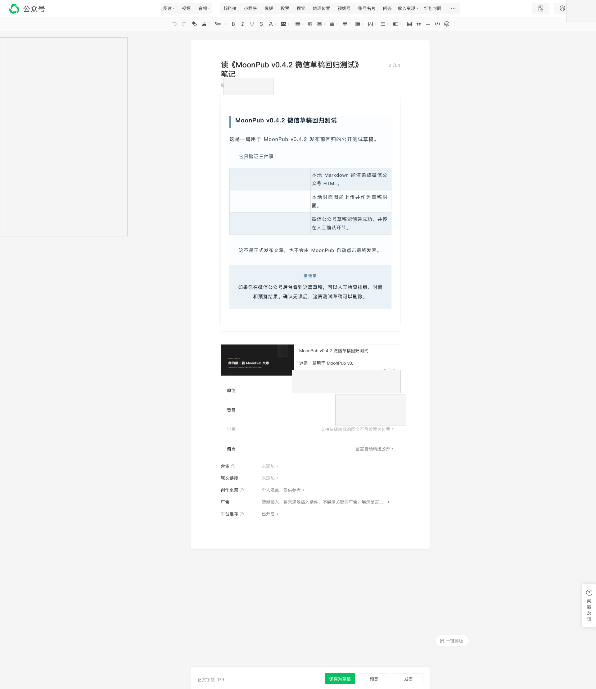

> **项目**：MoonPub —— 用 Rust 写的公众号发布副驾驶
> **仓库**：github.com/qiaopengjun5162/moonpub
> **本篇**：第 3 篇 · 把「Vue 不认 JS 点击」从一句结论变成能跑的代码

## 前言

上一篇结尾，根因找到了：微信编辑器是 Vue 应用，脚本用 JS 合成出来的点击 `isTrusted=false`，模型层直接忽略。我在三个半小时里换了七次技术栈，一次都没修好，因为问题不在库。

这一篇讲后半段：**知道根因之后，为什么还要再花一晚才把它变成能跑的代码。**

「取坐标 + 派发可信鼠标事件」这句话只有十几个字，落地时会撞上五个坑：开关在 iframe 里、按钮在 shadow DOM 里、控件是 0×0 的隐形元素、设置区不滚到底不渲染、弹窗的可见性不能用 `offsetParent` 判断。

每个坑都对应 `src/cdp.rs` 里一段现在还在跑的代码，你可以打开对照。读完你能拿走一套**在任意「Vue + iframe + shadow DOM + 懒渲染」页面上做可靠点击**的方法，不只是这个概念。

## 背景

时间：2026 年 6 月 12 日晚上，项目第三天。

前一晚（06-11）的三个半小时结束时，我能稳定进编辑器了，但里面那十几个开关一个都点不亮。06-12 从 19:29 重新开始，到 21:28 收工，两个小时里 22 次提交，全部围绕「怎么点」：

```text
19:29 37dc3c7 fix: use CDP coordinate clicks for Vue dialog buttons
19:54 12038c1 fix: add shadow DOM traversal to cdp_click_text + cdp_click_any_text
20:21 e750b8c fix: 原创 checkbox use CDP click for 我已阅读并同意 (Vue ignores JS events)
20:21 643f370 fix: 创作来源 prioritize CDP shadow DOM click for 确认 button
21:20 65429f3 fix: use CDP clicks for 赞赏 + 创作来源 initial triggers (Vue ignores JS events)
21:28 c12aca7 fix: scroll to bottom after editor load to trigger Vue settings rendering
```

19:29 那条的标题里第一次出现 `Vue dialog buttons`——也就是说，**在写下「Vue ignores JS events」这条全称结论之前 52 分钟，我已经在按 Vue 的特性改点击方式了**。人是先摸到答案，再承认答案的。

## 摘要

| 项 | 内容 |
| --- | --- |
| 问题 | 开关点得中但点不亮，脚本报成功，后台状态不变 |
| 现象 | 视觉状态变了，Vue 的 model 没更新，保存后刷新回退 |
| 根因 | JS 合成点击 `isTrusted=false`，Vue 只认内核派发的可信事件 |
| 修法 | `getBoundingClientRect()` 取坐标 → `page.click(Point)` 派发 CDP 鼠标事件 |
| 结论 | 坐标法只是入场券；iframe、shadow DOM、0×0、懒渲染四个坑得逐个填 |

## 实操

### 步骤 1：先确认「换一种点击」长什么样

`src/cdp.rs` 里 `xclick` 的文档注释，把这件事写全了：

**输入**

```bash
sed -n '80,84p' src/cdp.rs
```

**输出**

```rust
/// The click is a trusted CDP mouse event at the element's coordinates, NOT a
/// synthetic JS .click(). WeChat's editor ignores untrusted events for its Vue
/// model updates: synthetic clicks change the visual state but the change
/// never reaches the saved draft (settings silently revert on reload).
```

真正的动作只有最后两步：

**输入**

```bash
sed -n '144,153p' src/cdp.rs
```

**输出**

```rust
    if let Ok(v) = serde_json::from_str::<serde_json::Value>(&rect_json)
        && v["found"].as_bool() == Some(true)
    {
        let x = v["x"].as_f64().unwrap_or(0.0);
        let y = v["y"].as_f64().unwrap_or(0.0);
        page.click(chromiumoxide::layout::Point { x, y }).await.ok();
        return true;
    }
    false
```

JS 只负责**算坐标**，点击由 Rust 侧的 `page.click(Point)` 发出去。JS 里不调用 `element.click()`，这是整件事的关键分界线。

### 步骤 2：坑一——设置面板在 iframe 里

微信后台的正文编辑器是一个 iframe（`iframe[name="main"]`），原创/赞赏/创作来源这些设置都在里面。

先在顶层 `document` 上找元素，坐标算的是 iframe 外面的空气。所以查询顺序必须是「先进 iframe，找不到再回主文档」：

**输入**

```bash
sed -n '103,131p' src/cdp.rs
```

**输出**

```rust
    // Search order:
    // 1. iframe[name="main"] — settings panel and its dialogs
    // 2. Main document — save/preview buttons and any top-level overlays
    // Non-main iframes (article editor) intentionally excluded to avoid false matches.
    let js = format!(
        r#"(() => {{
            try {{
                var rect = function(n) {{
                    n.scrollIntoView({{block:'center'}});
                    var r = n.getBoundingClientRect();
                    if (r.width === 0 && r.height === 0) {{
                        // Hidden inputs (e.g. weui switches) have no box; click their visible parent/label instead.
                        var p = n.closest('label') || n.parentElement;
                        if (!p) return null;
                        p.scrollIntoView({{block:'center'}});
                        r = p.getBoundingClientRect();
                    }}
                    return JSON.stringify({{found:true, x: r.x + r.width/2, y: r.y + r.height/2}});
                }};
                var mainFr = document.querySelector('iframe[name="main"]');
                if (mainFr) {{
                    try {{
                        var doc = mainFr.contentDocument;
                        if (doc) {{ var m = {qf}; if (m) return rect(m); }}
                    }} catch(e) {{}}
                }}
                var n = {qd};
                if (n) return rect(n);
                return JSON.stringify({{found:false}});
            }} catch(e) {{ return JSON.stringify({{found:false}}); }}
        }})()"#,
        qf = query_frame,
        qd = query_doc,
    );
```

两个细节值得注意：

1. **源码里是 `{{` 而不是 `{`**。因为这段 JS 要过 Rust 的 `format!`，花括号必须转义。阅读时把它当 `{` 就行——这也说明这段代码是硬塞进字符串的，不是模板文件。
2. **故意只认 `iframe[name="main"]`**，注释写了原因：文章编辑器那个 iframe 里也有大量同名元素，一起搜会误中。

### 步骤 3：坑二——按钮在 shadow DOM 里

钻进 iframe 之后，有些「确定 / 确认」按钮还是点不到。因为它们在 Web Component 的 shadow DOM 里，`querySelector` 摸不到。

06-12 19:54 专门补了这个：

```text
19:54 12038c1 fix: add shadow DOM traversal to cdp_click_text + cdp_click_any_text
```

现在 `cdp_click_text` 在遍历节点时递归下钻每一个 `shadowRoot`：

**输入**

```bash
sed -n '185,192p' src/cdp.rs
```

**输出**

```rust
                    var all = root.querySelectorAll('*');
                    for (var j = 0; j < all.length; j++) {{
                        if (all[j].shadowRoot) {{
                            var sr = search(all[j].shadowRoot);
                            if (sr) return sr;
                        }}
                    }}
```

这是一个**自调用递归**：`search` 在 shadow root 里会再走一遍「先找 button，再找所有元素里的 shadowRoot」。不写这一层，组件内部的按钮永远点不中。

### 步骤 4：坑三——那个开关是 0×0 的隐形元素

最阴的一个。

微信「原创」的真实控件是 `weui` 的开关，那个 `<input>` 的 `getBoundingClientRect()` 返回 **0 宽 0 高**。中心点算出来就是它自己，点击落在空气上——**不报错，不生效**。

代码里的兜底就是前面那段 `rect` 函数：

```rust
var r = n.getBoundingClientRect();
if (r.width === 0 && r.height === 0) {
    // Hidden inputs (e.g. weui switches) have no box; click their visible parent/label instead.
    var p = n.closest('label') || n.parentElement;
    if (!p) return null;
    p.scrollIntoView({block:'center'});
    r = p.getBoundingClientRect();
}
```

判断顺序是「先量，量为 0 才回退」。回退目标优先 `<label>`，因为 `weui` 的开关把点击行为挂在 label 上；没有 label 才退到父元素。

### 步骤 5：坑四——不滚到底，Vue 根本不渲染

这个坑不在点击，在**渲染时机**。21:28：

```text
21:28 c12aca7 fix: scroll to bottom after editor load to trigger Vue settings rendering
```

微信编辑器有部分设置区是懒渲染的：不滚到可视范围，DOM 里根本没有那些节点。算坐标时元素不存在，再怎么改选择器都是空。

所以进编辑器后有一步固定操作：

**输入**

```bash
sed -n '803,813p' src/cdp.rs
```

**输出**

```rust
async fn settle_editor_page(page: &Page) {
    sleep_ms(3_000).await;
    let _ = page
        .evaluate("window.scrollTo(0, document.body.scrollHeight)")
        .await;
    sleep_ms(2_000).await;
    let _ = page
        .evaluate("window.scrollTo(0, document.body.scrollHeight - 500)")
        .await;
    sleep_ms(1_000).await;
}
```

先等 3 秒，滚到底，等 2 秒，再回滚 500 像素，等 1 秒。**注意最后那次回滚**——如果一直停在底部，底部可能有浮层遮挡；退回来一点，设置区才停在可视范围内。

### 步骤 6：附赠的第五个坑——可见性不能用 `offsetParent` 判断

填完四个坑，还有一个更细的：判断「这个弹窗是不是可见」时，`offsetParent !== null` 这个常见写法是错的。

因为**固定定位（fixed）的元素 `offsetParent` 恒为 `null`**——而微信的 picker 弹窗大量用固定定位。用 `offsetParent` 判断，会把**看得见的弹窗判成不可见**，然后继续往下走，最后点到一个被弹窗挡住的按钮上。

正确写法在 `src/publish_steps.rs:326`：

**输入**

```bash
sed -n '326p' src/publish_steps.rs
```

**输出**

```rust
var vis = function(el) { return !!el && el.getClientRects().length > 0; };
```

同一处上方那行注释解释了原因：**固定定位元素 `offsetParent` 为 null，必须用 `getClientRects` 判可见。**

而且这条有测试钉着（`src/publish_steps.rs:1135-1136`），断言脚本里必须出现 `getClientRects`——防止以后有人「顺手简化」成 `offsetParent`。

## 截图



这张图是自动化跑起来之后的真实窗口，它把这篇要解决的问题摆在同一屏里：

- 顶部是公众号后台的编辑器工具栏（图片、视频、音频、投票、小程序……）；
- 中间是渲染好的正文，底部一根绿条写着 **正文字数 179**，右边是「保存为草稿 / 预览 / 发表」；
- **右侧这一列**就是全部难点：原创、赞赏、付费、留言、合集、原文链接、创作来源、广告、平台推荐。

这张图证明的是「点击目标在哪里」：不是正文，不是工具栏，是右侧这一列**没有 API、只能靠浏览器点**的开关。前五步的所有代码，都是为了让这一列里的每一行真的生效。

## 解释说明

### 为什么坐标法能被 Vue 认

浏览器给每个事件对象都带一个 `isTrusted`：

- 页面脚本调用 `element.click()` 或 `dispatchEvent()` 造出来的事件，`isTrusted = false`；
- 浏览器内核根据真实输入（鼠标、键盘、触摸）产生的事件，`isTrusted = true`。

`isTrusted` 是**只读**的，脚本改不了。这也解释了为什么这个坑绕不过去——你不能伪造它，只能让内核真的产生一次输入。

`page.click(Point)` 走的是 CDP 的 `Input.dispatchMouseEvent`，由浏览器内核在指定坐标派发 `mousePressed` / `mouseReleased`。对内核来说，这和真人点鼠标没有区别。

### 坐标法自己的代价

它不是免费的，代价有三个，都在代码里留下了痕迹：

1. **坐标会过期。** `scrollIntoView` 之后布局可能还在变，所以每次点击前都要重新取一次坐标，不能缓存。
2. **iframe 是独立坐标系。** iframe 内部的坐标是相对 iframe 视口的，所以必须在 iframe 的 document 里取 rect，不能在顶层算。
3. **元素可能根本没有盒子。** 0×0 的 `input`、`display:none` 的容器，都要单独兜底——这就是步骤 4 和步骤 6。

### 四个坑其实是同一个错误假设

我一直默认「点一个元素」等于「在那个元素上调用 `.click()`」。这个假设在静态 HTML 上几乎总成立。

但在「Vue + iframe + shadow DOM + 隐形控件 + 懒渲染」这套组合上，它一步都不成立：元素可能不在当前文档里、可能在关闭的 shadow root 里、可能没有盒子、可能还没被渲染出来。

**所以真正的修法不是「换一个更准的选择器」，而是换一套定位模型：从「找到元素并调用它的方法」变成「找到元素、量出它在屏幕上的位置、让内核去那个位置点一下」。**

## 验证

```bash
# 1. 四个坑对应的当前代码
sed -n '80,84p'   src/cdp.rs     # 可信事件的由来
sed -n '103,131p' src/cdp.rs     # iframe 穿透 + 0×0 回退 label
sed -n '185,192p' src/cdp.rs     # shadow DOM 递归
sed -n '803,813p' src/cdp.rs     # 滚底触发 Vue 渲染
sed -n '325,326p' src/publish_steps.rs  # getClientRects 判可见

# 2. 那一段的真实提交
git show 12038c1   # 19:54 shadow DOM 遍历
git show e750b8c   # 20:21 首次写全 Vue ignores JS events
git show c12aca7   # 21:28 滚底触发渲染

# 3. 防复发测试
grep -n "getClientRects" src/publish_steps.rs   # 1135-1136 的断言
```

提交锚点都真实存在（`git rev-parse --verify` 可验），代码行号对应当前 `main`。

## 总结

1. **`isTrusted` 不能伪造，只能让内核真的产生输入。** 任何「绕过前端框架事件判断」的需求，最终都要落到 CDP/系统级输入，而不是更聪明的 JS。
2. **坐标法有三笔固定成本：坐标会过期、iframe 是独立坐标系、元素可能没有盒子。** 不预留这三处兜底，代码会在不同页面上随机失效。
3. **可见性判断要用 `getClientRects()`，不要用 `offsetParent`。** 固定定位（fixed）会让 `offsetParent` 恒为 null，这是个会把「看得见」判成「看不见」的静默错误。

下一篇讲一个更反直觉的问题：开关已经真的点亮了，点「保存」也返回成功，**刷新页面全部回退**。因为设置只活在页面内存里，而且保存按钮本身可能被上一个没关的弹窗挡着。

---

**参考**

- 提交 `37dc3c7` —— 06-12 19:29 首次使用 CDP 坐标点击
- 提交 `12038c1` —— 19:54 给点击函数加 shadow DOM 遍历
- 提交 `e750b8c` —— 20:21 首次在提交信息里写全 `Vue ignores JS events`
- 提交 `c12aca7` —— 21:28 滚到底触发 Vue 设置区渲染
- 代码 `src/cdp.rs:85` / `170` / `223` / `803` —— 四个落点
- 代码 `src/publish_steps.rs:325` —— `getClientRects` 可见性判断
- 文档 `AGENTS.md:151` —— Vue 忽略合成事件的正式约束
- 仓库 [github.com/qiaopengjun5162/moonpub](https://github.com/qiaopengjun5162/moonpub)
