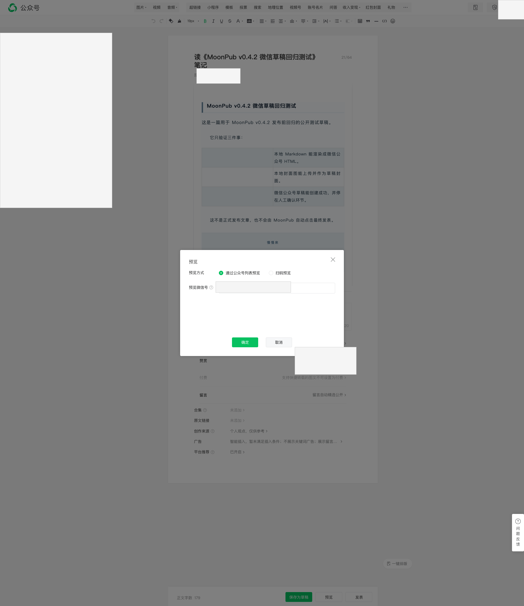

> **项目**：MoonPub —— 用 Rust 写的公众号发布副驾驶
> **仓库**：github.com/qiaopengjun5162/moonpub
> **本篇**：第 4 篇 · 配置写进后台了，但没存住

## 前言

上一篇（第 3 篇）解决的是「点了没反应」——Vue 忽略合成点击事件，改用 CDP 派发可信鼠标事件。那一关过了，我以为最难的过去了。

六周后我撞上更阴的一关：**点了有反应，界面也变了，刷新之后全部回退**。

配置原创声明、赞赏、创作来源，每一项都点了开关、点了「保存为草稿」。退出编辑器再进来，全回到默认值。没有报错，没有告警，程序打印的还是 `✅`。

这一篇拆开那四层叠在一起的根因，以及为什么最后的修法不是「再点一次」，而是**保存完重载编辑器，去读后台真实返回的状态**。读完你能拿走一条：自动化里最贵的 bug 不是崩溃，是假成功。

## 背景

MoonPub 把 Markdown 渲染成微信 HTML、生成封面、调 API 建草稿，然后开一个真实浏览器把 API 做不到的十几项后台设置点掉——原创声明、赞赏、创作来源、留言、合集、原文链接。

时间坐标是 **2026-07-26**，第 3 篇收尾（06-12）之后第 44 天。项目此时刚发到 v0.4.3，当天一共 35 次提交。

其中 18:49 到 20:30 这 101 分钟里，有四个提交是这条主线：

```text
18:49  e22f34a  fix(configure): make WeChat backend settings actually persist
19:23  e204f5b  fix(configure): trusted CDP click for picker confirms + leftover-dialog guard
20:26  24bf1aa  fix: WeChat draft settings persistence + cookie-mode publishing (#137)
20:30  08e3eb4  fix(configure): poll settings after reload; warn on missing qrcode path
```

第一个提交 `e22f34a` 的提交信息直接把四层根因列了出来，这段是我当时写的原话：

```text
Root cause (4-layer): steps only verified clicks not effects; hidden
未声明/已声明 DOM blocks fooled textContent state reads; global blind
确定 clicks hit wrong dialogs; configured settings were never saved to
the draft before the browser closed.
```

四条，每一条单独拿出来都能让整轮配置白做。

## 摘要

| 项 | 内容 |
| --- | --- |
| 问题 | 原创 / 赞赏 / 创作来源配好了，保存后刷新全部回退 |
| 现象 | 界面变了、程序打印 `✅`、后台却是默认值，没有报错 |
| 根因 | 四层叠加：只验点击不验效果、隐藏 DOM 骗读状态、全局盲点「确定」、设置从未真正落库 |
| 修法 | 保存前清残留弹窗 + 保存后重载编辑器读真实状态 + 守卫测试钉死脚本行为 |
| 结论 | 把「我执行了动作」当成「系统进入目标状态」，是自动化最贵的错误 |

## 实操

### 步骤 1：先把那晚的真实时间线拉出来

不靠回忆，直接查提交。这一步是本篇所有时间点的唯一来源。

**输入**

```bash
git log --format="%H %ad %s" --date=format:"%H:%M" \
  --since="2026-07-26 18:40" --until="2026-07-26 20:35"
```

**输出**

```text
08e3eb4a 20:30 fix(configure): poll settings after reload; warn on missing qrcode path
24bf1aa0 20:26 fix: WeChat draft settings persistence + cookie-mode publishing (#137)
e204f5b3 19:23 fix(configure): trusted CDP click for picker confirms + leftover-dialog guard
04b8c5d3 19:00 fix(footer): suppress default table borders in brand card
57644d20 18:58 fix(footer): use table layout for brand card (WeChat strips flex)
e22f34ae 18:49 fix(configure): make WeChat backend settings actually persist
```

注意 18:58 和 19:00 这两条是页脚表格的活，和弹窗无关。**当晚不是一个顺序推进的过程**——我在修设置的间隙还得回去救封面图。真实开发就是这样，别指望一条直线。

### 步骤 2：看保存前为什么要先关弹窗

`step_baocun` 是「保存为草稿」这一步。它做的第一件事不是找保存按钮，而是**先把残留弹窗全关掉**。

**输入**

```bash
sed -n '602,616p' src/publish_steps.rs
```

**输出**

```rust
    // 任何残留弹窗都会挡住保存按钮的点击（picker 未关曾导致整轮设置不落库），
    // 保存前先关掉所有可见弹窗。
    for _ in 0..3 {
        let closed = page
            .evaluate(CLOSE_VISIBLE_DIALOGS_SCRIPT)
            .await
            .ok()
            .and_then(|v| v.value().and_then(|v| v.as_u64()))
            .unwrap_or(0);
        if closed == 0 {
            break;
        }
        println!("    关闭残留弹窗: {closed} 个");
        sleep_ms(500).await;
    }
```

注释里那句「picker 未关曾导致整轮设置不落库」不是猜测，是我踩过的现场。

原因很物理：前面为了配原创和创作来源，我打开了好几个 picker。只要有一个没关干净，它就浮在编辑器上。CDP 按算出来的坐标点「保存为草稿」，那个坐标上恰好被 picker 盖住——**点击成功执行了，点到的是 picker**。

程序看到的是「点击已发出」，后台看到的是「什么都没发生」。

### 步骤 3：关弹窗脚本靠什么认弹窗

最多循环三轮，每轮返回关掉了几个。返回 0 就退出，不会无限转。

**输入**

```bash
sed -n '312,322p' src/publish_steps.rs
```

**输出**

```javascript
const CLOSE_VISIBLE_DIALOGS_SCRIPT: &str = r#"(() => {
    var vis = function(el) { return !!el && el.offsetParent !== null; };
    var closers = document.querySelectorAll('.weui-desktop-dialog__close-btn, .weui-desktop-dialog__wrp .weui-desktop-icon-btn');
    var n = 0;
    for (var i = 0; i < closers.length; i++) {
        if (!vis(closers[i])) continue;
        closers[i].click();
        n++;
    }
    return n;
})()"#;
```

三个细节值得看：

- 按**类名前缀**找关闭按钮，不按「文本是不是 ×」找——微信的 × 是图标，没有文字
- 只关**可见**的（`vis`），隐藏的不碰
- 关完返回数量，外层据此决定要不要再来一轮

### 步骤 4：保存完怎么确认真的落库了

这是整篇最关键的二十行。配置完、保存完，`step_fucha` 会**重载编辑器**，然后去读后台真正返回的状态。

**输入**

```bash
sed -n '527,543p' src/publish_steps.rs
```

**输出**

```rust
    // 只信保存后的服务器状态：重载编辑器，读设置行的真实文案。
    // 点击日志和内存态都可能是假成功（弹窗遮挡、校验拦截），重载后的
    // 页面状态才是微信后台真正落库的结果。
    let _ = page.evaluate("location.reload()").await;
    let mut loaded = false;
    for _ in 0..30 {
        sleep_ms(500).await;
        let ok = page
            .evaluate("document.querySelector('#js_original')!==null")
            .await
            .ok()
            .and_then(|v| v.value().and_then(|v| v.as_bool()))
            .unwrap_or(false);
        if ok {
            loaded = true;
            break;
        }
```

重载后最多等 15 秒（30 次 × 500ms），等编辑器加载出原创那一行，再逐项核对四个状态：

| 项 | 落库的判据 | 不落库时打印 |
| --- | --- | --- |
| 原创 | 状态以 `declared` 开头 | `⚠ 原创未保存到后台` |
| 赞赏 | 非空且不含「不开启」 | `⚠ 赞赏未保存到后台` |
| 创作来源 | 非空 | `⚠ 创作来源未保存到后台` |
| 留言 | `on` | `⚠ 留言未保存到后台` |

四项里任何一项不对，就当场告警，而不是继续假装成功往下走。

### 步骤 5：跑那几个守卫测试

脚本写了不等于还在。这四个测试把关键行为钉死在字符串层面，改坏了 CI 就红。

**输入**

```bash
env -u WECHAT_APPID -u WECHAT_SECRET cargo nextest run --all-features \
  -E 'test(~leftover_dialogs) | test(~chuangzuo_confirm) | test(~fucha_script) | test(~save_draft_script)'
```

**输出**

```text
    Starting 4 tests across 2 binaries (589 tests skipped)
        PASS [   0.011s] (1/4) moonpub publish_steps::tests::fucha_script_reads_persisted_rows
        PASS [   0.011s] (2/4) moonpub publish_steps::tests::chuangzuo_confirm_is_scoped_to_picker
        PASS [   0.011s] (3/4) moonpub publish_steps::tests::save_closes_leftover_dialogs_first
        PASS [   0.011s] (4/4) moonpub publish_steps::tests::save_draft_script_targets_editor_save_button
     Summary [   0.013s] 4 tests run: 4 passed, 589 skipped
```

`4 + 589 = 593`，和项目当前测试总数对得上。

## 截图



这张图证明的是**遮挡关系本身**：预览弹窗浮在编辑器中央，被它压住的正是底下那一列设置（留言、合集、原文链接、创作来源、广告、平台推荐），以及页面底部那一排按钮。

如果这时候去点「保存为草稿」，坐标算出来是对的，穿过去的是弹窗。这就是「点了，但没点到」的真实样子——**从这个画面里，你看不出点击会失败**。

## 解释说明

### 四层根因，其实是同一句话

`e22f34a` 列的四层，逐条翻译：

1. **只验点击不验效果**——步骤做完检查的是「我有没有点到按钮」，不是「开关是不是开了」。点到就打印 `✅`。
2. **隐藏 DOM 骗读 textContent**——微信在编辑器里同时放了两套块：「已声明」和「未声明」。未声明那套永远在 DOM 里，只是被 `display:none` 藏着。用 `textContent` 读，永远能读到「未声明」三个字，因为它物理上存在。
3. **全局盲点「确定」**——屏幕上可能同时叠着两三个弹窗，全局搜到的第一个「确定」未必是你要关的那个。点错等于把别的操作提交了。
4. **设置从未真正落库**——配置好了，但浏览器关闭前没真正保存进草稿。

四条看起来是四个 bug，本质都是一句话：**把「我执行了动作」当成「系统进入了目标状态」。**

### 为什么「假成功」比报错贵

报错会停下来。假成功会继续往下走，把后面的步骤全部建立在一个错误前提上。

那一晚最煎熬的不是修，是**不知道自己修没修好**。界面显示配置成功、程序打印 `✅`、草稿建出来了——三个信号全绿，但后台是空的。没有哪个信号会告诉你「这次又白做了」。

直到我把判据从「点击日志」换成「重载后的服务器状态」，才有了唯一一个不会骗人的信号。**内存里的状态可以骗人，DOM 表象可以骗人，只有重新从服务器拉一遍不会。**

### 代价：每轮多等最多 15 秒

重载编辑器 + 轮询 30 次 × 500ms，最坏情况给这一轮加 15 秒。相比「设置没落库但没人发现」，这 15 秒是划算的。

设计上还有一层保险：等不到编辑器加载就直接 `⚠ 复核页面未加载 — 请到后台人工核对`，不超时死等，也不假装通过。

### 一个顺手发现的不一致

同一个文件里有两套可见性判断：关弹窗脚本用 `offsetParent !== null`，创作来源的确认脚本用 `getClientRects().length > 0`。

两者判断的对象不同——前者判的是弹窗内部的关闭按钮，后者判的是固定定位的 picker 容器——所以选择不同。但**这个差异值得记一笔**：可见性判断不是「哪种写法更高级」的问题，而是要看你判的那个元素自己是不是固定定位的。选错了不会报错，只会静默判错。

## 验证

**一、命令可复算。** 下面三条照抄就能得到本文所有关键结论：

```bash
# 当晚四个主线提交
git log --oneline --since="2026-07-26 18:40" --until="2026-07-26 20:35"

# 保存前清弹窗的循环
sed -n '602,616p' src/publish_steps.rs

# 保存后重载复核
sed -n '527,543p' src/publish_steps.rs
```

**二、代码锚点**（截至 2026-10-30 实测存在）：

| 符号 | 位置 | 作用 |
| --- | --- | --- |
| `step_baocun` | `src/publish_steps.rs:600` | 保存草稿，内含清弹窗循环 |
| `CLOSE_VISIBLE_DIALOGS_SCRIPT` | `src/publish_steps.rs:312` | 按类名关可见弹窗，返回关闭数 |
| `step_fucha` | `src/publish_steps.rs:525` | 重载编辑器 + 轮询 + 四项核对 |
| `FUCHA_SCRIPT` | `src/publish_steps.rs:584` | 读四个设置行的真实状态 |
| `close_dialog` | `src/cdp.rs:273` | Escape 兜底，再点取消/关闭 |

**三、提交锚点：**

```bash
git show e22f34a --stat   # 四层根因 + 状态优先重写
git show e204f5b --stat   # 可信点击 + 残留弹窗守卫
git show 24bf1aa --stat   # #137，设置持久化 + cookie 模式
git show 08e3eb4 --stat   # 重载后轮询设置
```

**四、测试钉死行为**：`save_closes_leftover_dialogs_first`（`src/publish_steps.rs:1143`）断言关弹窗脚本必须含 `__close-btn`；`chuangzuo_confirm_is_scoped_to_picker`（同文件 1129）断言确认脚本必须从 radio 逐层向上找 `parentElement`，且**不许出现 `.click()`**——因为点击必须走 CDP 可信事件，不能走 JS 合成。

## 总结

1. **判断依据要从「动作」换成「效果」。** 点到了不等于生效了；保存了不等于落库了。每个动作后面都要有一个读真实状态的动作。
2. **读完要重新从源头拉一次。** 内存态和 DOM 表象都会骗人。重载页面、重查数据库、重读接口，成本远低于「假成功后继续往下走」。
3. **遮挡问题是静默的。** 坐标点击不会告诉你它点到了什么。凡是「按坐标点」的地方，都要先清理可能盖住目标的浮层。

## 参考

- 提交：`e22f34a` 四层根因 + 状态优先重写步骤（2026-07-26 18:49）
- 提交：`e204f5b` 可信 CDP 点击 + 残留弹窗守卫（19:23）
- 提交：`24bf1aa` 设置持久化 + cookie 模式发布（20:26，PR #137）
- 提交：`08e3eb4` 重载后轮询 + 缺二维码路径告警（20:30）
- 代码：`src/publish_steps.rs:600` / `:525` / `:312` / `:584`
- 代码：`src/cdp.rs:273`
- 文档：[`docs/ENGINEERING_LESSONS_ZH.md`](../docs/ENGINEERING_LESSONS_ZH.md)
- 前一篇：第 3 篇《Vue 不认 JS 点击》，可信点击是这一篇的地基
