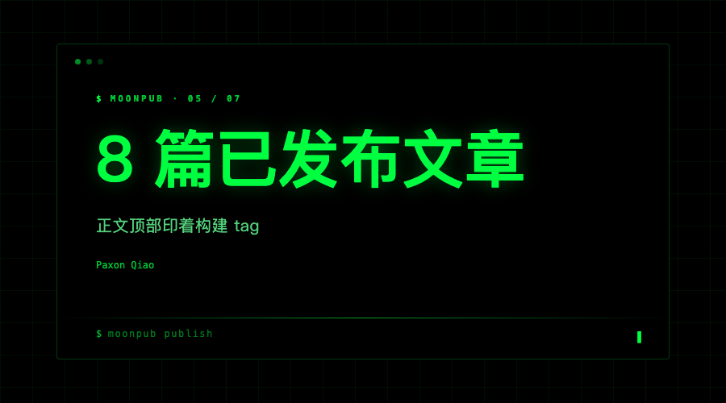
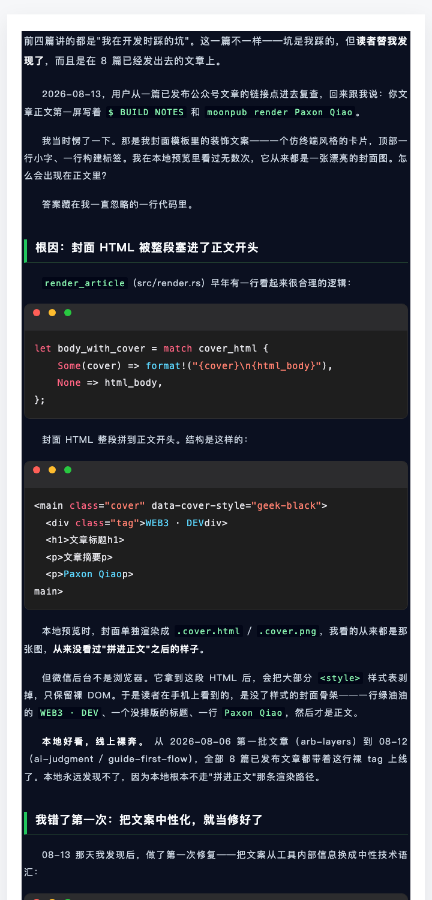

> **项目**：MoonPub —— 用 Rust 写的公众号发布副驾驶
> **仓库**：github.com/qiaopengjun5162/moonpub
> **本篇**：第 5 篇 · 一个我漏了 19 天、读者替我发现的 bug

## 前言

前四篇都是「我在开发时踩的坑」。这一篇不一样——坑是我踩的，但**是读者替我发现的**，而且是在 8 篇已经发出去的文章上。

读完这篇你能拿走一条和语言无关的经验：**只在某一条渲染路径上出现的 bug，本地所有检查都看不见它**。它会安静地活到你发布之后，再由用户帮你发现。

## 背景

2026 年 8 月初，MoonPub 已经有了封面系统，`geek-black` 是默认发布主题。从 08-06（arb-layers）到 08-12（ai-judgment / guide-first-flow），一共 8 篇文章发到了公众号后台（影响面记录见 `docs/ENGINEERING_LESSONS_ZH.md:225`）。

当时我以为封面只是「一张本地预览图」——设计封面时看 `.cover.html` / `.cover.png`，发文章时微信用 `thumb_media_id` 单独挂封面。封面怎么会进正文呢？我没往那方面想过。

## 摘要

| 项 | 内容 |
| --- | --- |
| 问题 | 封面 HTML 被整段拼进正文开头 |
| 现象 | 已发布文章正文第一屏露出 `WEB3 · DEV` / `Paxon Qiao` 等裸文字 |
| 根因 | `ship` 把封面 HTML 拼到正文前；微信剥样式表只留裸 DOM；只有 ship 走这条路径，本地 render 永远干净 |
| 修法 | 08-13 文案中性化（治标）→ 08-25 彻底不拼封面（治本）+ 回归测试 |
| 结论 | 装饰性内容也是产品；本地渲染器和线上不是同一个 |

## 实操

### 步骤 1：定位「谁把封面塞进了正文」

先看 `render_article` 的所有调用点，确认第 6 个参数（`cover_html`）是 `Some` 还是 `None`（实测，2026-10-30）：

**输入**

```bash
grep -rn "render_article(" src --include=*.rs | grep -v "fn render_article"
```

**输出**

```text
src/ship.rs:208          render_article( …, cover_html.as_deref(), …)   # Some
src/push.rs:182          render_article( …, None, …)                    # None
src/push_browser.rs:101   render_article( …, None, …)                    # None
src/render.rs:487         render_article( …, None, …)                   # 测试
```

只有 `ship` 传了 `Some`——这正是事故来源。`render` 和 `push` 都传 `None`，所以**本地怎么渲染都复现不了**。

### 步骤 2：看修复前的拼接代码

**输入**

```bash
git show 3d67d91^:src/render.rs | sed -n '51,54p'
```

**输出**

```rust
let body_with_cover = match cover_html {
    Some(cover) => format!("{cover}\n{html_body}"),
    None => html_body,
};
```

封面 HTML 整段拼到正文开头——结构是一个 `<main class="cover" data-cover-style="geek-black">` 卡片，里面是标题、摘要、作者和那行装饰 tag。

### 步骤 3：看修复后的代码

**输入**

```bash
sed -n '52,60p' src/render.rs
```

**输出**

```rust
// 2026-08-25: 封面 HTML 不再嵌入正文。
// 此前 `cover_html` 会整段拼到正文开头 …… 微信编辑器会剥离
// 封面样式表，只留下裸 DOM …… 封面作为 thumb_media_id 图片已单独设置，
// 正文不需要再嵌一份封面模板。
let _ = cover_html;
let body_with_cover = html_body;
```

封面不再拼进正文。参数保留仅为兼容调用方。

### 步骤 4：跑回归测试

**输入**

```bash
cargo nextest run --lib cover_html_not_embedded_into_body
```

**输出**

```text
PASS [0.023s] moonpub render::tests::cover_html_not_embedded_into_body
```

这条测试故意塞一份带 `WEB3 · DEV` 的封面 HTML，然后断言本地 `.html` 和微信 `draft.json` **都不含** `data-cover-style`、也**都不含** `WEB3 · DEV`（见 `src/render.rs:365`）。以后谁再把 `cover_html` 拼回去，CI 立刻红。

### 步骤 5：为什么本地查不出

用同一篇文章、分别用修复前版本（v0.4.4）和当前版本（v0.4.8）跑 `render`，解析 `draft.json` 的 `content` 开头（实测，2026-10-30）：

```text
旧版 v0.4.4  content 开头: <section style="font-family: …"> …（正文）
            含 <main class="cover": False
新版 v0.4.8  content 开头: <section style="font-family: …"> …（正文）
            含 <main class="cover": False
```

两个版本跑同一个命令，结果一样干净。这恰好证明：**问题不在 render 路径上**——本地 render 永远走 `None` 分支，本地预览怎么看都是一张漂亮的封面图。要触发泄漏，必须走 `ship` 传 `Some` 的那条路。

## 截图



图 1 · 第 05 篇封面（`geek-black` 终端风）。主标题「8 篇已发布文章」、副标题「正文顶部印着构建 tag」。它证明：封面图本身可以是体面的——08-13 那次「文案中性化」让这张图更干净，所以那次不是白做，只是它从来不是真正的修复。



图 2 · 修复后 `render` 产物的正文第一屏。第一眼看到的是引言段，没有任何封面卡片 / `WEB3` / `Paxon Qiao` 的裸 DOM；`WEB3 · DEV` 等字样只在代码块里作为示例文本出现。这张图即「治本之后」的状态。（「治本之前」的线上截图缺本机存档，需要一台手机打开 D17–D19 中任一篇的已发布链接补证。）

## 解释说明

为什么微信会把封面露成裸文字？因为微信公众号编辑器会**剥离大部分 `<style>` 样式表，只保留裸 DOM**。本地预览看的是带样式的 `.cover.html`，而线上拿到的是被剥了 CSS 的同一段 HTML——于是读者在手机上看到一行绿油油的 `WEB3 · DEV`、一个没排版的标题、一行 `Paxon Qiao`，然后才是正文。

**本地好看，线上裸奔。** 更隐蔽的是：这条拼接只发生在 `ship` 路径上，`render` / `push` 都不传封面 HTML。所以：

- 我本地设计封面，看的是 `.cover.html`；
- 我本地 `render` 检查排版，看的是 `None` 分支的产物；
- 两者都干净，于是这个 bug 从 08-06 到 08-25 活了 19 天，直到用户从线上链接复查才暴露。

写这篇时还顺手撞到一个同源问题：`moonpub layout-audit` 原本用裸子串 `" class="` 扫描 HTML，会把正文里转义过的代码示例（`&lt;main class=&quot;cover&quot;`）误判成真属性，导致文章自己过不了自己的发布门。已改为只匹配带引号的真实属性写法（`src/layout_audit.rs`），并补了 `layout_audit_ignores_escaped_code_samples` 测试。**连我自己的检查工具都会被正文里的示例代码骗过去——这恰恰说明了「只看字面量」有多不可靠。**

## 验证

三种证据齐了：

1. **命令可复算**：步骤 4 的 `cargo nextest run` 任何人可重跑；步骤 5 的新旧 `render` 对比任何人可做。
2. **代码锚点**：`src/render.rs:51-54`（旧拼接）、`src/render.rs:52-60`（新逻辑）、`src/render.rs:365`（回归测试）、`src/ship.rs:208`（唯一传 `Some` 的调用点）。
3. **提交锚点**：`git show 3d67d91`（08-25 治本）、`git show 58be536`（08-13 治标）、`git show 4c9d8dc`（同日 15:09 的封面风格静默 fallback 修复，D19 事故）。

⚠️ 不要拿 `grep` 判断产物里有没有封面残留。正文里只要提到过那段代码，`grep -c data-cover-style` 就会命中（本文正文就提到了好几次）。要看正文结构，解析 `draft.json` 的 `content` 字段开头，像步骤 5 那样。

## 总结

三条可迁移到任何项目：

1. **本地渲染器和线上不是同一个。** 只在某条路径上出现的 bug，本地所有检查都看不见——它安静地活到发布后，由用户帮你发现。
2. **装饰性细节也是产品。** 封面、页眉、loading 动画最终都会进用户眼睛，不能当「内部实现」对待。
3. **治标和治本的区别在于：下次还漏不漏。** 08-13 改文案，换个字明天还露；08-25 不拼接，一次性解决。

## 参考

- 提交：`3d67d91`（2026-08-25 fix(render): 封面HTML不再嵌入微信正文）、`58be536`（2026-08-13 fix(cover): 文案中性化）、`4c9d8dc`（2026-08-25 feat(ship): 封面风格校验防静默 fallback）
- 代码：`src/render.rs:51-54`（旧拼接）、`src/render.rs:52-60`（新逻辑）、`src/render.rs:365`（回归测试 `cover_html_not_embedded_into_body`）、`src/ship.rs:208`（唯一传 `Some(cover_html)` 的调用点）、`src/layout_audit.rs`（带引号属性匹配修复）
- 文档：`docs/ENGINEERING_LESSONS_ZH.md:225`（封面装饰文案不能泄漏工具内部构建信息）、`docs/ENGINEERING_LESSONS_ZH.md:233`（防复发三条）
