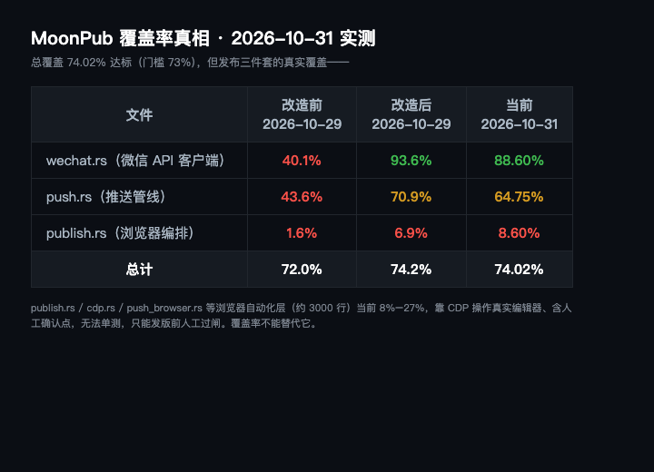

> **项目**：MoonPub —— 用 Rust 写的公众号发布副驾驶
> **仓库**：github.com/qiaopengjun5162/moonpub
> **本篇**：第 6 篇 · 覆盖率 72% 是假的，核心链路只有 1.6%

## 前言

有人晚上问我一句话：「测试覆盖率如何了，要验证的，不要写了很多没有验证大家都没有办法使用。」

我当时心里是有底的——项目一直在跑 `cargo nextest`，几百个测试全绿，`lcov.info` 也在仓库里躺着。覆盖率嘛，两位数，看着还行。

直到我真的把 `cargo llvm-cov` 跑起来，**逐文件**看那份报告。这篇文章讲的就是：那个让我安心的两位数，是怎么骗了我的。读完你能拿走一条可迁移的结论——**覆盖率是平均值，平均值会骗人；真正要问的是「用户最依赖的那条路，覆盖率是多少」**。

## 背景

时间回到 2026-10-29 晚上。MoonPub 当时已经能跑通「渲染 → 传图 → 建草稿 → 归档」的完整发布链路，本地 `cargo nextest` 几百个测试全绿，仓库里也确实躺着覆盖率报告。

但「全绿」和「覆盖率高」是两件事。我当时从没逐文件看过每一份报告——直到那句追问逼我把总数字拆开。拆开之后才发现问题：这个项目最核心的事（把文章推到公众号），它的主链路覆盖率是 40%、43%、1.6%。

## 摘要

| 项 | 内容 |
| --- | --- |
| 问题 | 总覆盖 72% 看着及格，核心链路却在裸奔 |
| 现象 | `wechat.rs` 40.1% / `push.rs` 43.6% / `publish.rs` 1.6%（2026-10-29 改造前实测） |
| 根因 | 微信域名硬编码在方法里，无注入点，测真实请求就得打线上后台 |
| 修法 | `c1c1286` 加 `with_base_url` + `WECHAT_API_BASE` + `mock_wechat.rs`，把出口变成数据 |
| 结论 | 改后核心链路才真正被测到，总覆盖 74.2%；平均值骗人，要看核心链路 |

## 实操

### 步骤 1：把总覆盖拆成逐文件，看一眼真相

为什么做这一步：总数字会掩盖结构。只有逐文件看，才知道「及格」是不是被平均出来的。

**输入**

```bash
./scripts/coverage.sh            # 跑测试 + 逐文件报告 + 卡 73% 门槛
```

**输出**（2026-10-29 改造前实测，逐文件行覆盖节选）

```text
wechat.rs        ...   40.1%     # 微信 API 客户端：取 token / 建草稿 / 传图
push.rs          ...   43.6%     # 推送管线：渲染→传图→建草稿→归档
publish.rs       ...    1.6%     # 浏览器步骤编排
publish_steps.rs ...   12.0%     # 编辑器内单步操作
cdp.rs           ...   24.1%     # CDP 原语
TOTAL            ...   72.0%     # 两位数，看着及格
```

**总量 72.0%，但发布三件套的真实覆盖是 40% / 43% / 1.6%。** 72% 是怎么来的？被大量解析函数、格式化函数、纯字符串处理平均出来的——那些代码确实被测了，测得很漂亮，但它们不是用户真正依赖的那条路。

### 步骤 2：查 `wechat.rs` 那 15 个测试到底测了什么

为什么做这一步：覆盖率高不等于验证过。要看「测试碰没碰真实代码」。

当时（2026-10-29）`wechat.rs` 有 **15 个测试**，`grep` 一下它们调用的函数就能发现——**没有一个调用过 `create_draft` 或 `upload_image`**。它们全在解析 JSON 字符串：喂一段假响应，断言解析结果对不对。

```text
15 个测试里 create_draft / upload_image 的真实调用次数 = 0
它们只测了 parse_response 那几行：喂假 JSON，断言字段解析对不对
```

这叫测试吗？从行数上看，它确实执行了 `parse_response`。但它从来没碰过「发一个 HTTP 请求到微信」这件事。**测试写了很多，被测代码一行没跑。**

### 步骤 3：根因——出口是写死的

为什么做这一步：要修，先得说清为什么测不到。

`WechatClient` 把域名硬编码在每一个方法里，你要测 `create_draft`，它就必须真的往 `api.weixin.qq.com` 发请求。CI 里没有凭据、没有网络、更不该打真实微信后台。于是唯一「能跑」的测试方式，就是绕开这个方法，去测它内部调用的纯函数。

**问题的本质不是「测试写得少」，是「代码没有给测试留出口」。**

修复 `c1c1286`（2026-10-29 22:14）做了一件事：把「往哪发」从常量变成字段。

**输入**

```bash
git show c1c1286 --stat
sed -n '32,53p' src/wechat.rs      # new / with_base_url
sed -n '381,412p' src/wechat.rs    # default_base_url + is_loopback_url 旁路
```

**输出**（当前仓库里的真实代码，`src/wechat.rs`）

```rust
pub fn new(appid: impl Into<String>, secret: impl Into<String>) -> Self {
    Self::with_base_url(appid, secret, default_base_url())
}

pub fn with_base_url(
    appid: impl Into<String>,
    secret: impl Into<String>,
    base_url: impl Into<String>,
) -> Self {
    Self { appid: appid.into(), secret: secret.into(), base_url: base_url.into() }
}

fn default_base_url() -> String {
    std::env::var("WECHAT_API_BASE")   // 测试/staging 指向 mock，不动生产默认值
        .ok().map(|v| v.trim().to_owned()).filter(|v| !v.is_empty())
        .unwrap_or_else(|| DEFAULT_BASE_URL.to_owned())
}
```

三行代码的改变，带来两个能力：① 测试可以指向本地 mock：`WechatClient::with_base_url("app","secret", mock.base_url())`；② staging 可以指向回放代理，不用改一行生产默认值。

配套新增 `src/mock_wechat.rs`——一个基于 `std::net::TcpListener` 的假微信服务，零外部依赖，按顺序应答，并且**记录收到的每一个请求**。这样测试断言的不是「函数返回了什么」，而是「真正发出去的 path 和 body 长什么样」。

```rust
let mock = MockWechat::start([r#"{"errcode":0,"media_id":"MEDIA_1"}"#]);
let client = WechatClient::with_base_url("app", "secret", mock.base_url());
let id = client.create_draft("TOKEN", &draft)?;
assert_eq!(id, "MEDIA_1");
let req = &mock.wait_for(1)[0];
assert_eq!(req.path(), "/cgi-bin/draft/add");   // 真发出去了，路径对
assert!(req.body_text().contains("测试标题"));    // body 里有该有的东西
```

改造过程中还顺手撞上一个之前没暴露的 bug：`HTTPS_PROXY` 会把本地 mock 的 `127.0.0.1` 请求也塞进代理，直接 502。修复很短（`src/wechat.rs:410` 的 `is_loopback_url` 旁路）——这个 bug 之前一直存在，只是没人测过本地 mock，所以从没暴露。**可测性改造本身，就是一次代码体检。**

### 步骤 4：改完复测，以及「现在」的值

**输入**

```bash
./scripts/coverage.sh            # 复测
```

**输出**（2026-10-29 改造后实测）

```text
wechat.rs  40.1% → 93.6%
push.rs    43.6% → 70.9%
publish.rs  1.6% →  6.9%
TOTAL      72.0% → 74.2%     # 跨过 73% 门槛
```

截至 **2026-10-31** 我重新实测（代码继续演进，新增了 `ship.rs` 等推送管线拆分），当前值是：

```text
wechat.rs  88.60%   push.rs  64.75%   publish.rs  8.60%   TOTAL  74.02%
```

数字漂了，但门禁仍稳稳过 73%——这正是这套改造的意义：它把「可测」变成了准入条件，而不是事后补救。

## 截图



这张表证明了标题说的那句话：总覆盖 74.02% 达标（门槛 73%），但发布三件套 `wechat/push/publish` 在改造前只有 40.1% / 43.6% / 1.6%——「72% 及格」是被大量纯函数平均出来的假象。绿色是改造后（含当前）的真实覆盖，红色是改造前的裸奔状态。

## 解释说明

**覆盖率是平均值，平均值会骗人。** 一个项目里一定有大量「容易测」的纯函数（解析、格式化、字符串处理），它们覆盖率天然高；也一定有少量「难测」的核心链路（打外部 API、操作真实 UI）。加权平均之后，难测的那条路被稀释得看不见。

**「测不到」本质是「代码没留出口」。** 一个把外部地址写死在方法体里的客户端，天然不可单测——你写一百个测试也碰不到它。可测性不是测试的事，是设计的事。把「往哪发」变成数据（`with_base_url`），测试才有支点。

**mock 要记录「真实发出去的请求」，而不是只测返回值。** `mock_wechat.rs` 的关键不是「返回假 JSON」，是「断言 path 和 body 真实长什么样」。前者只证明函数内部对，后者才证明「请求真的打对了地方」。

**有些代码本来就不该假装覆盖。** `publish.rs` / `cdp.rs` / `push_browser.rs` 约 3000 行浏览器自动化，靠 CDP 操作真实微信编辑器，代码里就有人机确认点（`wait_enter()` / `ask_ok(...)`），不可能在 CI 跑。硬写单测只会得到一堆「调用了 mock 过的空函数」的假测试，数字好看，问题一个不少。这部分（当前 8%–27%）只能发版前人工过闸，**覆盖率不能替代它**。

## 验证

三种证据齐全：

1. **命令可复算**：`env -u WECHAT_APPID -u WECHAT_SECRET cargo nextest run` 或 `./scripts/coverage.sh`，读者照抄就能得到同样的逐文件数字（截至 2026-10-31：总 74.02%）。
2. **代码锚点**：`src/wechat.rs:34`（`new`）、`:39`（`with_base_url`）、`:383`（`default_base_url`）、`:410`（`is_loopback_url` 旁路）、`src/mock_wechat.rs`（假微信服务，当前 90.37% 覆盖）。
3. **提交锚点**：`git show c1c1286` 能看到 `with_base_url` + `mock_wechat.rs` 的改动；`docs/TEST_COVERAGE_ZH.md` 把「浏览器层 7%–27% 只能人工过闸」写成了硬规则。

## 总结

1. **看覆盖率先看核心链路，别看总数。** 用户最依赖的那条路（本项目是发布三件套）覆盖率多少，比总数字重要十倍。
2. **「测不到」通常是设计债，不是测试懒。** 把外部依赖变成可注入的数据，测试才有支点。
3. **覆盖率不能替代人工过闸。** 含人机确认点的浏览器自动化，硬刷覆盖率是自欺；发版前人看着跑一遍才是真验证。

## 参考

- 提交：`c1c1286` test(coverage): verify the publish path against a mock WeChat API
- 代码：`src/wechat.rs:34` / `:39` / `:383` / `:410`、`src/mock_wechat.rs`
- 文档：`docs/TEST_COVERAGE_ZH.md`（覆盖率边界与 73% 门槛规则）
- 工具：`./scripts/coverage.sh`（`--report` 复用上次结果，`--html` 出 HTML 报告）
