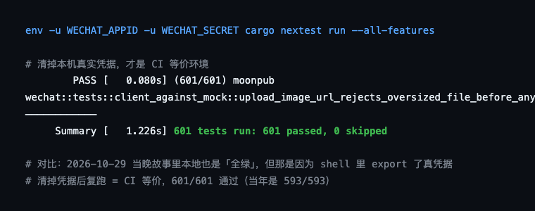

> **项目**：MoonPub —— 用 Rust 写的公众号发布副驾驶
> **仓库**：github.com/qiaopengjun5162/moonpub
> **本篇**：第 7 篇 · 本地全绿，CI 全红

## 前言

上一篇讲了怎么把发布链路的可测性救回来——本地 `cargo nextest` **593 个测试全绿**，覆盖率 74.2%。我以为这事成了。

推上去，CI 直接双红。这篇文章讲的就是这次打脸：两个回归都是我自己刚引入的，而「本地为什么没红」这个问题的答案，比改代码本身更值得记。读完你能拿走一条铁律——**自己机器上的绿灯，不算证据**。

## 背景

时间：2026-10-29 晚上 22 点多。我刚合完上一篇那套覆盖率改造（`c1c1286`），本地测试全绿，覆盖率 74.2%，心情不错。

为了让推送管线可以打 mock 测试，我把 `push_wechat_draft` 拆成了两半——外壳负责读凭据、建 client，内层 `push_wechat_draft_with_client` 负责真正的网络流程。拆的时候我只想着「把网络半边变成可注入的」，没注意**顺序被改变了**。这个改动，就是后面一切的起点。

## 摘要

| 项 | 内容 |
| --- | --- |
| 问题 | 本地 593 测试全绿，推上去 CI 双红（test + coverage 两个 job） |
| 现象 | 两个测试先后挂：`push_json_fails_with_no_draft_before_network`、`push_auto_render_creates_draft_json` |
| 根因 | 拆函数时把「读凭据」提前到「校验/渲染」之前；更深处是本机 `export` 了真实凭据，断言被环境偷偷满足 |
| 修法 | `e5ef3a4` 把 draft.json 校验挪回凭据前；`191d2f7` 把「校验+渲染」整体前移 |
| 结论 | 清掉凭据跑测试才是 CI 等价；本地绿灯只是「本机能跑」的假设 |

## 实操

### 步骤 1：本地全绿，推上去 CI 红

为什么做这一步：先确认现象不是幻觉。CI run `40892503877` 当晚实测，`test` 和 `coverage` 两个 job 一起挂。

**输出**（CI 第一次报错）

```text
failures:
    push::tests::push_json_fails_with_no_draft_before_network
expected NoDraftJson, got MissingEnvVar("WECHAT_APPID")
```

我盯着这行看了半天。本地明明全绿，怎么一上 CI 就变了？更奇怪的是——这个测试在我改之前是过的，我也没动它的断言。

### 步骤 2：第一次修——把校验提前（`e5ef3a4`，22:32）

为什么做这一步：病根是我自己刚下的手。拆函数时顺序变了：原来先检查 `draft.json` 在不在、再读凭据；拆完之后，client 先被构造、凭据先被读。于是没有 `draft.json` 时，错误类型从 `NoDraftJson` 变成了 `MissingEnvVar`。

**输入**

```bash
git show e5ef3a4 --stat
```

**输出**（修复逻辑：把 `draft.json` 存在性校验挪回凭据之前）

```rust
let draft_json = dir.join(format!("{slug}.draft.json"));
if !draft_json.exists() && !auto_render {
    return Err(AppError::NoDraftJson(draft_json));
}
```

跑测试，本地全绿。推送。我以为完了。

### 步骤 3：第二次修——渲染也得提前（`191d2f7`，22:37）

**五分钟后**，CI 又红了。这次挂的是另一个测试：

```text
failures:
    push::tests::push_auto_render_creates_draft_json
assertion failed: draft.json should be created by auto-render
```

我才意识到第一次修只修了一半。看那行条件：`if !draft_json.exists() && !auto_render`。当 `auto_render = true` 时，这个分支直接跳过——校验放行了，但**渲染动作还留在内层函数里**，而内层函数是在 client 构造之后才被调用的。

链条是这样的：

```text
外壳：读凭据 → 建 client  ← 这里就炸了（没凭据建不出 client）
内层：缺 draft.json → 渲染 → 上传 → 建草稿
```

没有凭据，client 根本建不出来，`push --render` 连「渲染」这一步都走不到——它承诺的「没有 draft.json 就自动渲染」失效了。

**输入**

```bash
git show 191d2f7 --stat
sed -n '109,128p' src/push.rs     # 当前「校验+渲染」前移的完整逻辑
```

**输出**（最终态，当前 `src/push.rs`）

```rust
// Materialise draft.json before touching credentials or the network.
// Ordering matters twice over: a missing draft must fail as NoDraftJson
// rather than as a missing appid, and `push --render` must still write the
// draft on machines that have no credentials configured.
let draft_json = dir.join(format!("{slug}.draft.json"));
if !draft_json.exists() {
    if !auto_render {
        return Err(AppError::NoDraftJson(draft_json));
    }
    render_draft(articles_dir, &article, cfg)?;   // 先渲染，再碰凭据
}
```

同时把内层那个已经没用的 `auto_render` 参数删了——职责清了：外壳负责「把草稿准备好」，内层只管「把草稿发出去」。这次推送，CI 绿了。

### 步骤 4：真正的根因——清掉凭据，才是 CI 等价

为什么做这一步：两次修复都只治了「顺序」，但有个更根本的问题我一直没问——**为什么本地会全绿？** 如果是顺序错了，本地应该也挂才对。

答案在我自己的 shell profile 里：这台机器 `export` 了真实的 `WECHAT_APPID` / `WECHAT_SECRET`。那个测试走的是「先读凭据 → 凭据存在，顺利通过 → 再渲染 → 渲染成功 → 断言 draft.json 存在 → 通过」。**断言的是结果，而结果被本机环境变量偷偷满足了。** CI 上没有这两个变量，同一段代码直接返回 `MissingEnvVar`，渲染根本没执行，断言自然失败。

修复之后我没有直接信「本地绿了」，而是先清掉凭据再跑：

**输入**

```bash
env -u WECHAT_APPID -u WECHAT_SECRET cargo nextest run --all-features
```

**输出**（2026-10-31 我重新实测；当年当晚是 593/593、74.19%）

```text
     Summary [   1.226s] 601 tests run: 601 passed, 0 skipped
```

和 CI 完全一致。从那以后这条命令成了本项目的固定动作。

## 截图



这张终端图证明了标题的潜台词：不是「本地通过了就行」，而是「清掉本机真实凭据后复跑，601/601 通过」才等于 CI 环境。当年那次「全绿」之所以骗了我，正是因为本机 `export` 了真凭据，把断言悄悄喂饱了。

## 解释说明

**「测试通过」和「逻辑正确」是两件事。** 本地全绿，可能是因为环境凑巧满足了断言的前置条件，而不是代码真的对。当你的机器和 CI 的唯一差别是一个环境变量时，那个变量就是你最大的盲区。

**拆函数时，顺序也是接口。** 我把「读凭据」从「校验/渲染」之后挪到之前，看似只是重排，却改变了「没有 draft.json」这种边界情况下的错误类型。任何涉及「先 A 后 B」的代码，改顺序前要先问：B 的前置是不是被 A 挡住了？

**可测性的副作用是暴露环境债。** 这次 CI 全红，反而逼我发现了「本机一直 export 真凭据」这个隐患。之前所有依赖「凭据存在」的测试，在本地其实都没在「无凭据」这个真实前提下验证过。

`ENGINEERING_LESSONS_ZH.md` 把这件事记成了第 264 条「本地有真实凭据，测出来的是『本机能跑』，不是『CI 能跑』」，并定下三条防复发规则：

1. **本地验证必须清掉凭据跑一次**：`env -u WECHAT_APPID -u WECHAT_SECRET cargo nextest run`，这才是 CI 等价环境。
2. **任何依赖环境变量存在与否的分支，测试里要用 `env -u` 或显式注入来固定前提**，不要依赖「本机正好有」。
3. **结论以 CI 为准**，本地绿只说明「本机能跑」。

第一条是操作，第二条是设计，第三条是心态。第三条最难——它要求你承认：**自己机器上的绿灯，不算证据。**

## 验证

三种证据齐全：

1. **命令可复算**：`env -u WECHAT_APPID -u WECHAT_SECRET cargo nextest run --all-features`，读者照抄得到同样的 `601 tests run: 601 passed`（截至 2026-10-31）。
2. **代码锚点**：`src/push.rs:109` 起是「校验 + 渲染前移」的最终逻辑；两个回归测试名仍在仓库：`push_json_fails_with_no_draft_before_network`（`src/push.rs:564`）、`push_auto_render_creates_draft_json`（`src/push.rs:588`）。
3. **提交锚点**：`git show e5ef3a4`（22:32 校验前移）、`git show 191d2f7`（22:37 渲染前移）；CI 现场 run `40892503877`（`test` / `coverage` 双红，panic 在 `src/push.rs:597`）。

## 总结

1. **本地绿灯是一个待验证的假设，不是结论。** 当机器与 CI 的唯一差别是一个环境变量时，那个变量就是最大盲区。
2. **改函数顺序前，先盘清「前置条件」的流向。** 把「读凭据」提前，会挡住后面所有依赖「无凭据」的边界分支。
3. **把「清掉凭据跑一次」写进肌肉记忆。** 任何依赖环境变量存在与否的测试，本地默认环境都可能悄悄满足它。

## 参考

- 提交：`e5ef3a4` fix(push): check for draft.json before reading credentials
- 提交：`191d2f7` fix(push): render the draft before reading credentials
- 代码：`src/push.rs:109`（校验+渲染前移）、`:564`、`:588`（两个回归测试）
- 文档：`docs/ENGINEERING_LESSONS_ZH.md` 第 264 条、`AGENTS.md`（本地验证固定动作）
- CI：run `40892503877`（test / coverage 双红现场）
