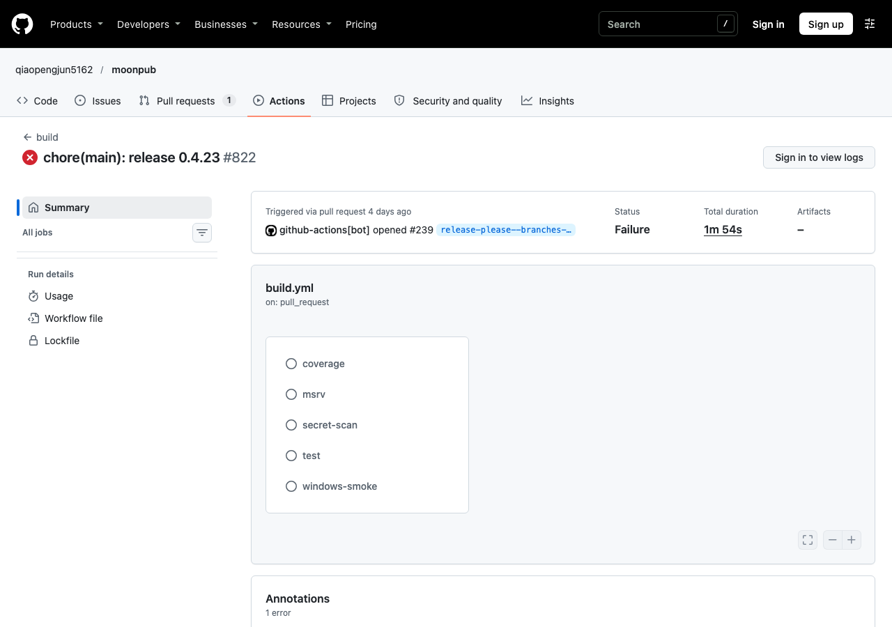
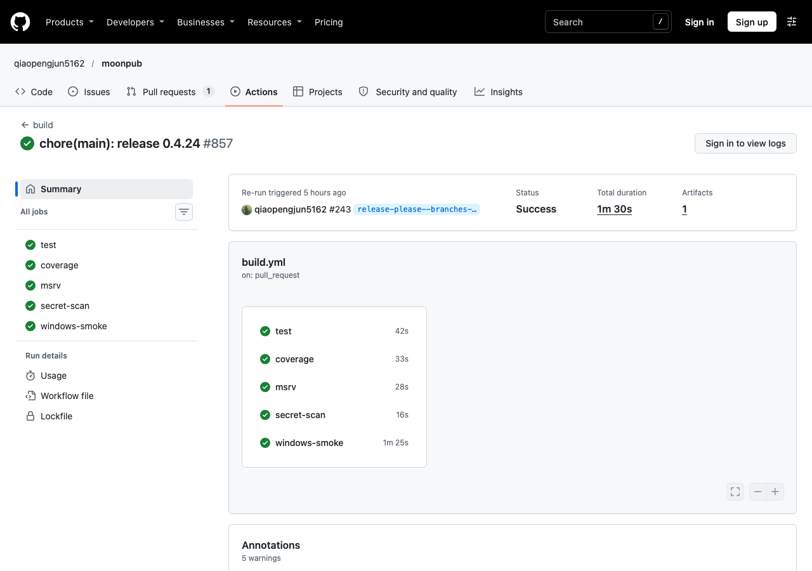

> **项目**：MoonPub —— 用 Rust 写的公众号发布副驾驶
> **仓库**：github.com/qiaopengjun5162/moonpub
> **本篇**：第 8 篇 · 九次发版，零个 job

## 前言

2026-11-23 中午，v0.4.24 发完，我顺手回查了一件事：过去每一次发版，CI 到底跑没跑。这个问题在我脑子里是有答案的——"一直跑，而且一直是绿的"。所以这次回查本来只是补个证据。

结果反过来：十个已合并的发版 PR，**前九个的构建任务一个 job 都没跑过**。

这篇讲两件事。一是"没红"和"通过"能长得一模一样，因为中间那条判断链上没有任何一环真的看过 CI；二是我在这条路上把工具的退出码读错了一次，还把错的结论写进了文档。读完你能拿走一个判据（数 job，不看颜色）和一条规矩（读退出码要在没有管道的语句上读）。

## 背景

MoonPub 是纯 Rust 的公众号发布 CLI，截至 2026-11-23 有 642 次提交。发版交给 release-please：它按 conventional commit 算版本号，开一个标题是 `chore(main): release X.Y.Z` 的 PR，合并后建 tag 和 draft release，再由 `release.yml` 出五个平台的资产。

这里有个只有踩过的人才知道的细节：release-please 用 `GITHUB_TOKEN` 开 PR，而 GitHub 对**由 bot 开的 PR** 的 workflow run 要人工批准才启动。这条规则的初衷很正当——PR 里的 workflow 可以执行任意代码，未审就让它跑，等于给陌生人一个偷 secrets 的入口。代价是：**你的自动发版 PR，天生就是"没有跑过 CI"的状态**。

上一篇（第 7 篇）写的是"跑了但失败"：本地 593 个测试全绿，CI 双红。这一篇是另一半，也是更隐蔽的一半：**根本没跑**。

## 摘要

| 项 | 内容 |
| --- | --- |
| 问题 | 十个发版 PR 里，CI 到底有几个真的执行过 |
| 现象 | `gh pr checks` 只给一句 `no checks reported`；`gh run view` 说 `likely failed because of a workflow file issue` |
| 根因 | bot 开的 PR 的 run 在人工批准前不启动（`jobs=0`），而绿「Merge」按钮和 `gh pr merge` 都不校验检查 |
| 修法 | `scripts/release-pr-check.sh`：校验纯版本 diff、按 head SHA 找被扣住的 run、空列表判 exit 3 |
| 结论 | 「没红」不是证据，「这个 run 跑过几个 job」才是 |

## 实操

### 步骤 1：一条命令，一行输出，一个我读错的数字

先看 `gh pr checks` 对一个发版 PR 说什么。

**输入**

```bash
gh pr checks 239; echo "exit=$?"
```

**输出**

```text
no checks reported on the 'release-please--branches--main--components--moonpub' branch
exit=1
```

这里必须交代我第一次是怎么读的。我当时写的是：

```bash
gh pr checks 238 2>&1 | tail -5; echo "exit=$?"
```

打印出来是 `exit=0`。管道里 `$?` 拿到的是 **`tail` 的退出码**，`gh` 返回的 1 被 `tail` 的 0 覆盖掉了。我把这个 0 当成"工具说没问题"，顺手写进了 `docs/RELEASE_CHECKLIST.md` 和教训库——直到今天为了写这篇文章重测，才发现自己在两个地方读错了同一个东西。

### 步骤 2：不数结论，数 job

`gh pr checks` 看不见东西，就往下走一层：直接问 GitHub 这次 run 有几个 job。

**输入**

```bash
gh pr list --state merged --limit 60 \
  --json number,title,headRefOid \
  --jq '.[] | select(.title|startswith("chore(main): release")) | "\(.number)\t\(.title)\t\(.headRefOid)"' \
| sort -n | while IFS=$'\t' read -r num title sha; do
    rid=$(gh run list --commit "$sha" --limit 40 \
      --json databaseId,workflowName \
      --jq '[.[]|select(.workflowName=="build")][0].databaseId // empty')
    jobs=$(gh api "repos/qiaopengjun5162/moonpub/actions/runs/$rid/jobs" --jq '.total_count')
    conc=$(gh api "repos/qiaopengjun5162/moonpub/actions/runs/$rid" --jq .conclusion)
    echo "#$num $title -> run $rid conclusion=$conc jobs=$jobs"
  done
```

**输出**

```text
#198 chore(main): release 0.4.15 -> run 44235951774 conclusion=failure jobs=0
#201 chore(main): release 0.4.16 -> run 44448954683 conclusion=failure jobs=0
#222 chore(main): release 0.4.17 -> run 44455667555 conclusion=failure jobs=0
#224 chore(main): release 0.4.18 -> run 44471618468 conclusion=failure jobs=0
#229 chore(main): release 0.4.19 -> run 44480091322 conclusion=failure jobs=0
#233 chore(main): release 0.4.20 -> run 44491669185 conclusion=failure jobs=0
#235 chore(main): release 0.4.21 -> run 44515499037 conclusion=failure jobs=0
#237 chore(main): release 0.4.22 -> run 44527055412 conclusion=failure jobs=0
#239 chore(main): release 0.4.23 -> run 44551374756 conclusion=failure jobs=0
#243 chore(main): release 0.4.24 -> run 45099669061 conclusion=success jobs=5
```

九个 `jobs=0`，一个 `jobs=5`。`jobs` 这一栏是这次排查里唯一没有歧义的数：run 记录存在、`conclusion` 可以叫 failure 也可以叫 action_required、页面颜色可以红也可以灰，但 **job 数是 0 就说明没有任何一步真正执行过**。

### 步骤 3：点开那个 0 job 的 run

**输入**

```bash
gh run view 44551374756
```

**输出**

```text
X release-please--branches--main--components--moonpub build qiaopengjun5162/moonpub#822 · 44551374756
Triggered via pull_request about 3 days ago

X This run likely failed because of a workflow file issue.
```

（`#822` 是 build 工作流的第 822 次运行序号，不是 PR 号。）

这句话里有个 `likely`。`gh` 只知道"失败了而且没有 job"，于是猜 `.github/workflows/build.yml` 写坏了。这个猜测是错的：同一个 `build.yml`，四天后在 v0.4.24 上跑出了五个绿 job（见下面截图 2）。**工具给出的解释也是一种输出，它同样需要被验证。**

### 步骤 4：那个 run 的真实状态是「等批准」

同一分支上还有另一种形态的 run。查其中一个：

**输入**

```bash
gh api repos/qiaopengjun5162/moonpub/actions/runs/45060362368 \
  --jq '{conclusion, created_at, head_sha: (.head_sha[0:8])}'
```

**输出**

```text
{"conclusion":"action_required","created_at":"2026-11-22T19:22:12Z","head_sha":"362a167c"}
```

`action_required` 就是"等你点批准"。同一个分支上，有的 run 被记成 `action_required`，有的被记成 `failure` 加 0 个 job——区别在于那个 PR 后来是被合掉了还是关掉了：等批准的状态被关掉之后，就落成了失败。

这一条我给 **C 级证据**：`action_required` 是 11-22 的实测，`failure + 0 job` 是 11-19 的实测，但"前者被关闭后变成后者"这条因果关系我没有当天的日志。写清楚这一点，比让它听起来更确定重要。

### 步骤 5：批准一次，五个 job 就起来了

**输入**

```bash
gh api -X POST repos/qiaopengjun5162/moonpub/actions/runs/45099669061/approve
gh pr checks 243
```

**输出**

```text
coverage  pass  33s
msrv  pass  28s
secret-scan  pass  16s
test  pass  42s
windows-smoke  pass  1m25s
```

五个全绿。其中 `test` job 里有一条测试叫 `doc_version_contract`，校验 `ROADMAP.md` 写的"当前源码版本"等于 `Cargo.toml` 的 `version`。它一直是绿的——不是因为当时没问题，而是**从来没有人让它跑过**。

### 步骤 6：把判据写成四个退出码

清单一句话，人记不住；脚本一个退出码，流水线能拦。`scripts/release-pr-check.sh` 做三件事：

```bash
# 只允许改版本元数据，出现 src/ 之类就 exit 2
ALLOWED_FILES=(
  .release-please-manifest.json
  CHANGELOG.md
  Cargo.toml
  Cargo.lock
  ROADMAP.md
)

# 按「这个提交」找 run，不是按分支名
done <<<"$(gh run list --commit "$head_sha" --limit 30 ...)"

# 空列表不是通过
if [ "$passed" -eq 0 ]; then
  echo "FAIL: 这个 PR 一个检查都没有——CI 从未跑过，不能当成通过。" >&2
  exit 3
fi
```

中间那句 `--commit` 是踩出来的。第一版我用 `gh run list --branch <head>`，对 v0.4.24 报出"13 个 run 被扣住"——因为**每个发版 PR 的头分支名都完全一样**（`release-please--branches--main--components--moonpub`），按分支名查等于把历史上所有发版的 run 一起捞了出来（v0.4.9 到 v0.4.23）。同名分支不等于同一次 PR，能落到 commit 就别停在 branch。

四条分支的实测退出码：

```text
run 被扣住、不批准  -> 3   （列出 run 号 + 可直接粘贴的批准命令）
diff 混进 src/      -> 2
一个检查 FAILURE    -> 1
--approve 后全绿    -> 0
```

### 步骤 7：然后发现自己昨天写在文档里的那句是错的

这篇文章本来不该有这一节。昨天合并的 PR（`ebbc50f`）在发版清单里写着「`gh pr checks` 在没检查时 exit 0」，并据此推出"`&&` 链会静默放行"。重测之后这个前提是错的：它返回 1，`&&` 链会断。

真实的风险在别处：**合并这条路根本不看 CI**。仓库没设 required checks，所以 GitHub 那个绿色的「Merge」按钮只表示"可以合并"，不表示"检查通过"；`gh pr merge` 也不校验。三道门全空着，"一个 job 都没跑"和"全部通过"在操作上没有区别。

所以今天补了一个 PR（`dff03ec`）去改自己的文档：脚本首段注释、发版清单第 3 步、教训库条目。错的知识比没有知识危险，因为它会被下一个人当依据。

## 截图



这张图证明：v0.4.23 的 build run 页面里，五个 job 名字都在，但全是**空心圆圈**——那是"从未启动"的样子。右上角 `Status: Failure`、`Total duration 1m 54s`，看起来像"跑了两分钟然后挂了"，实际上一个 job 都没执行过。这就是"红了"和"跑了"之间的全部差别。



这张图证明：同一个 `build.yml`、同样的五个 job，人工批准后 1 分 30 秒全绿。它同时否掉了上一步 `gh run view` 那句"likely failed because of a workflow file issue"——workflow 文件没问题，缺的是一次批准。

## 解释说明

**为什么 bot 的 PR 不会自动跑。** GitHub 对"由非仓库成员的 token 触发"的 workflow run 默认要求人工批准，而 release-please 用的 `GITHUB_TOKEN` 恰好属于这一类。规则本身是安全设计：`pull_request` 触发的 workflow 能读到仓库 secrets，如果允许未经审查的 PR 直接跑，任何人都可以提一个 PR 把 secrets 打出来。代价就是自动化的发版 PR 卡在门口。

**为什么"0 个 job"会被写成 Failure 而不是 Skipped。** 等批准的状态本身是 `action_required`；PR 被合并或关闭后，这个待办失去了意义，GitHub 把它落成失败。我没有找到官方对这种落法的描述，所以上面把它标成了 C 级证据——能确定的是 `jobs=0`，不确定的是它内部的状态迁移。

**为什么合并按钮不能当证据。** 分支保护里可以要求"必须通过指定检查才能合并"，这个仓库没开。于是按钮的绿色只代表"没有冲突、有权限"，和 CI 无关。任何"点了绿按钮所以没事"的判断，在没配 required checks 的仓库里都不成立。

**代价。** 这套做法每个发版多一次人工批准。想彻底自动化，可以给 release-please 换一个 PAT——bot 用 PAT 开的 PR 不会被扣住，`action_required` 和"publish 不点火"两个问题会一起消失。但那是把"bot 可以触发自己的 workflow"这个权限面打开，值不值要单独权衡，不是一个技术细节。

## 验证

三种证据至少给两种，这里给三种：

**一、命令可复算**

```bash
gh pr checks 239; echo "exit=$?"                       # 期望 exit=1
gh api repos/qiaopengjun5162/moonpub/actions/runs/44551374756/jobs --jq .total_count   # 期望 0
gh api repos/qiaopengjun5162/moonpub/actions/runs/45099669061/jobs --jq .total_count   # 期望 5
./scripts/release-pr-check.sh --pr 243                 # 期望 exit 0（5 检查全绿）
./scripts/release-pr-check.sh --pr 239                 # 期望 exit 3（一个检查都没有）
```

**二、代码锚点**

- `scripts/release-pr-check.sh:38` — `ALLOWED_FILES`
- `scripts/release-pr-check.sh:138` — `gh run list --commit "$head_sha"`
- `scripts/release-pr-check.sh:199` — 检查状态分档统计
- `scripts/release-pr-check.sh:221` — 空列表判 `exit 3`

**三、提交锚点**

- `ebbc50f` — 加入 `release-pr-check.sh`（含那个写错的 exit 0）
- `dff03ec` — 更正退出码与失败模式描述

## 总结

**一、"没有输出"和"通过"必须在代码里分开。** 聚合型工具（`gh pr checks`、`gh run list`）的空结果要单列一档，默认值必须是失败而不是通过。这里只差一行 `if [ "$passed" -eq 0 ]; then exit 3`。

**二、读退出码要在没有管道的语句上读。** `cmd | tail` 后面的 `$?` 是 `tail` 的。要留输出又要退出码，就 `out=$(cmd 2>&1); code=$?`。我为这一条错了一天，还把它写进了文档。

**三、判断"跑过没有"，数 job，不看颜色。** 红色可能来自"失败"，也可能来自"从未启动"；绿色只代表"上一次的结果"。`jobs=0` 是唯一不含歧义的判据，而它藏在一个没人会主动点开的地方。

## 参考

- 提交：`ebbc50f` 新增 `scripts/release-pr-check.sh`；`dff03ec` 更正退出码描述
- 代码：`scripts/release-pr-check.sh:38` / `:138` / `:199` / `:221`
- 文档：`docs/RELEASE_CHECKLIST.md`（发版清单第 3 步）、`docs/ENGINEERING_LESSONS_ZH.md`（本条教训）
- 截图：`writing/assets/2026-11-23-release-01-zero-jobs.png`、`2026-11-23-release-02-five-jobs.png`
