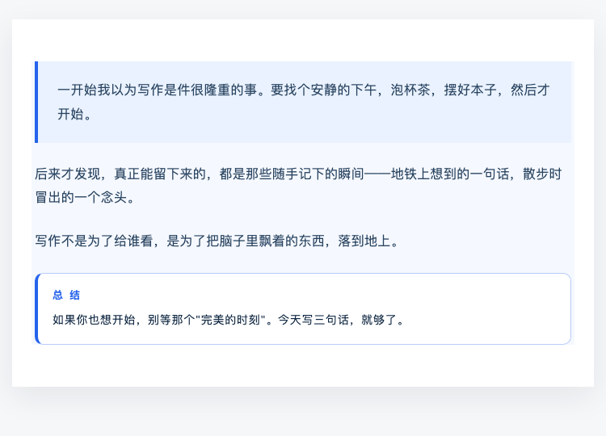
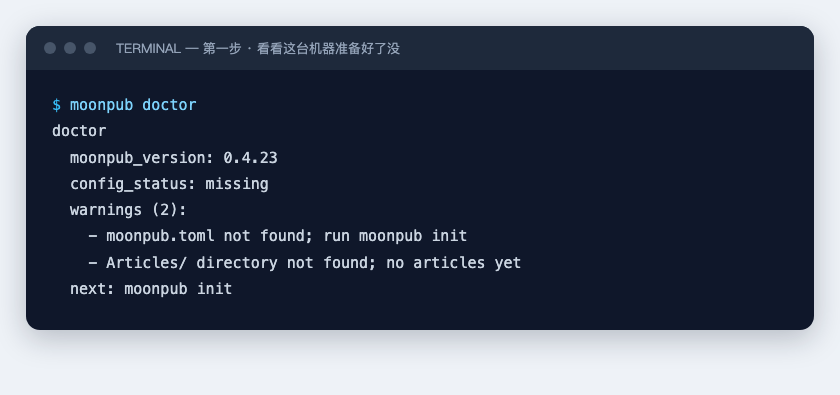
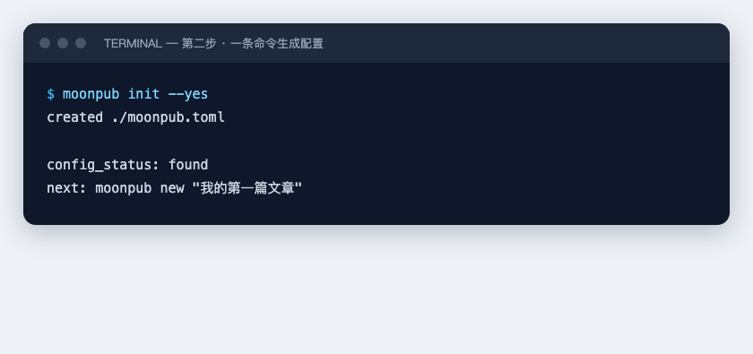
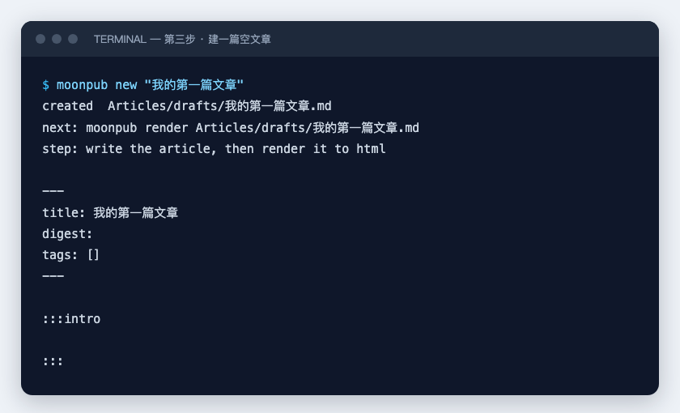
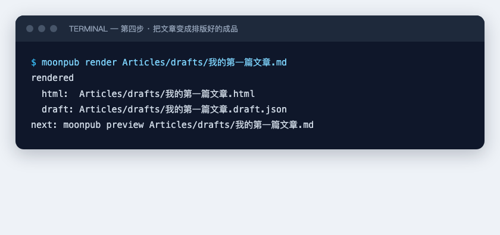
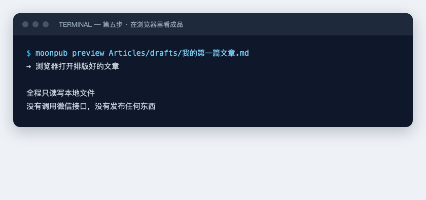

先看一张图。这是一个人第一次用 MoonPub，敲了四行命令之后，在浏览器里看到的东西：



文章写好了，排版自动完成——蓝色引言、段落间距、结尾总结块，全都在。而这件事从头到尾只用了几条命令，没有打开过公众号后台，没有调过一次样式。

这篇就带你把这几条命令亲手敲一遍。读完你会有一份自己写的、排版好的文章成品——它可能还躺在你的电脑里，但已经随时可以发。

## 它到底帮你做了什么

一句话：**你在电脑上用 Markdown 写文章，MoonPub 帮你把它变成公众号里那种排版好的样子。**

它不替你写作，也不替你发表。它只做中间那段最烦人的活——排版、做封面、推到草稿箱、设置原创赞赏这些。这篇先只走前半段：从零到一份排版好的成品，纯本地，连公众号账号都不用登录。

为什么值得花三分钟？因为这套动作你以后每篇文章都要做一遍。今天跑通一次，后面每篇都是复用。

## 第一步：装上它

先把它装到你的电脑上。三种方式，挑一种：

```bash
# macOS 苹果芯片（最常见）：复制这一整行，回车
curl -L https://github.com/qiaopengjun5162/moonpub/releases/latest/download/moonpub-macos-arm64.tar.gz | tar xz
sudo mv moonpub /usr/local/bin/
```

Windows 和 Linux 去项目的 Releases 页面下对应版本，解压后把程序放进系统能找到的位置就行。装完敲一句 `moonpub --version`，能看到版本号就成功了。

> 你不需要懂 Rust，也不需要装开发环境。下载的是一个已经编译好的小程序。

## 第二步：看看机器准备好了没

装好后，先跑一句体检命令。它会告诉你缺什么、下一步该干什么：

```bash
moonpub doctor
```



看到没？它不光检查，还直接把**下一条该敲的命令**打印给你（`next: moonpub init`）。这是 MoonPub 的一个习惯：每一步都告诉你下一步，不用你去翻文档。

## 第三步：一条命令生成配置

按它说的敲：

```bash
moonpub init --yes
```



就一行字：`created ./moonpub.toml`。配置文件建好了，这一步不需要你改任何东西。

## 第四步：建一篇空文章

再敲一句，给它起个名字：

```bash
moonpub new "我的第一篇文章"
```



它做了两件事：建好文章目录，并生成一篇带好开头的空文章。你打开那个 `.md` 文件，会看到长这样：

```markdown
---
title: 我的第一篇文章
---

:::intro

:::

```

上面那几行是文章的信息（标题、摘要），下面那两组符号是给正文留的位置——`intro` 放开头的话，`summary` 放结尾的话。你不用记住它们，照着填就行。

## 第五步：写正文，然后变成成品

现在打开那个 `.md` 文件，把中间填上你想写的话。我这篇随便写了几句：

```markdown
---
title: 我为什么开始每天写点东西
digest: 写作不是为了给谁看，是为了把脑子里飘着的东西，落到地上。
theme: blueprint
---

:::intro
一开始我以为写作是件很隆重的事。
:::

后来才发现，真正能留下来的，都是那些随手记下的瞬间。

:::summary
如果你也想开始，别等那个"完美的时刻"。今天写三句话，就够了。
:::
```

`theme: blueprint` 是选排版风格，蓝色清爽那一套。以后你想换风格，改这个词就行，换主题的玩法我另外单独写过一篇。

填完保存，敲一句渲染命令：

```bash
moonpub render Articles/drafts/我的第一篇文章.md
```



它生成了两个文件：一个是给你看的网页成品（`.html`），一个是给公众号用的草稿数据。

## 第六步：看成品

最后敲一句，它会在浏览器里打开排版好的文章：

```bash
moonpub preview Articles/drafts/我的第一篇文章.md
```



这就是开头那张图里的样子。读一遍，看看排版顺不顺、有没有错别字。不满意就回去改那个 `.md` 文件，再 render 一次，成品就更新了。

**到这里，你已经完整跑通了。** 全程只在你自己电脑上读写文件，没有调用公众号接口，没有发出任何东西。

## 卡住了怎么办

第一次跑，最可能遇到这三个情况：

**敲 `moonpub` 提示"找不到命令"。** 说明上一步没装进系统能找到的位置。回到第一步，确认那个程序文件真的放进了 `/usr/local/bin/`（或系统的 PATH 目录），重开一个终端窗口再试。

**`doctor` 报缺配置。** 说明你不在刚才 init 的那个目录里。终端要先切到那个目录，或者每次命令前面带上 `--articles <目录>`。

**改了文章但成品没变。** 忘了重新 render。记住这个顺序：改 `.md` → 重新 `render` → 再 `preview`。

## 然后呢？

现在你手上有一份排版好的成品了。下一步是把它真正送到公众号——登录、推到草稿箱、设好原创赞赏、发到手机上看一遍，最后由你亲手点发表。

那部分涉及公众号账号，流程更长一点，我单独写在另一篇里（标题是「MoonPub 推到草稿箱，手机上先过目」）。你现在可以先把这篇的流程多跑两遍，把这几条命令敲熟。

## 参考

- 项目：`github.com/qiaopengjun5162/moonpub`
- 下载：`github.com/qiaopengjun5162/moonpub/releases`（取最新版本）
- 命令全解：仓库内 `docs/COMMANDS_ZH.md`
- 本文所有截图：真实跑一遍上述流程采集，存于 `writing/assets/2026-11-24-tutorial-01/`
