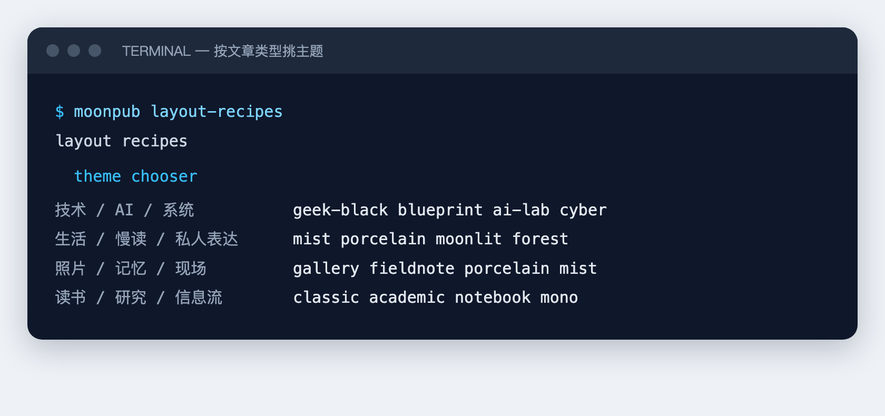

先看一张图。这四块内容**一模一样**，同一段文字、同一个开头、同一个结尾总结：


不一样的是外观。左上是偏冷的蓝，右上是近白配青灰，左下是灰绿，右下是纯黑白。字还是那些字，但读起来的感觉完全不同——偏蓝像技术文档，灰绿像慢读随笔，纯黑白只让你看文字本身。

这就是 MoonPub 排版的省事之处：**你只管写内容，样子由一行字决定。**

上一篇跑通流程时，那行填的是 `blueprint`。这一篇只讲一件事：那一行还能填什么，怎么挑。上一篇末尾提到的「推到草稿箱」放到后面单独讲——先把样子弄满意，再送去公众号，顺序反过来只是白折腾。

## 换样子，只改一行

打开你的文章文件，最上面有几行抬头信息，其中一行是 `theme`，后面跟一个名字：

```markdown
---
title: 我为什么开始每天写点东西
theme: blueprint
---
```

把 `blueprint` 换成别的名字，保存，重新 `render`，再 `preview`，样子就变了。就这么简单。


不用打开任何设计软件，不用调字号行距颜色，不用懂 CSS。你只回答一个问题：**这篇文章，我想让它看起来像什么。**

## 能换成哪些

记不住名字没关系，敲一句命令，它按文章类型分好组给你看：

```bash
moonpub layout-recipes
```



它把可选的样子按四大类分好了：技术、生活慢读、照片记录、读书研究。你只要知道自己写的是哪一类，就能圈定几个候选。

## 怎么挑：先看你写的是什么

挑样子不是审美问题，是**匹配问题**。我自己的用法是这样：

**技术文、系统设计、架构说明**——用 `blueprint`（偏冷的蓝）。颜色冷静，标题带着工程感，读者一看就知道这是正经技术内容。

**生活随笔、散步跑步、情绪记录**——用 `mist`（近白底、灰绿点缀）或 `porcelain`（近白底、青灰点缀）。饱和度低，不抢文字，适合慢慢读的东西。

**只想让人看文字本身**——用 `mono`（纯黑白）。没有任何颜色干扰，最像一本书。

**拿不准就用 `porcelain`。** 它是近白底配青灰，几乎不挑内容——这是我给所有「不知道选啥」的人的第一推荐。

选完别急着定。`render` 之后一定 `preview` 看一眼，手机宽度下的实际效果和你想象的经常不一样。

## 两个坑

**第一，名字写错不会悄悄帮你兜底，而是直接报错。**

这是好事。如果你手滑把 `blueprint` 写成 `blueprnt`，MoonPub 会直接告诉你这个名字不认识，而不是默默换成默认的样子让你以为选对了。报错了就回去检查拼写。

**第二，挑深色的那几套之前，一定先看结尾总结块。**

MoonPub 早前的版本有个坑：`geek-black`、`nord` 这类深色外观，正文是浅色字配深色底很好看，但结尾那个「总结」块被渲染成白底配浅色字，那一块的内容几乎看不见。我自己测的时候踩到了，后来把它修掉了——现在总结块的底色会跟着整套样子走。

所以：**如果你用的是较早的版本，挑深色时一定 `preview` 看一眼结尾总结块能不能读清。** 看不清就升级到最新版，或者换浅色的那几套。浅色（`blueprint`、`porcelain`、`mist`、`mono`）一直都没这个问题。

## 然后呢？

样子定好，文章的观感就定了。再往下是封面——公众号发出去，读者第一眼看到的是封面图，不是正文。下一篇讲封面：怎么用一句话生成一张拿得出手的封面，连字体和尺寸都不用自己算。

现在你可以做的：把手上任意一篇文章，换一个名字 `render` 一次，对比看看。几套轮流看一遍，你会很快知道自己喜欢哪种。

## 参考

- 项目：`github.com/qiaopengjun5162/moonpub`
- 全部可选样子与配方：仓库内 `docs/LAYOUT_RECIPES_ZH.md`
- 本文四套对比图：同一篇文章分别用 `blueprint` / `porcelain` / `mist` / `mono` 渲染后拼图，源图存于 `writing/assets/2026-11-25-tutorial-theme/`
