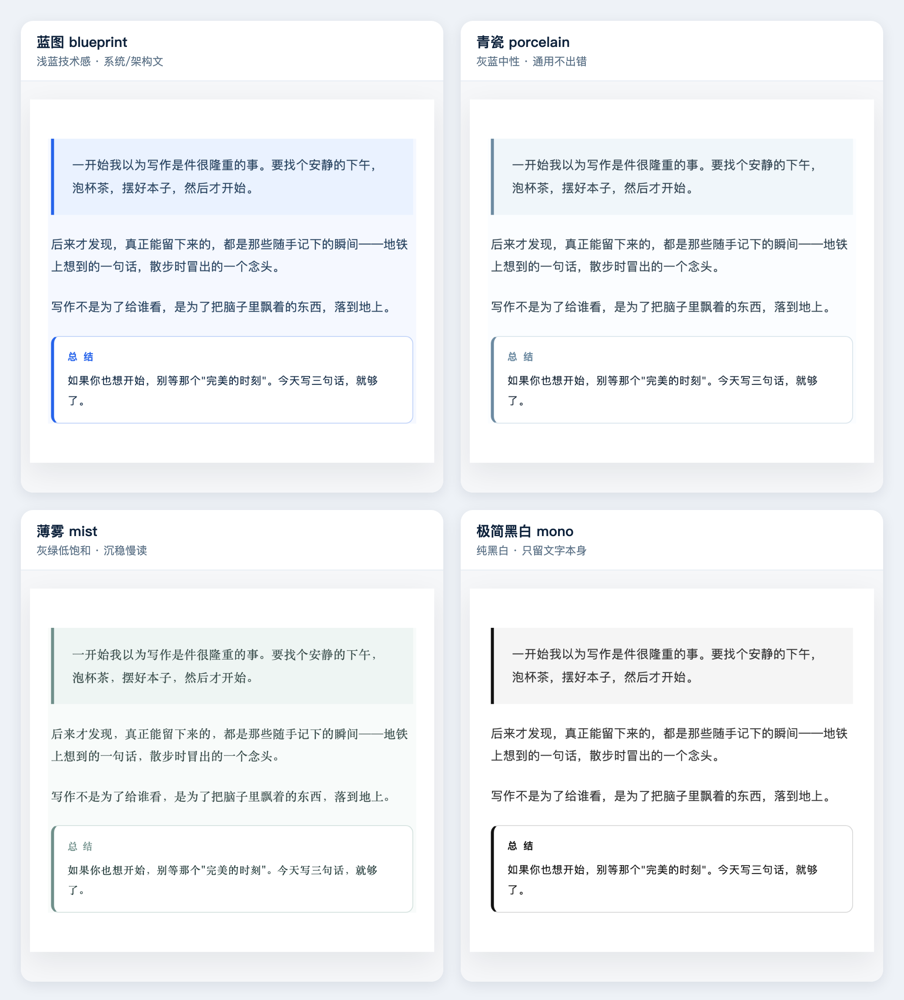
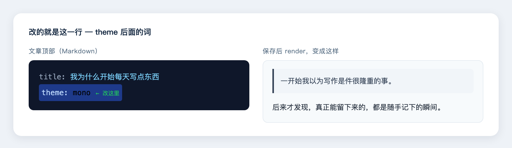

先看一张图。这四块内容**一模一样**，同一段文字、同一个开头、同一个结尾总结：



不一样的是外观。左边上是浅蓝，右边上是灰蓝，左下是灰绿，右下是纯黑白。字还是那些字，但读起来的感觉完全不同——浅蓝像技术文档，灰绿像慢读随笔，纯黑白只让你看文字本身。

这就是 MoonPub 排版的核心：**你只管写内容，样子用一个词决定。**

## 换主题，只改一行

打开你的文章文件，最上面有几行抬头信息，其中一行叫 `theme`：

```markdown
---
title: 我为什么开始每天写点东西
theme: blueprint
---
```

把 `blueprint` 改成别的名字，保存，重新 `render`，再 `preview`，样子就变了。就这么简单。



不用打开任何设计软件，不用调字号行距颜色，不用懂 CSS。你只回答一个问题：**这篇文章，我想让它看起来像什么。**

## 有哪些主题可选

记不住名字没关系，敲一句命令，它按文章类型把主题分好组给你看：

```bash
moonpub layout-recipes
```


它把主题按四大类分好了：技术、生活慢读、照片记录、读书研究。你只要知道自己写的是哪一类，就能圈定几个候选。

## 怎么挑：先定类型，再看一眼

挑主题其实不是审美问题，是**匹配问题**。我自己的用法是这样：

**技术文、系统设计、架构说明**——用 `blueprint`（浅蓝）。颜色冷静，标题线有工程感，读者一看就知道这是正经技术内容。

**生活随笔、散步跑步、情绪记录**——用 `mist`（灰绿）或 `porcelain`（灰蓝）。饱和度低，不抢文字，适合慢慢读的东西。

**只想让人看文字本身**——用 `mono`（纯黑白）。没有任何颜色干扰，最像一本书。

**拿不准就用 `porcelain`。** 它是灰蓝中性色，配什么内容都不出错——这是我给所有"不知道选啥"的人的第一推荐。

选完别急着定。`render` 之后一定 `preview` 看一眼，手机宽度下的实际效果和你想象的经常不一样。

## 两个挑之前要知道的坑

**第一，主题名写错不会悄悄帮你兜底，而是直接报错。**

这是好事。如果你手滑把 `blueprint` 写成 `blueprnt`，MoonPub 会直接告诉你这个名字不认识，而不是默默换成默认主题让你以为选对了。报错了就回去检查拼写。

**第二，深色主题挑之前，一定先看结尾总结块。**

MoonPub 里的 `geek-black`、`nord` 这类深色主题，正文是浅色字配深色底，很好看。但结尾那个"总结"块目前是白底——白底配浅色字，那一块的内容会几乎看不见。我自己测的时候踩到了。

所以：**如果你要用深色主题，`preview` 时重点看结尾总结块能不能读清楚。** 看不清就换浅色主题，或者把 `:::summary` 那段去掉。浅色主题（`blueprint`、`porcelain`、`mist`、`mono`）都没有这个问题。

## 然后呢？

主题定好，文章的样子就定了。再往下是封面——公众号发出去，读者第一眼看到的是封面图，不是正文。封面怎么用几个字生成，我单独写过一篇。

现在你可以做的：把手上任意一篇文章，换个主题 `render` 一次，对比看看。四套主题轮流看一遍，你会很快知道自己喜欢哪种。

## 参考

- 项目：`github.com/qiaopengjun5162/moonpub`
- 全部主题与配方：仓库内 `docs/LAYOUT_RECIPES_ZH.md`
- 本文四主题对比图：同一篇文章用 `blueprint` / `porcelain` / `mist` / `mono` 分别渲染后拼图，源图存于 `writing/assets/2026-11-25-tutorial-theme/`
