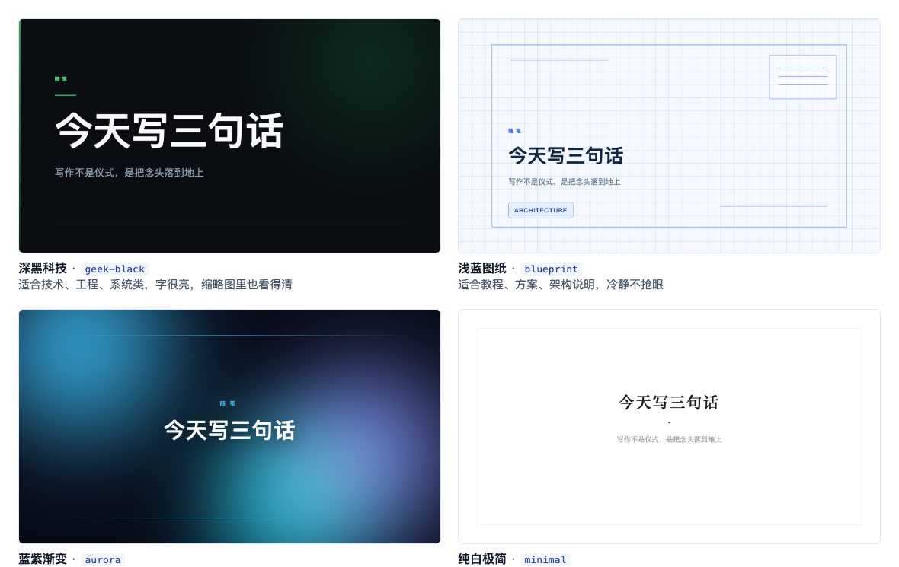
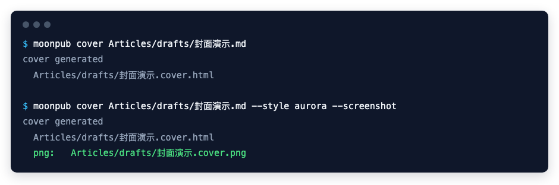
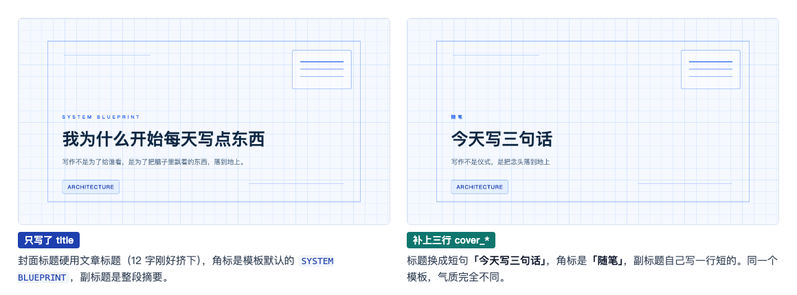
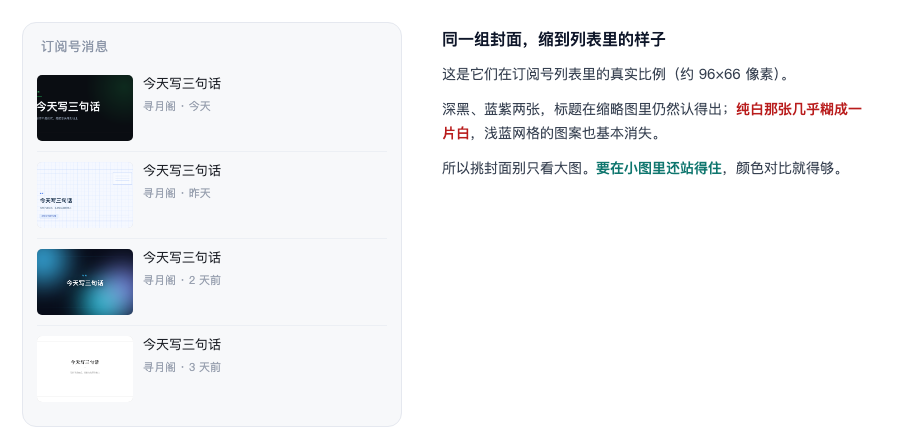

先看一张图。同一篇文章、同一句标题、同一套模板，唯一的区别是我在命令里换了一个词：



四张图的文字一模一样。左上深黑底，右上浅蓝网格，左下蓝紫渐变，右下纯白。它们不是四张手做的图，是四条命令的输出。

这篇讲怎么在一分钟内拿到其中任意一张。

## 为什么封面值得单独花五分钟

公众号发出去之后，读者在订阅号列表里看到的第一眼，不是你的标题，是那张大约 96×66 像素的小图。点不点开，很多时候是它先决定的。

而封面这件事麻烦在：它不属于"写作"，属于"设计"。手做一张，正常流程是打开设计软件、找模板、改文案、调字号、导出——一件五分钟起步的事，写十篇就要烦十次。烦到第三次，人就开始用上一篇文章的封面凑数了。

MoonPub 的思路是：**封面从文章自己的信息里长出来**。你已经写好了标题和摘要，它拿这些去排版，你只需要回答三个小问题——封面上写哪句标题、下面配哪句副标题、标题上方那个小标签写什么。

## 一条命令，两个参数

进到文章目录，敲：

```bash
moonpub cover Articles/drafts/封面演示.md
```



差别就在最后那个 `--screenshot`：

- **不带它**：只生成 `<文章名>.cover.html`。这是封面的网页版，能用浏览器打开、能改、能自己调。
- **带上它**：顺手截一张 900×500 的 PNG，就是公众号要的那张图。

想换风格，加 `--style`：

```bash
moonpub cover Articles/drafts/封面演示.md --style aurora --screenshot
```

一句话交代清楚优先级，省得你以后困惑：**`--style` 写的 > 文章里 `cover_style` 写的 > 文章 `theme` 对应的风格 > 都没有就用 `editorial`。**

前三档都是**你自己写下来的名字**，写错它会当场报错，还会告诉你最接近的那个名字（「卡住了怎么办」里有例子）。只有最后一档 `editorial` 是它替你选的——一个中性的米褐色底，不抢眼，但也谈不上好看，所以值得花两分钟给自己定一个固定风格。

## 三个字段，各管一块

封面上其实就三处文字，对应文章开头三行：

```markdown
---
title: 我为什么开始每天写点东西
cover_title: 今天写三句话
cover_subtitle: 写作不是仪式，是把念头落到地上
cover_tag: 随笔
theme: blueprint
---
```

不写这三行会怎样？看对比：



左边那张，标题直接用了文章标题「我为什么开始每天写点东西」——12 个字，刚好挤下，字号被迫变小；标题上方的小标签是模板默认的英文 `SYSTEM BLUEPRINT`；副标题是整段摘要，读起来像一句话被截断。

右边补了三行之后：标题变成短句「今天写三句话」，字撑得开；小标签是「随笔」两个字；副标题我自己写了一行短的。**模板一个没换，气质完全不同。**

三处的取值规则记一下就够了：

- `cover_title` → 没写就用 `title` → 再没有就用正文第一个一级标题 → 再没有就用文件名。
- `cover_subtitle` → 没写就用 `digest`（摘要）。
- `cover_tag` → 没写就用各模板自己的默认值（多数是英文）。

一句实用建议：**封面标题控制在 6 到 10 个字。** 超过 12 个字，模板会自动缩字号，缩到列表小图里就糊了。文章标题可以长，封面标题不该长——它是一句口号，不是标题。

## 22 种风格，怎么挑

能用的风格名有 22 个。敲一句 `moonpub layout-recipes`，里面有一段 `cover styles (--style / frontmatter cover_style)`，22 个名字都列在那儿；同一份输出还会告诉你每套主题默认配哪个封面。不用背，挑的时候按内容类型圈四个方向：

- **技术、工程、系统、复盘** → `geek-black`：深黑底，细绿线，标题白色粗体，最"硬"的一套。
- **教程、方案、架构说明** → `blueprint`：浅蓝网格纸，蓝框，像一张工程图纸。
- **产品、设计、活动预告** → `aurora`：蓝紫渐变，颜色最抓眼，适合要"好看"的场合。
- **随笔、读书、慢读** → `minimal`：纯白细框，衬线标题居中，安静。

拿不准的时候我会给两个保底选择：**技术文一律 `geek-black`，其他一律 `blueprint`。** 这两套不会出错，也不会显得刻意。

## 挑完一定要看一眼缩略图

这是最容易被忽略的一步。同一组封面，缩到订阅号列表里是这个样子：



深黑和蓝紫两张，标题在小图里仍然认得出；**纯白那张几乎糊成一片白**，浅蓝的网格图案也基本消失，只剩一团浅色。

所以挑封面的标准不是"大图好看"，是"小图还站得住"。判断方法很土但有效：把生成的 PNG 用看图软件缩小到拇指盖大小，还能一眼看清标题，就用它。

## 卡住了怎么办

**报错 `unknown cover style: swis`。** 名字打错了。这个报错挺好用——它会把你敲的原样打出来，再补一句最接近的名字：

```
Error: unknown cover style: swis
  did you mean `swiss`?
  run 'moonpub layout-recipes' for the 22 valid cover style names
```

照着改就行。想不起来有哪些名字，敲 `moonpub layout-recipes`，输出里有一段 `cover styles`，22 个正名全列着，还告诉你每套主题默认配哪个封面。

**报错说 `notebook` is a body theme name。** 你把正文主题名填给 `--style` 了。这是两套清单：`theme` 管正文长什么样，`cover_style` 管封面长什么样，名字不通用（`blueprint`、`geek-black`、`minimal` 这几个恰好两边都有，所以容易混）。正文继续用 `theme: notebook`，封面另外挑一个，两者可以并存。

**没报错，但封面是一张米褐色的默认样。** 那是三处都没写风格时的 `editorial`。不想要它，就给自己定一个固定风格写进 `cover_style`，以后每篇都一致。

**只生成了 HTML，没有 PNG。** 忘了加 `--screenshot`。这个参数是"另外截一张图"的意思，不加就只有网页。

**封面标题太长，字被压小了。** 写 `cover_title`，把标题换成一句话。

**换了 `theme`，封面没变。** 因为你可能写了 `cover_style`。优先级是 `--style` > `cover_style` > `theme`，写了 `cover_style` 就一直听它的。

**`blueprint` 左下那个 `ARCHITECTURE` 徽标是什么？** 是模板自带的装饰文字，改不了。中文文章用着略出戏，介意就换 `geek-black` 或 `minimal`——它们没有这类英文标签。

## 然后呢？

封面定了，一篇文章的门面就齐了：标题、摘要、排版、封面。

下一步是把它真正送到公众号——登录、推到草稿箱、设好原创和赞赏、发到手机上看一遍，最后由你自己点发表。那部分我另外写过一篇，专门讲怎么把它推过去。

现在可以先做一件小事：拿你手上任意一篇文章，用 `geek-black` 和 `blueprint` 各生成一次封面，把它们缩到拇指盖大小比一比。你会立刻明白"小图还站得住"是什么意思。

## 参考

- 项目：`github.com/qiaopengjun5162/moonpub`
- 全部封面风格与排版配方：仓库内 `docs/LAYOUT_RECIPES_ZH.md`
- 本文四张图：用 `geek-black` / `blueprint` / `aurora` / `minimal` 对同一篇演示文章分别生成后拼图，源图存于 `writing/assets/2026-11-25-tutorial-cover/`
