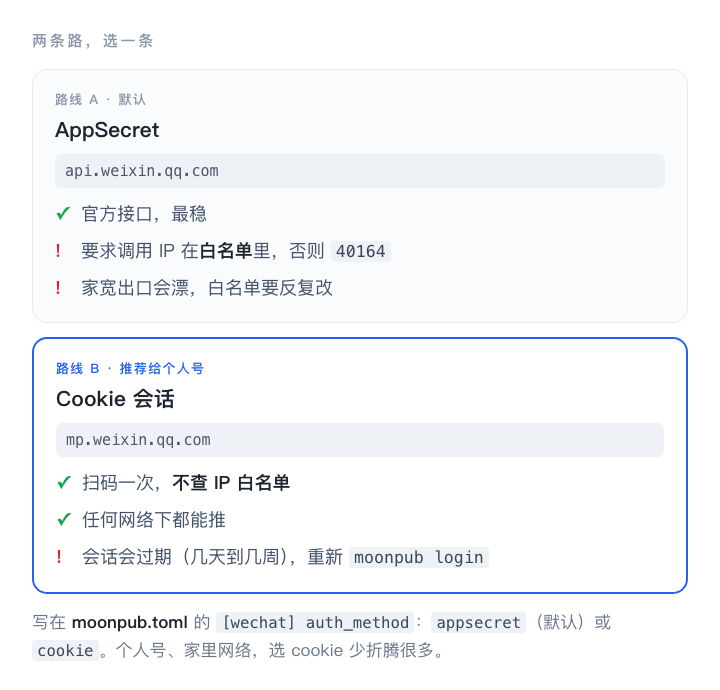

前面几步全在你自己的电脑上：写字、排版、生成封面。`moonpub` 从头到尾没连过网。

这一步不一样——文章第一次离开本地，进到公众号后台的**草稿箱**。也是整个流程里唯一有明确分界线的一步：


它做到草稿为止，**发表那一下永远留给人**。发出去没有撤销键，这个门不该交给脚本。

## 第一次：扫一次码

推草稿要证明「你是这个号的主人」。两条路，选一条就够了：



写在 `moonpub.toml` 里：

```toml
[wechat]
auth_method = "cookie"      # appsecret（默认）| cookie
```

**个人号、家里宽带，直接选 `cookie`。** 理由很具体：`appsecret` 走的是 `api.weixin.qq.com`，微信要求调用方的公网 IP 在白名单里，而家用宽带的出口 IP 是会变的——今天加了白名单，路由器一重拨就变成 `40164 invalid ip ... not in whitelist`。`cookie` 走的是网页后台那条通道，不查白名单。

选好之后扫码一次：

```bash
moonpub login
```

浏览器会打开公众号后台的登录页，用手机微信扫一下，会话就存到 `~/.config/moonpub/session.json` 了。**以后不用每次扫**，直到它过期——但有效期比想象中短：我这边 11-22 晚上扫的码，11-25 晚上还能推，隔天凌晨就失效了，**大概三天**。所以「隔几天推一次」的节奏基本每次都要重扫，别指望它能放几周。

## 一条命令，六件事

```bash
moonpub push Articles/drafts/我的文章.md --render
```

`--render` 的意思是「先按最新的 Markdown 重渲一遍，再推」。不加也行，但如果 HTML 比 Markdown 旧，它会直接拒绝——推一份过期的排版上去，比报错难查得多。

真实输出长这样（这是我推一篇真文章时的记录，5 张图；你的文件名会不一样）：

```text
$ moonpub push Articles/drafts/我的文章.md --render
  ✅ Session 已恢复，无需扫码
▶ 原创声明...
  ✅ 原创已声明
▶ 赞赏...
  ✅ 赞赏已开启 (state='账户: 寻月隐君')
▶ 留言...
  ✅ 留言已开启
▶ 创作来源...
  ✅ 创作来源
▶ 保存草稿...
  ✅ 草稿已保存
▶ 复核后台设置（重新加载编辑器）...
  ✅ 原创已落库
  ✅ 赞赏已落库 (账户: 寻月隐君)
  ✅ 创作来源已落库 (个人观点，仅供参考)
  ✅ 留言已落库
▶ 预览 (cookie 接口)...
  ✅ 预览已发送到手机微信 (ret=0, 接收人: qpj4812701762)
pushed to WeChat draft (cookie session, no IP whitelist)
  media_id: 100019274
  images: 5 uploaded to WeChat CDN (cookie mode)
  next: check in WeChat backend, then publish manually
  ✓ done
```

这份日志里最值得看的是**中间那四行「已落库」**。前面几步都在点开关：点了不一定生效，弹窗可能没弹出来，勾选框可能被微信改版挪走了。所以推完它会**重新加载一次编辑器**，把原创、赞赏、创作来源、留言四个状态重新读一遍。读到才算数。

这也是它跟「写个脚本点按钮」的区别：判断依据是后台读回来的状态，不是「我点过了，没报错」。

最后三行：

- `media_id: 100019274` —— 这篇草稿在微信那边的编号，更新草稿、查状态都靠它。
- `images: 5 uploaded` —— 正文 4 张 + 封面 1 张，都传上了微信的图床。
- `next: check in WeChat backend, then publish manually` —— 它自己也把「发表是你的活」写在最后一行。

## 它在你目录里留下了什么

推完，那篇文章旁边会多出几个文件：

```text
Articles/drafts/
├── 我的文章.md          你写的源文件
├── 我的文章.html        成品网页
├── 我的文章.draft.json  草稿数据
├── 我的文章.cover.png   封面图 900×500
└── 我的文章.media_id    草稿编号
```

只有 `.md` 是源文件，其余全是生成物，已经写进 `.gitignore`。所以你的版本库里永远只有干净的正文——不会因为重新渲染一次就冒出一堆 diff。

`.media_id` 这个文件别删。它记着这篇草稿的编号，下次再推同一篇时，`moonpub` 靠它知道该更新哪一份。

## 手机上收到预览之后

推送成功的最后一步是把预览**发到你的微信**。接收人会记住（存在 `.moonpub/preview_to`），推过一次以后就不用再指定。

点开预览，重点不是「有没有错别字」，而是**手机上的样子**：

1. **标题有没有被截断。** 公众号列表里标题超过两行就会折成「…」，你精心想的后半句可能根本没人看见。
2. **摘要有没有被砍。** 摘要有字数上限，超了会被截。这块在电脑后台看着完整，手机上少一截。
3. **封面缩到小图还认不认得出。** 列表里的封面只有拇指盖大小，深色和渐变还站得住，接近纯白的会糊成一片。

这三样都是「电脑上好看，手机上不好看」的典型。预览这一步的意义就在这里，别跳过。

看完没问题，回到公众号后台点**发表**。或者手机上用「订阅号助手」发也行——草稿是同步的。

## 卡住了怎么办

**报 `session not ready`／`请先 moonpub login 重新扫码`。** Cookie 会话过期了，重新扫一次就好。这是 cookie 模式唯一的日常成本——而且**间隔久了必然要重扫**：我实测三天就失效，所以别把它当成「扫一次管一个月」。

**报 `40164 invalid ip`。** 你用的是 `auth_method = "appsecret"`，当前出口 IP 不在白名单。两条路：去后台把日志里打出来的那个 IP 加进白名单，或者干脆换成 `cookie` 模式，一劳永逸。

**报错说缺 `WECHAT_SECRET`。** 同上，你还在 appsecret 模式。cookie 模式不需要 secret。

**手机上没收到预览。** 先看它的日志里有没有 `预览已发送到手机微信 (ret=0`。有 `ret=0` 就是发出去了，去微信里搜「公众平台安全助手」那个会话，或者检查有没有被折叠。没有这一行，说明预览那步被跳过了——常见原因是接收人没配置。

**日志里出现「⚠ 未保存到后台」，最后一行也不是 `✓ done`。** 先别跑去后台手工补一遍——大多数情况是「读不到」，不是「没存上」：`push` 刚提交完保存就去读，页面还没反映过来。新版本会自己重读一遍，重读后通常就全绿了；**要是重读之后还是四条 ⚠**，跑：

```bash
moonpub configure
```

它从草稿列表重开这一篇再读，读得到就说明已经落库，读不到才需要真的补。

**日志里说「重载后的编辑器不是刚编辑的那篇」。** 重载落到的那一页跟刚编辑的对不上（标题不一致），那份页面上的设置不必当真——它既不能证明存上了，也不能证明没存上。同样跑 `moonpub configure`。

**重复推同一篇会怎样？** 会产生一份新草稿、删掉旧的，`media_id` 跟着变。想原地更新、编号不变，用 `moonpub update-draft`——但它只走 AppSecret 那条路。扫码头（`auth_method = "cookie"`）用不了，会直接告诉你 cookie 模式只覆盖 `push` / `ship` / `delete-draft`。所以：用 AppSecret 的话，写文章阶段改一次跑一次 `update-draft` 最省事；只开了扫码头的话，改完就重推一份，旧草稿顺手删掉（`moonpub delete-draft <旧的 media_id>`）。

**推之前想先体检一遍。** `moonpub preflight <文章.md>` 会把标题长度、摘要字数、图片路径、封面是否就位、有没有用微信不认的排版全查一遍。查完再推，比推完在手机上发现问题快。

## 然后呢

到这里，一篇文章的完整链路就走通了：**写 → 排版 → 封面 → 草稿箱 → 你点发表**。

这五步里，只有第一步和最后一步需要你。中间三步都是命令，而且记住一条就够——每步跑完，它都会把下一条该敲的命令打印在输出末尾（`next: ...`）。所以其实不用背这些命令，跟着提示走也能走完。

如果你想连「排版 + 封面 + 推送」都合成一条，那是 `moonpub ship`：一条命令从 Markdown 直接到草稿箱，连后台四项设置一起做完。第一次用建议还是分开跑，看得清每一步在干什么；熟练之后再合成一条。
