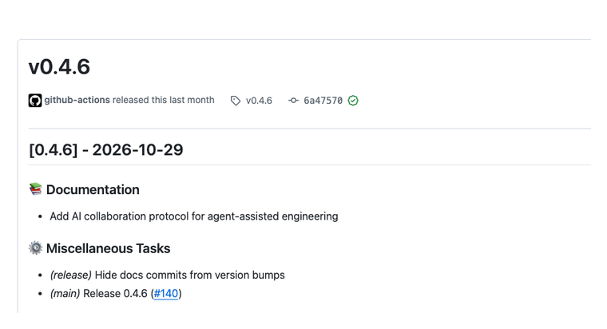
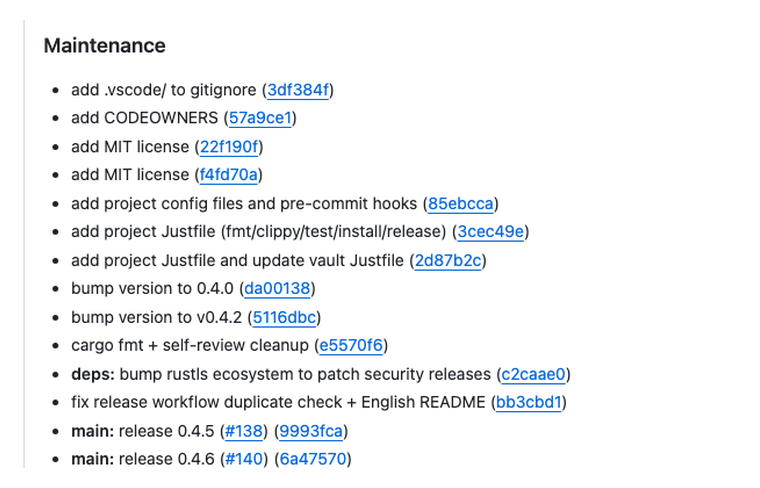

> **项目**：MoonPub —— 用 Rust 写的公众号发布副驾驶
> **仓库**：github.com/qiaopengjun5162/moonpub

先看一张图。这是 v0.4.6 的发布说明。



「Miscellaneous Tasks」下面三条，最后一条是「Release 0.4.6 (#140)」——**这个版本的发布说明里，列着「这个版本」自己**。

这不是贴心的自我引用，是一个环。那晚我在这个环里绕了四个多小时。

## 前言

2026-10-29 下午 16:13，我推了一个只加文档的提交。没改一行 Rust 代码，只是把一份协作规范补进仓库。

半小时后，发版 PR 换成了新的一个（#140），要把版本号推到 0.4.6。我当时的判断是「这版没有实际内容，是废话」，但既然它反复出现，16:54 我还是合了——反正里面只有一行配置。

16:56:57，也就是合并后**两分三十四秒**，新的发版 PR 又出现了，这次推 0.4.7。

那一晚我改同一个配置文件四次（16:38、17:31、21:11、23:06）。前三次改动，各自换来一版：0.4.6、0.4.7、0.4.8；第四次改完已经快半夜，它换来的 0.4.9 是两天后才合的。第三次改动跟这个环毫无关系，是我顺手「优化」的——**那笔账三个星期后才到，代价是所有安装链接 404。**

这篇讲三件事：这个环是怎么形成的（一句话：输出的东西又成了输入）；为什么「把某类提交藏起来」第一晚改不对；以及顺手改配置为什么比改错更贵。

## 背景

MoonPub 是纯 Rust 的公众号发布工具，截至 2026-11-26 有 679 次提交。发版不手动做，交给一个机器人（release-please）：它读提交信息，算出下一个版本号，开一个标题固定的 PR，合并后建标签、建发布单，CI 编译出五个平台的安装包。

要讲清这个环，先认三个东西：

- **提交类型**：每条提交信息前缀。`feat` 是新功能，`fix` 是修 bug，`docs` 是文档，`chore` 是杂活，`ci` 是流水线配置。
- **`changelog-sections`**：配置里的一个列表，声明每种类型要不要写进更新日志，以及要不要 `"hidden": true`。
- **那条我当时不知道的规则**：机器人算版本号时，**任何没被标成 hidden 的类型，都算「值得发一版」**。它不看这个类型改了多少行，只看名字。

第三条是整晚的根因。而合并发版 PR 产生的那条提交，类型恰好是 `chore`。

## 摘要

| 项 | 内容 |
| --- | --- |
| 问题 | 一个只加文档的提交，换来了一个正式版本 |
| 现象 | 0.4.6 的源码零改动；合并后 2 分 34 秒，0.4.7 的发版 PR 自动出现 |
| 根因 | `docs` 与 `chore` 都是「可见类型」；而合并发版 PR 恰好产生一条 `chore(main): release X.Y.Z` |
| 修法 | 给 `docs` 和 `chore` 加 `"hidden": true`（两个提交），之后只留 feat/fix/perf/refactor/build/ci/revert 能涨版本 |
| 结论 | 自动化的自指环不会自己停，必须显式切断；顺手改的配置，代价会延迟到账 |

## 实操

### 步骤 1：先确认 0.4.6 到底改了什么

不要靠记忆。这一版是不是空版，看两次提交之间动了哪些文件。

**输入**

```bash
git log --oneline v0.4.5..v0.4.6
```

**输出**

```text
6a47570 (tag: v0.4.6) chore(main): release 0.4.6 (#140)
7abde7b ci(release): hide docs commits from version bumps
52543d6 docs: add AI collaboration protocol for agent-assisted engineering
```

三条提交：一条文档、一条配置、一条机器人自己的发版提交。

**输入**

```bash
git diff --stat v0.4.5 v0.4.6 -- src | wc -l
```

**输出**

```text
0
```

零。0.4.6 没有动过一行源码。

三条提交里唯一算「改动」的，是那条 `ci(release): hide docs commits from version bumps`——**「把文档提交藏起来，别再涨版本号」这条改动本身，涨了一个版本号。**

回到开头那张图：发布说明里一共三条，两条是配置和发版记录，剩下一条是文档。这一版没有一行代码。

### 步骤 2：藏掉文档，两分半后又一版

16:38 我提交了那次配置改动：给 `docs` 加 `"hidden": true`。16:54 合并；16:56 新的发版 PR 就出现了。

**输入**

```bash
for n in 140 141 142 144; do
  gh pr view $n --json number,createdAt,mergedAt \
    --jq '"#\(.number) created \(.createdAt) merged \(.mergedAt)"'
done
```

**输出**

```text
#140 created 2026-10-29T08:50:53Z merged 2026-10-29T08:54:23Z
#141 created 2026-10-29T08:56:57Z merged —
#142 created 2026-10-29T12:30:50Z merged 2026-10-29T12:57:07Z
#144 created 2026-10-29T14:32:51Z merged 2026-10-29T14:41:06Z
```

合并 16:54:23，下一版 PR 16:56:57 —— **2 分 34 秒**。机器人一点没犹豫。

### 步骤 3：那一版的说明里，出现了自引用

第二张图是 0.4.7 那个自动 PR 的正文（PR #141），翻到最后一段「Maintenance」：



加粗那两行是 `main: release 0.4.5 (#138)` 和 `main: release 0.4.6 (#140)`——**上一版和上上版的发版记录，被当成「本次变更」写进了这一版**。

那个 PR 的正文一共 388 行：

**输入**

```bash
gh pr view 141 --json body --jq .body | wc -l
```

**输出**

```text
388
```

到这里环就闭合了：**发版 → 产生一条 `chore(main): release X.Y.Z` 提交 → 这条提交属于可见类型 → 它自己算一次「值得发版」 → 又发一版。**

### 步骤 4：把 `chore` 也藏起来（第一次改对）

17:31，我把 `chore` 也标成 hidden。当天合并的那一版（#142，20:57）更新说明只有 14 行，自引用条目 0 条——环断了。

但注意时间：从 16:38 到 17:31，**53 分钟、两次发版**，才把这条规则补全。第一次我只想到「文档不该涨版本」，没想到「发版记录本身也是杂活」。

### 步骤 5：当晚第三、第四次改动，一笔三周后才到的账

21:11，我改了一行跟这个环无关的配置：把 `"draft": true` 改成 `false`。

理由很朴素——草稿态要多点一次「发布」按钮，我想一步到位。一个半小时后 0.4.8 出来了，看起来一切正常。

23:06，我又补了第四次：把只碰流水线的提交也排除。

真正的问题在 11 月 18 日才暴露。补丁把开关改回去：

**输入**

```bash
git show 3ba942e -- .release-please-config.json | grep '^[-+]'
```

**输出**

```text
-      "draft": false,
+      "draft": true,
```

同一提交在流水线里加了五行注释，把原因写在最靠近报错的地方：

**输入**

```bash
git show 3ba942e -- .github/workflows/release.yml | grep '^+' | head -6
```

**输出**

```text
+      # release-please 建的是 **draft** release：草稿不计入 latest，所以资产
+      # 上传完成前 `releases/latest/download/...` 始终指向上一个可用版本。
+      # v0.4.14 就因为「先发布、资产构建失败」让 latest 指向 0 资产的空壳，
+      # 所有安装链接 404。这里显式 draft: false ——上传完即发布，一步到位。
+          draft: false
```

那晚我为了「少点一次按钮」，把「先发布、后传资产」变成了默认顺序。三周后，v0.4.14 发布时资产构建失败，`latest` 指向一个没有安装包的空壳——**首页上所有下载链接 404**，而报错的地方离原因隔了 20 天。

### 步骤 6：残渣今天才清完

「发布单先建、标签后建」这条链路还留下另一种残渣：既没有安装包、也没有标签的空壳发布单，一直挂在发布页上。

**输入**

```bash
gh api repos/qiaopengjun5162/moonpub/releases --paginate \
  --jq '[.[] | select(.draft == true)] | length'
```

**输出**

```text
0
```

（这是清完之后的数。清之前那一批是 2026-11-26 上午逐个删掉的。）

## 截图

- **图 1**（v0.4.6 发布说明）：证明一个「零源码改动」的版本确实存在，而且它自己的发布记录被列进了自己的变更里。
- **图 2**（PR #141 的 Maintenance 分组）：证明自引用不是巧合——上一版、上上版的 release 提交排在「本次变更」里，还带着加粗的 `main:` 前缀。

## 解释说明

**为什么这个环不会自己停。** 判断「要不要发版」的输入是提交信息，而「发版」这个动作本身会写一条提交信息。只要那条信息的类型在可见集合里，环就闭合了。它不是 bug，是两条各自正确的规则拼出来的：一条说「chore 要写进日志」，另一条说「写进日志的都算变更」。

**为什么「藏起来」是白名单思路，我第一晚却当黑名单用。** 正确做法是反过来定：只让真正改变行为的类型可见（feat / fix / perf / refactor），其余默认不可见。我第一晚做的是逐个排查——先藏 docs，发现还涨；再藏 chore，才停。**黑名单永远是「漏一个再来一版」**，而我每次漏，代价是一个正式版本号。

**为什么顺手改比改错更贵。** 那晚四次改动，两笔完全不同的账混在一起：前三笔在修自指环，第四笔（`draft`）在改发布顺序。当时看起来都对，因为没有一处报错。等三周后链接 404，我要先把这四次改动一个个排除，才能定位到那一个布尔值。**改错会立刻红；顺手改会安静地等三周。**

## 验证

三种证据都给了，读者可以照着复算：

1. **命令可复算**：`git diff --stat v0.4.5 v0.4.6 -- src | wc -l` 得 0；`gh pr view 141 --json body --jq .body | wc -l` 得 388；`gh api ... --jq '[.[]|select(.draft==true)]|length'` 得 0（截至 2026-11-26）。
2. **提交锚点**：`git show 7abde7b`（藏 docs）、`git show a236059`（藏 chore）、`git show 47c1ebc`（关掉草稿态）、`git show d49ce7b`（排除流水线提交）、`git show 3ba942e`（三周后改回来）。
3. **代码锚点**：`.release-please-config.json` 里 `docs` / `chore` 两行的 `"hidden": true`，以及同文件第 14 行的 `"draft": true`。

## 总结

1. **凡是「动作会产生一条同格式记录」的自动化，都要问一句：这条记录会不会被自己再消费一次。** 会，就必须显式切断，而且要用白名单（默认不可见），不要用黑名单。
2. **一次只改一件事。** 那晚四个提交里，三个在修同一个问题，一个在「顺手优化」。事故复盘时，前者帮我，后者害我。
3. **配置的代价延迟到账。** 改的时候多写一行「为什么」，别写「优化」。三周后读注释的人，和当时写代码的人，不是同一个状态。

## 参考

- 提交：`7abde7b` 藏 docs；`a236059` 藏 chore；`47c1ebc` 关掉草稿态；`d49ce7b` 排除流水线提交
- 提交：`3ba942e` 三周后把草稿态改回来（附带 v0.4.14 的 404 记录）
- 代码：`.release-please-config.json`（`changelog-sections` 与 `draft`）
- 文档：`docs/ENGINEERING_LESSONS_ZH.md`「release-please 把自身发版提交当作可发布变更，导致链式发版」
- 文档：`docs/RELEASE_CHECKLIST.md`（合并发版 PR 后要确认「没有新的发版 PR 生成」）
