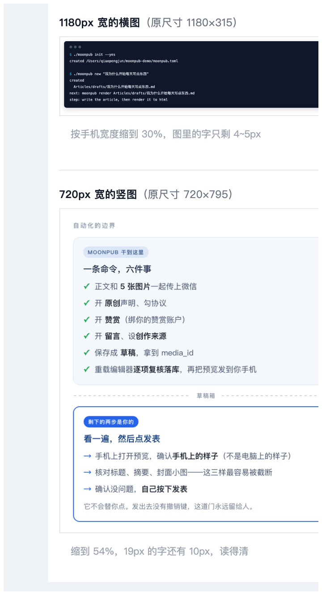

> **项目**：MoonPub —— 用 Rust 写的公众号发布副驾驶
> **仓库**：github.com/qiaopengjun5162/moonpub

先看一张图。这是同一篇文章、两种图片宽度，在手机屏幕上的真实效果。



上半张是 1180px 宽的横图，缩到三分之一，里面的字糊成一片灰线。下半张是 720px 宽的竖图，只缩一半，标题和小字都还认得出。

**同样的排版、同样的字号，唯一的区别是图片宽度。** 这篇就讲这件事：图放多大、放哪里、什么时候根本不该用图。

## 第一步：记住一个数字，390

手机竖屏看公众号，正文宽度大约 **390px**。比这个大很多的图，都会被等比缩到这个宽度再显示。

缩多少，是个除法：**显示宽度 = 390 ÷ 原图宽度**。

- 1180px → 缩到 33%，图里 15px 的字只剩 5px，读不了
- 1040px → 缩到 37%，剩 6px，只能认出形状
- 720px → 缩到 54%，剩 8px，能读
- 540px → 缩到 72%，剩 11px，舒服

所以「我电脑上看着很清楚」这句话在手机上不成立：你看的是原图，读者看的是缩到三分之一后的图。

先量一下手上那张图到底多宽：

**输入**

```bash
sips -g pixelWidth -g pixelHeight docs/demo/assets/initnew.png
```

**输出**

```text
  pixelWidth: 1180
  pixelHeight: 315
```

1180 ÷ 390 ≈ 3。这张图在手机上会被缩成三分之一。

## 第二步：正文图按 720px 宽做

720 是个好数字：缩到 54%，图里的字还能落到 8px 以上，够读；同时细节也没丢。

具体怎么做到？

- **截图时就截窄。** 不要截整个显示器再缩，先把窗口拖窄、或者只框住要说明的那一块。
- **竖版优先。** 720×900、720×1200 都比 1080×600 好看，因为手机是竖的，横长条会被压得很扁。
- **一张图只说明一件事。** 图越窄，越容易做到这件事。

对比一下同一条命令的两种图：

**输入**

```bash
sips -g pixelWidth -g pixelHeight writing/assets/2026-11-25-tutorial-push/1-边界.png
```

**输出**

```text
  pixelWidth: 720
  pixelHeight: 795
```

720×795，接近正方形，手机上一屏能看完，字也读得清。

## 第三步：这三类东西，不要用图

有一类内容天生不适合做成图：**命令、日志、目录树**。

它们在图里就是一坨等宽文字，缩到 33% 之后全是马赛克；而写成代码块，读者能选中、能复制、字号跟着系统走，还能被搜索到。

我第一篇教程里就犯过这个错：把一整屏推送日志截成 1120px 的图放进去，在自己电脑上非常清楚，手机上完全没法看。后来全删了，换成代码块：

```text
▶ 复核后台设置（重新加载编辑器）...
  四项都读空，5 秒后重载再读一遍（保存可能刚提交）
  ✅ 原创已落库
  ✅ 赞赏已落库（账户: 寻月隐君）
```

同样一段内容，写成代码块，读者还能直接搜「读空」两个字找到它。

判断标准很干脆：**这段内容是「文字」，就写成文字；是「界面上长什么样」，才用图。**

## 第四步：图放哪里、正文怎么引用

图统一放在文章旁边的 assets 目录，按日期和主题命名：

```text
writing/
  articles/13-xxx.md
  assets/2026-11-26-images/01-width-compare.png
```

正文里用相对路径引用：

```markdown

```

方括号里那句就是图注。**图注要写「这张图证明了什么」，不是「截图」。** 读者滑到图那里，看一眼图注就知道该看哪儿。

检查所有图片路径是否都对得上：

**输入**

```bash
moonpub preflight writing/articles/14-配图.md
```

**输出**

```text
    - image_links [pass]: all 2 local image reference(s) resolve on disk
```

`image_links [pass]` 说明每张图在磁盘上都找得到。这一步不过，推上去就是一个个空白框。

推草稿时这些图会被逐张上传到微信，所以本地文件删了、图就没了——**图不要放在临时目录**。

## 第五步：封面单独算，别跟正文图混为一谈

封面和正文图是两套规格：

- 封面是横的，2.35:1，在信息流里只是一张小图；
- 所以封面上的字要少、要大：主标题不超过 22 字，副标题不超过 34 字。

MoonPub 按 frontmatter 里的三个字段生成封面，不用打开设计软件：

```yaml
cover_title: 图怎么放才看得清
cover_subtitle: 手机上只有 390px，你的图会被缩到多小
cover_tag: MOONPUB · 使用说明
```

生成之后**必须亲眼看图**，不能只看命令返回成功：

**输入**

```bash
moonpub cover writing/articles/14-配图.md --style blueprint --screenshot
```

**输出**

```text
cover generated
  writing/articles/14-配图.cover.html
  png:   writing/articles/14-配图.cover.png
```

打开那张 png 看一眼：标题有没有被截断、副标题是不是一行放得下。这一步省不掉——生成成功和「好看」是两件事。

## 卡住了怎么办

**图在草稿里显示成空白框。** 路径写错了，或者图片文件名里有空格、中文括号。跑一次 `moonpub preflight <md>`，`image_links` 会直接报哪张找不到。

**手机上还是糊。** 量宽度：超过 1000px 的正文图，在手机上一定糊。缩到 720 再传。

**图太多，读者划不到底。** 一篇文章三到五张就够。每个步骤一张，比每个界面一张有用。

**封面标题被截断。** 主标题超过 22 字了。封面不是标题栏，它只需要让人看懂「这篇讲什么」。

## 下一步

图的规矩定完，剩下两件跟它直接相关：封面怎么一句话生成（「MoonPub 封面，一句话生成，不用设计软件」），以及整篇怎么推到草稿箱、在手机上过最后一遍（「MoonPub 推草稿，后台那些开关它替你点完」）。
