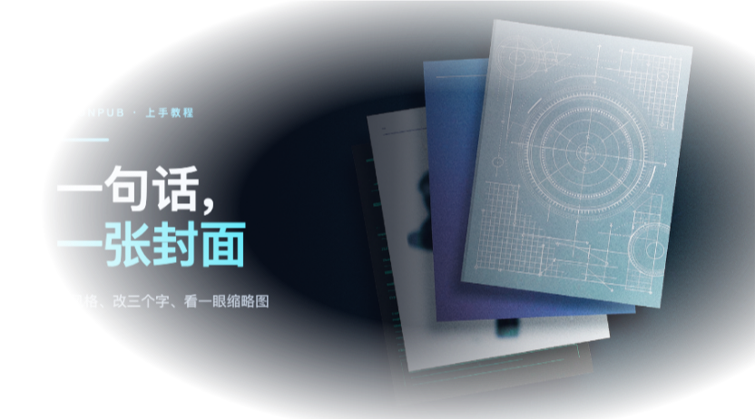
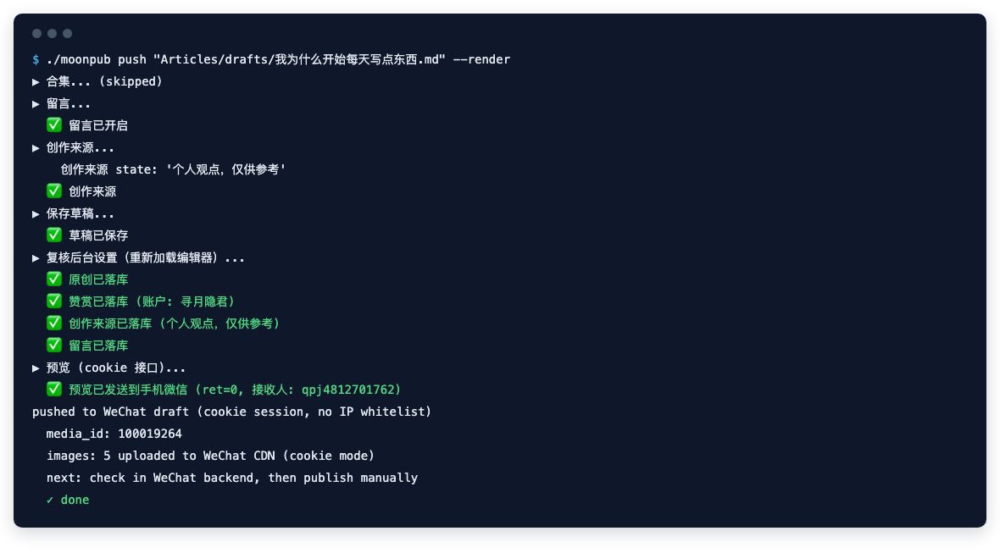
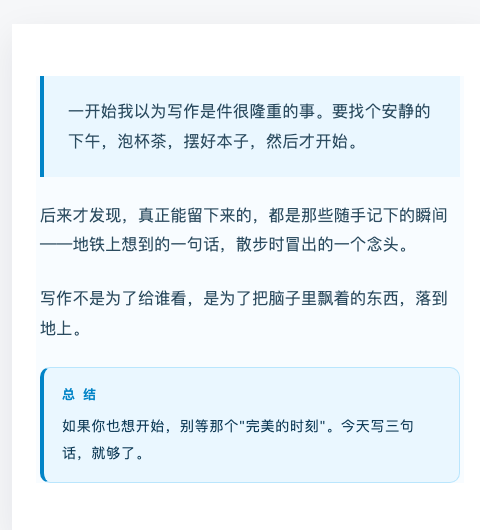

> **项目**：MoonPub —— 用 Rust 写的公众号发布副驾驶
> **仓库**：github.com/qiaopengjun5162/moonpub

【你写】开头三到五句：这篇讲什么、为什么值得看、读完能拿走什么。一句话定位就够——Markdown 进、公众号草稿出；你写、它干活、你发表。

## 先看成品长什么样

*这张图证明了：一篇 Markdown 出来，就是排好的成品，不用再进后台调格式。*

【你写】一两句，把读者的预期钉住：下面讲的就是"怎么从一段字走到这个样子"。

## 它替你做了什么

【你写】用短列表列：排版 / 封面 / 图片上传 / 后台四项设置 / 推草稿。补一句"全部本地跑，凭证不出电脑"。

## 省的不是创作时间

【你写】讲稿 P3 的数字：手动 30–40 分钟 vs 用它约 3 分钟。更值钱的是十篇文章样子永远一致——这条比省时间重要。

## 换样子只改一个词

*这张图证明了：改一个词，整篇外观就换了。*

【你写】技术文 / 通用文各给一个保底推荐。别写"主题随便挑"——按用途给具体建议。

## 缩到拇指盖才是真考验

*这张图证明了：大图看着都不错，缩到信息流里，纯白糊成一片，深色和渐变站得住。*

【你写】这条经验对所有写公众号的人都成立，跟用不用工具无关。

## 一条命令做完六件事

*这张图证明了：它不是点完就算——会重载编辑器读后台真实状态，四项设置都落库。*

【你写】重点写清边界：推到草稿箱就停，发表那一下仍留给你自己点。

## 手机上读起来是什么样

*这张图证明了：排版在 390px 宽度下也能读，不是只在电脑上好看。*

【你写】一两句带过即可，图已说清。

## 凭什么信，边界在哪

【你写】数字带测量时间：截至 2026-11-28，1090 个测试、行覆盖 85.2%、五个平台每个资产带 sha256、每周自动扫依赖漏洞。
边界照念，别粉饰：只做公众号 / 依赖后台界面、它改版就得跟 / 登录态约三天过期 / 命令行有门槛 / 仍是 Beta。
收尾三条以内，写能迁移到别处的经验，不要写"这个项目很棒"。

## 参考

- 仓库：`github.com/qiaopengjun5162/moonpub`
- 讲稿：`docs/demo/SPEAKER_NOTES_ZH.md`
