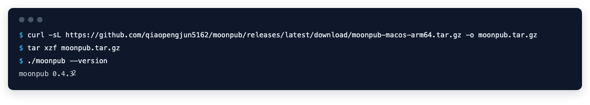
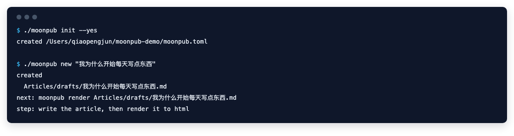
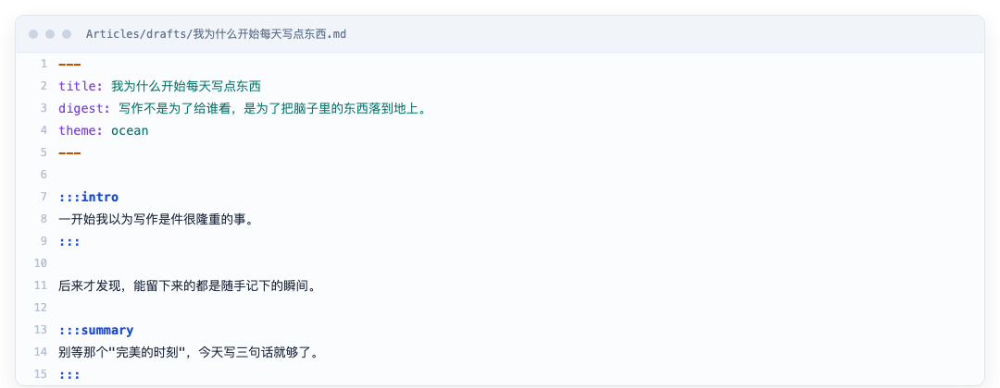
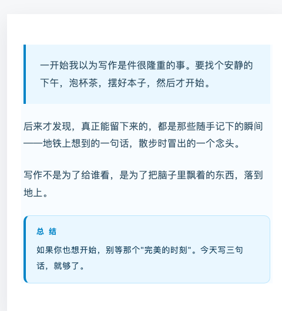
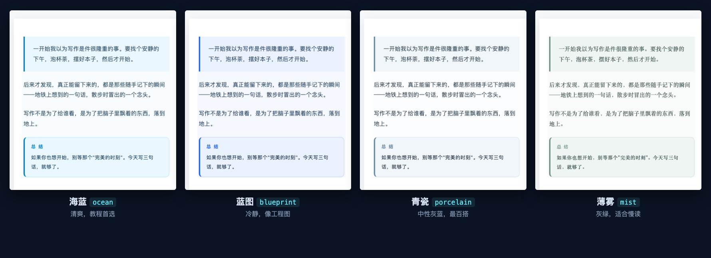
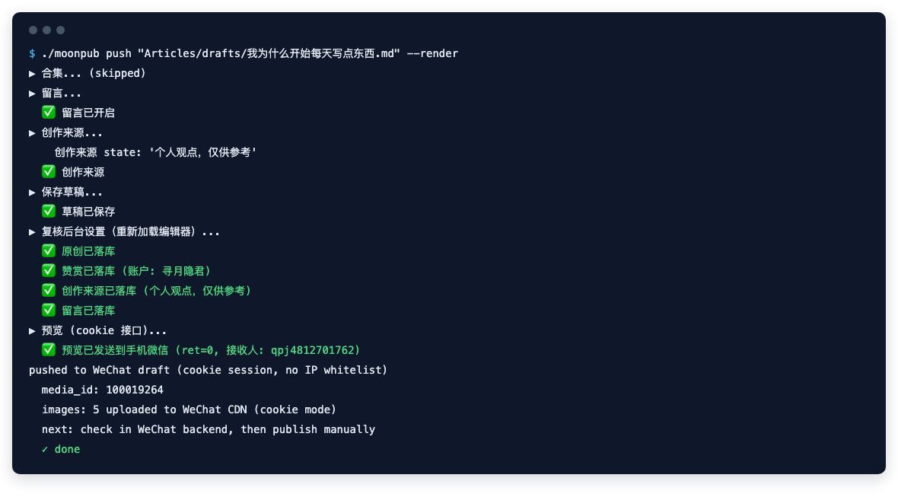
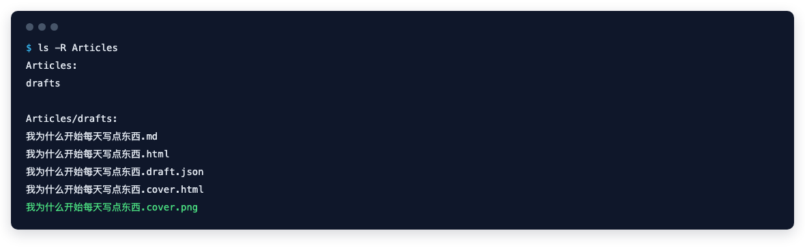

> **项目**：MoonPub —— 用 Rust 写的公众号发布副驾驶
> **仓库**：github.com/qiaopengjun5162/moonpub

【你写】开头三到五句：这篇是跟着图走的上手流程，读完能照着跑出第一篇草稿。

## 安装：解压就算装好

*这张图证明了：从压缩包到 `moonpub --version` 出号，就这一步。*

【你写】解压 + 移到 PATH。`--version` 出号就算装好。（终端输出用代码块，别再截成图。）

## 建配置、建文章

*这张图证明了：`init --yes` / `new "标题"` 两步建好骨架，每步末尾它打印下一条命令。*

【你写】贴真实命令与输出，强调"下一条命令它会告诉你"。

## 你写的就长这样

*这张图证明了：抬头三行 title/digest/theme，正文里两个块，不用学新语法。*

【你写】点出 `:::intro` / `:::summary` 两个块的作用，别展开讲 Markdown 教程。

## 一键出成品

*这张图证明了：`render` 出 HTML + draft.json，`preview` 浏览器打开，断网也能看。*

【你写】两条命令、输入与输出各贴一段。

## 换样子

*这张图证明了：改 `theme` 一个词，重新 render，整篇外观就变了。*

【你写】补一句坑：名字拼错会报错，不兜底——这是故意的，免得 `check --json` 谎报 publishable。

## 封面一句话生成

*这张图证明了：`--style` 换风格，三个字段 cover_title / subtitle / tag 控制封面文字。*

【你写】贴 `moonpub cover ... --style geek-black --screenshot` 命令；提醒主标题≤22字、副标题≤34字。

## 推草稿

*这张图证明了：cookie 扫码一次，`push --render`，四项设置复核后落库。*

【你写】扫码登录态约三天过期；四项是原创/赞赏/创作来源/留言。发预览到手机，最后发表仍是你手动点。

## 目录里留下什么

*这张图证明了：只有 .md 是源文件，其余生成物都已 gitignore。*

【你写】一句话提醒 `.media_id` 别删——删了下次推会重复建草稿。

## 图片怎么放才看得清

*这张图证明了：在 390px 手机宽度下，横图缩成一条看不清，竖图还能读。*

【你写】一两句：宽图放正文会被缩，重要的图优先用竖版或裁成竖版。

## 卡住了怎么办

*这张图证明了：哪一段归它、哪一段归你。*

【你写】报错对照表压到 5 行内：会话过期→`login`；产物过期→`--render`；图找不到→`preflight`；主题名拼错→查清单；标题超 64 字→砍短。
兜底两句：`doctor` 查配置，`status` 看本地状态。收尾三条以内，写能迁移的经验。

## 参考

- 仓库：`github.com/qiaopengjun5162/moonpub`
- 讲稿：`docs/demo/SPEAKER_NOTES_ZH.md`
