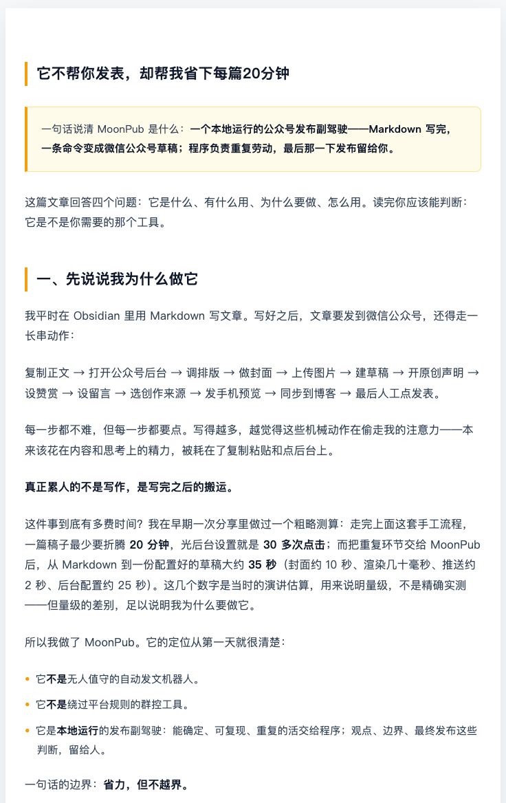
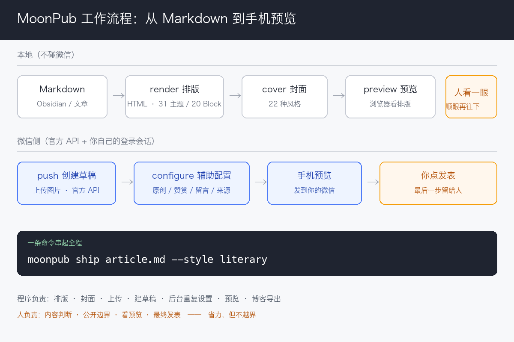

# 它不帮你发表，却帮我省下每篇20分钟

> 一句话说清 MoonPub 是什么：**一个本地运行的公众号发布副驾驶——Markdown 写完，一条命令变成微信公众号草稿；程序负责重复劳动，最后那一下发布留给你。**

这篇文章回答四个问题：它是什么、有什么用、为什么要做、怎么用。读完你应该能判断：它是不是你需要的那个工具。

## 一、先说说我为什么做它

我平时在 Obsidian 里用 Markdown 写文章。写好之后，文章要发到微信公众号，还得走一长串动作：

复制正文 → 打开公众号后台 → 调排版 → 做封面 → 上传图片 → 建草稿 → 开原创声明 → 设赞赏 → 设留言 → 选创作来源 → 发手机预览 → 同步到博客 → 最后人工点发表。

每一步都不难，但每一步都要点。写得越多，越觉得这些机械动作在偷走我的注意力——本来该花在内容和思考上的精力，被耗在了复制粘贴和点后台上。

**真正累人的不是写作，是写完之后的搬运。**

这件事到底有多费时间？我在早期一次分享里做过一个粗略测算：走完上面这套手工流程，一篇稿子最少要折腾 **20 分钟**，光后台设置就是 **30 多次点击**；而把重复环节交给 MoonPub 后，从 Markdown 到一份配置好的草稿大约 **35 秒**（封面约 10 秒、渲染几十毫秒、推送约 2 秒、后台配置约 25 秒）。这几个数字是当时的演讲估算，用来说明量级，不是精确实测——但量级的差别，足以说明我为什么要做它。

所以我做了 MoonPub。它的定位从第一天就很清楚：

- 它**不是**无人值守的自动发文机器人。
- 它**不是**绕过平台规则的群控工具。
- 它是**本地运行**的发布副驾驶：能确定、可复现、重复的活交给程序；观点、边界、最终发布这些判断，留给人。

一句话的边界：**省力，但不越界。**

## 二、MoonPub 是什么

一句话定义再正式写一遍：

> **MoonPub 是一个用 Rust 写的、本地运行的公众号发布副驾驶。你把 Markdown 文章交给它，它负责排版、封面、上传图片、创建微信草稿、辅助完成后台的重复设置，并把预览发到手机上；最终的发表，始终由你在微信后台亲手点。**

拆开看，它是这样一条流水线：

```text
Markdown 文章
   ↓
微信友好的 HTML（inline CSS，31 套正文主题，24 种 Block 模板）
   ↓
封面图（22 种风格，内容驱动生成）
   ↓
上传本地图片到微信素材库
   ↓
调微信官方 API 创建草稿
   ↓
本地 Chrome 辅助配置：原创 / 赞赏 / 留言 / 创作来源 / 手机预览
   ↓
导出到个人博客（Zola）
   ↓
你在后台检查、人工发表
```

从命令看，最短的一键是：

```bash
moonpub ship 你的文章.md --style literary
```

跑完这一条，文章已经到了你的手机上等你确认。`ship` 串起了封面 → 渲染 → 推草稿 → 后台配置 → 手机预览 → 博客导出的全流程。

换一个更高的视角看，MoonPub 内部其实分三层——这是项目文档里正式收口过的结构，也解释了它为什么不只是"一堆命令"：

:::concept-card
number: 1
核心层 · MoonPub Core
最底下是本地发布内核，负责渲染、封面、推送、后台辅助、状态管理和博客导出。它不关心文章从哪来、由谁调用，只把"一篇 Markdown 变成一份配置好的微信草稿"这件事做稳、做可复现。这一层是纯 Rust，核心渲染完全离线。
:::

:::concept-card
number: 2
输入工作流层 · Input Workflows
中间层把还不是文章的东西接进来：飞书秒记、语音转写、生活照片，先整理成可编辑的草稿，再并入主线。它解决的是"素材阶段"的混乱——你手上是零散记录，而不是一篇写好的稿子。
:::

:::concept-card
number: 3
用户入口层 · User Surfaces
最上面是你实际接触的入口：命令行、Obsidian 插件，以及未来可能的本地 App 和 Agent。入口可以换、可以加，但走的都是同一套内核——所以你在插件里点"发布"和在终端敲 `ship`，得到的是同一个结果。
:::

所以更准确地说，它是一个**本地优先的发布内核**：底层能力稳定下来，上面可以长出不同的入口。这个分层不是纸面设计，而是被真实需求逼出来的——先有 CLI，后来 Obsidian 插件要做首发入口，正因为核心独立，插件才能薄薄一层就接上，不必重写发布逻辑。



*上面这张图就是本文用 MoonPub 渲染后的真实排版：标题、一句话定义卡片、正文、分节小标题都在，全部用微信兼容的 inline CSS 写成，不需要你再进后台手动调样式。*

## 三、它到底有什么用

MoonPub 的价值不在于"少敲一条命令"，而在于**把一篇已经写好的文章，从素材状态一路送到"你可以在手机上判断"的状态**，中间不再需要你反复切页面、复制粘贴、点后台。

它可以从三种素材起步，对应三类人：

**1. 你已经有 Markdown 文章**

如果你在 Obsidian / Markdown 里写好了文章，只想排版后推进公众号草稿，走这条：

```text
Markdown → 本地预览 → 微信草稿
```

**2. 你手上只有飞书秒记 / 语音转写**

如果你拿到的还不是文章，而是一段原始素材，想先整理成草稿再决定发不发：

```text
飞书秒记 → 草稿 → 预览 → 微信草稿
```

**3. 你主要想整理一组生活照片**

如果你想把散在相册里的照片沉淀成一篇可记录的文章：

```text
照片素材 → 草稿 → 预览 → 微信草稿
```

三条路最后都汇到同一个终点：**把内容送到一个你能从手机上做判断的状态。** 人只在四个关键点上确认——素材能不能用、草稿内容准不准、照片适不适合公开、最终发不发。其余能稳定复现的步骤，都交给本地流程。

这就是"副驾驶"的含义：它把车开到路口，方向盘最后交给你。

还有一点要说明：**AI 在这套流程里是可选的，不是地基。** 你完全可以不用任何 AI，把写好的文章排版、推草稿，核心链路一步都不依赖它。如果你愿意，也可以打开 AI 辅助：把一段飞书秒记或零散笔记 `expand` 展开成文、`polish` 润色，或用 `ship --ai` 在发布前先润色一遍。模型提供方可以自己配（比如 DeepSeek 或 OpenAI），也可以只用本地规则。**要不要用 AI、用哪家，决定权都在你手里。**



*上面这张图证明：整条流程被清楚地切成两半——本地部分（排版、封面、预览）完全不碰微信，微信侧部分（建草稿、后台配置、手机预览）走官方 API 和你自己的登录会话；而"点发表"这一步始终留给人。程序省力，但不越界。*

## 四、为什么要做成本地工具，而不是在线服务

这一点我想多说几句，因为它决定了这个项目的性格。

**第一，文章和素材留在你自己的电脑上。** 写作内容、配置、凭证都不上传第三方。核心渲染完全离线、确定性——同一篇文章、同一套配置，永远出同一个结果。它不依赖外部 SaaS，核心链路也不需要 AI。

**第二，用 Rust 写，图的是可审计、可复现、少魔法。** 它要处理你的文章、配置和凭证，我希望它尽量透明：一个本地 CLI，行为能预测，出问题能查日志，而不是一个黑盒网页。

具体到选型，有几个很实际的考虑：

- **单二进制、零运行时依赖。** 编译出来就是一个可执行文件，扔进 `PATH` 就能跑，不用装 Python 环境、Node 运行时或一堆包。对一个"装好了就别老出问题"的本地工具，这点很关键。
- **静态类型 + 严格编译期检查。** 微信 API 的返回、草稿状态、错误码这些东西很容易写错，Rust 的类型系统把一大类错误挡在运行之前；再加上 `-D warnings` 的严格 clippy 和几百个测试，改一处不容易悄悄弄坏另一处。
- **确定的错误处理。** 网络失败、凭证缺失、后台页面变了——这些都要说清楚"哪一步、为什么、下一步怎么办"，而不是抛一个调用栈就完事。项目把错误码、帮助文案和下一步提示做成了结构化协议，CLI 和插件能给出一致的指引。
- **跨平台的发布产物。** 同一套代码编译出 Linux / macOS / Windows 五个平台的预编译包，读者不用从源码折腾环境。

代价也坦白讲：Rust 的学习曲线比脚本语言陡，改起来没有 Python 那么随手。但这个项目要长期被人信任地放在电脑里处理凭证和内容，我宁可一开始多花些开发成本，换一个"升级不会半夜炸"的稳当内核。

**第三，浏览器自动化只是"辅助驾驶"，不是"替你做主"。** 微信后台有些设置没有稳定 API，只能在页面上点，比如原创声明、赞赏、留言、创作来源。MoonPub 在你**自己扫码登录**的本地 Chrome 会话里，帮你完成这些重复点击。它的边界非常硬：

- 用户自己扫码登录；
- 不绕过验证码、平台审核、账号权限；
- 不默认代替用户点"发表"；
- 后台页面变了，自动化步骤允许软失败，但不能影响本地渲染和 API 推草稿这条主流程。

所以它是"发布副驾驶"，不是"自动发文机器人"。这两个词差别很大：前者省你的力，后者替你担责——而内容的责任，不该交给一个程序。

## 五、它是怎么长出来的（项目过程）

讲完成品，说说过程。因为一个工具值不值得信，往往要看它是怎么被真实问题逼出来的。

先把这条时间线摆出来，后面再讲每一步背后的故事：

:::timeline

- 2026-06: 第一个提交 4967 行挤在一个文件；第二天晚上 49 次提交、七次换栈，锁定 CDP 驱动
- 2026-07: 微信 IP 白名单漂移诊断，cookie 会话模式成形
- 2026-08: 模块边界重划，主力文件从 4967 行压到 131 行
- 2026-10: 8 篇已发布文章被印上 tag，逼出 layout-audit 微信兼容体检
- 2026-11: 代码块 letSome 粘连事故，v0.4.23 把空白焊进 span

:::

MoonPub 从 2026 年 6 月开始，到今天（2026-11-22）已经迭代到 **v0.4.23**。它不是一次性设计出来的，而是被一个个真实的坑推着走：

**最早的版本很粗糙。** 第一个提交塞了 4967 行在一个文件里，四个多月后主力文件只剩 131 行——中间是一次次模块边界的重新划分。

**技术栈换过七次。** 有整整一个晚上，49 次提交，在 Vue、原生 JS、CDP 之间反复试错，最后才找到能可靠驱动微信后台的办法——Vue 不认 JavaScript 合成的事件，必须用 CDP 派发可信事件。

**线上翻过车。** 有 8 篇已发布文章的正文顶部，被印上了构建的 tag——原因是封面 HTML 嵌进正文后被微信剥掉了 CSS，在本地根本看不出来，只有发出去才发现。这类"本地好好的、线上翻车"的问题，逼出了 `layout-audit` 这道微信兼容性体检。

**最近一次是代码块的排版事故。** 有读者反馈：代码在公众号里变成了一个 token 一行，`let Some(meta)` 粘成 `letSome`。查下来根因是——微信后台会删掉"只含空白的文本节点"，旧渲染器把空格写成独立的空格占位节点，正好被删；再配上"保留原样空白"的样式，后台重新序列化时插入的换行又变成了真断行。

修法是两条：把 token 之间的空格搬进 span 内部，让后台删不掉；代码行显式把空白处理设为 normal，让插入的换行不再是断行。修完拿读者反馈的那段原话现场渲染验证，输出变成：

```text
let\xa0Some(meta)\xa0=\xa0meta\xa0else\xa0{...}
```

`\xa0` 是不换行空格，稳稳待在 span 里，`let` 和 `Some` 不再粘连。这个 bug 和它的回归测试，现在被钉死在 `src/illustrate.rs` 里。

这些坑没有一个是"设计时想到的"，全是真跑出来的。**项目的可靠，不是来自一开始就设计得漂亮，而是来自每一次翻车都留下了防复发的门禁。** 现在它有 976 个测试、覆盖率 80% 上下、CI 全绿、五个平台的预编译包——这些都是被坑过之后补上的。

## 六、怎么用

先把整条路摆在一张图里——下面是从一篇 Markdown 到微信草稿的完整命令时间线，每一步的产物和判断点都列出来了。后面几节再逐步展开：

:::timeline

- ① 安装: cargo install 或下载预编译包，moonpub --version 能跑通
- ② 建工作区: moonpub init --yes 生成示例配置
- ③ 写文章: moonpub new "标题" → Articles/drafts/ 下出现带 frontmatter 的 md
- ④ 本地排版: moonpub render <md> → 产出 .html + .draft.json，全程离线
- ⑤ 看效果: moonpub preview <md> → 浏览器打开，判断版式能不能接受
- ⑥ 配凭证: 环境变量 WECHAT_APPID/SECRET，或 [wechat] auth_method="cookie"
- ⑦ 推草稿: moonpub push <md> --render → 建草稿、写 .media_id、进 ready/
- ⑧ 一键到手机: moonpub ship <md> → 封面+渲染+推送+后台配置+预览+导出
- ⑨ 人工发表: 你在微信后台检查并亲手点「发表」

:::

> 全程只有第 ⑤ 步的"版式能不能接受"和第 ⑨ 步的"发不发"由你判断，其余都是确定性的重复劳动。

### 第 0 步：安装

从源码装（始终可用）：

```bash
cargo install --git https://github.com/qiaopengjun5162/moonpub
```

或者从 Releases 页面下载对应平台的预编译包，解压后把 `moonpub` 放进 `PATH`：

```bash
# 例：macOS Apple Silicon
curl -L https://github.com/qiaopengjun5162/moonpub/releases/latest/download/moonpub-macos-arm64.tar.gz | tar xz
sudo mv moonpub /usr/local/bin/
moonpub --version
```

### 第 1 步：不配微信凭证，先本地体验（推荐）

我最希望新用户先走这条路——它不碰微信 API、不打开浏览器，只读写本地文件，回答一个朴素问题：**这个工具排出来的版，我愿不愿意往草稿推？**

```bash
moonpub init --yes
moonpub new "我为什么开始每天读书"
moonpub status      # 照抄它打印出来的路径
moonpub render Articles/drafts/我为什么开始每天读书.md
moonpub preview Articles/drafts/我为什么开始每天读书.md
```

`preview` 会在浏览器里打开排好版的文章。这一步如果看着顺眼，再往下走。

### 第 2 步：配好凭证，推进草稿

```bash
export WECHAT_APPID=wx***
export WECHAT_SECRET=你的secret
moonpub login                       # 首次扫码登录，保存会话
moonpub push Articles/drafts/我为什么开始每天读书.md --render
```

`push` 走微信官方 API 创建草稿。默认需要把机器的公网 IP 加进公众号后台的白名单，否则会报 `40164 invalid ip`。如果你出口 IP 不固定、不想碰白名单，可以切成 cookie 会话模式——复用扫码登录的浏览器会话，不走 API 网关，因此不查白名单：

```toml
[wechat]
auth_method = "cookie"
```

```bash
moonpub login
moonpub push Articles/drafts/我为什么开始每天读书.md --render   # cookie 模式下不需要 WECHAT_SECRET
```

### 第 3 步：一键到手机（可选，替代第 2 步）

如果你已经配好凭证、想省掉上面那些分步命令，可以用 `ship` 一次跑完——它是第 2 步的捷径，不必先执行 `push`：

```bash
moonpub ship Articles/drafts/我为什么开始每天读书.md --style literary
```

`ship` 会把封面、渲染、推草稿、后台配置、手机预览、博客导出一次跑完。最终发表，还是你在后台点。

### 第 4 步：不想开终端？用 Obsidian 插件

如果你本来就在 Obsidian 里写作，可以装上 MoonPub 插件，不用碰命令行：在命令面板里按 `Cmd+P`，输入"发布"，回车就能把当前文章推进到草稿。插件还有一个首页工作台，集中显示当前工作区有哪些文章、分别处于什么阶段、下一步该做什么——项目文档推荐的首次体验，其实就是从这个首页开始的：**先选一篇素材，停在本地草稿和预览，确认没问题了，再显式推进到微信草稿。**

无论 CLI 还是插件，走的都是同一套本地内核，能力没有区别，只是入口不同。

> 提醒：无论哪条路，**最后的发表都需要你自己在微信后台确认**。这是设计，不是没做完。

## 七、常见问题

把最容易被问到的几个问题集中在这里，都是真实踩过的坑。

**Q1：为什么 `push` 报 `40164 invalid ip`？**

默认用 appsecret 模式调微信 API，机器公网 IP 必须在公众号后台白名单里。家用宽带、代理出口 IP 会漂移，上次加的白名单这次可能就失效。两个办法：要么固定出口 IP 再加白名单，要么切成 cookie 会话模式——复用你扫码登录的浏览器会话，不走 API 网关，也就不查白名单：

```toml
[wechat]
auth_method = "cookie"
```

**Q2：我已经推过草稿，改了文章再 `push`，为什么被拒？**

因为旧产物可能过期。MoonPub 有一道新鲜度门禁：如果磁盘上的 `.html` 带着旧版本"保留原样空白"样式的签名，或者它的修改时间早于 Markdown，就会在联网前拦下来，防止把旧排版推上去。处理很简单——加 `--render` 强制重渲：

```bash
moonpub push Articles/drafts/我为什么开始每天读书.md --render
```

**Q3：代码在公众号里粘成 `letSome`，是 bug 吗？**

是，而且已经修了。微信后台会删掉"只含空白的文本节点"，旧渲染器把 token 间的空格写成独立节点，正好被删；配上"保留原样空白"的样式，后台重新序列化插入的换行又变成真断行。现在空格被焊进 span 内部、代码行显式把空白处理设为 normal，并有专门的回归测试钉住这件事。用 v0.4.23 重渲即可。

**Q4：AI 是必须的吗？要联网吗？**

不是。排版、封面、预览、推草稿这条核心链路完全离线、确定性，不需要 AI。AI 只在可选增强里出现：`expand` 把零散笔记展开成文、`polish` 润色、`ship --ai` 发布前润色。模型提供方可以自己配（DeepSeek / OpenAI），决定权都在你。

**Q5：它会不会哪天不经我同意就把文章发出去？**

不会，这是设计红线。MoonPub 只做到"草稿 + 手机预览"，最终的"发表"必须你在后台亲手点。它也不绕验证码、不绕审核、不绕账号权限。浏览器自动化只是帮你点那些没有稳定 API 的重复设置，且允许软失败，不会影响本地渲染和 API 推草稿这条主流程。

## 八、谁适合用，谁可以先不用

**适合：**

- 已经在用 Obsidian / Markdown 写公众号文章，烦透了每次手动排版、点后台的人；
- 有飞书秒记、语音转写、生活照片，想稳定沉淀成草稿的人；
- 在意数据与凭证留在本地、希望流程可复现的技术用户。

**可以先不用：**

- 你期待"输入一句话，AI 自动写完并自动发表"——这不是 MoonPub 的方向；
- 你完全不在公众号发文章，或只用编辑器可视化排版——那它帮不上忙。

当前状态是 **Beta / 技术用户可试用**：本地渲染、封面、预览、API 草稿推送这几条是稳定核心；浏览器自动化是辅助能力，微信后台页面变动时可能需要跟进维护。我不会把它说成"生产级稳定"，但它对日常写作流程已经明显省力。

## 九、结论

回到开头那句话：

> **MoonPub 是一个本地运行的公众号发布副驾驶——Markdown 写完，一条命令变成微信草稿；程序负责重复劳动，最后那一下发布留给你。**

它解决的不是"写作"，而是"写完之后的搬运"。它不替你做判断，也不替你担责任；它只是把那些你已经做了无数遍、闭着眼都能做的机械动作，变成一条本地可复现的流程。

如果你也在用 Markdown / Obsidian 写公众号，欢迎试用，也欢迎提 issue。项目地址和下载在下面。

## 参考

- 项目：`github.com/qiaopengjun5162/moonpub`
- 下载：`github.com/qiaopengjun5162/moonpub/releases`（取最新版本）
- 命令全解：仓库内 `docs/COMMANDS_ZH.md`
- 排障与防复发记录：仓库内 `docs/ENGINEERING_LESSONS_ZH.md`
